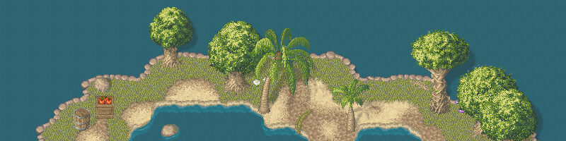

# Thiên Đạo Nghịch Mệnh

**Thiên Đạo Nghịch Mệnh** (TDNM) là game tu tiên 2D (Godot) — thế giới Trúc Sơn, ngũ hành, kiếm đạo và đột phá cảnh giới.

Bản web chơi ngay: https://cuong2000aa.github.io/thien-dao-nghich-menh-godot/?autologin=1

## Về dự án

**Engine:** Godot 4.7 (client + server)

**Công cụ:** (phiên bản trong [versions.cfg](versions.cfg))
- Editor: [Godot](https://godotengine.org/)
- Map: [Tiled](https://www.mapeditor.org/)

**Mục tiêu:** MMORPG tu tiên Việt hoá, chơi được solo / co-op / web.

**Nền tảng:** Desktop (Windows, macOS, Linux), Mobile (Android), Web (HTML5/WASM)

## Gameplay

- Tu luyện, đột phá, ngũ hành khắc chế
- Chiêu thức kiếm đạo (Thanh Phong, Vạn Kiếm Quy Tông, Nhất Kiếm Trảm Thiên Môn…)
- Nhiệm vụ, giao thương, tông môn
- Server-authoritative + offline in-process

## Điều khiển (tóm tắt)

- **Di chuyển:** `WASD` / click
- **Tương tác:** `Ctrl` · **Nhắm:** `E`
- **Chạy:** giữ `Shift` · **Nhặt:** `Q`
- **Xem Trước FX/chiêu:** `V` / Xbox Start
- **UI:** `F1`–`F9` (menu, chỉ số, túi, kỹ năng…)

## VFX

PixelFX (MIT) full catalog dưới `assets/vfx/pixelfx/` — xem `assets/vfx/pixelfx/NOTICE.md`.

## Giấy phép

Chi tiết: [LICENSE.md](LICENSE.md) và [NOTICE_THIEN_DAO.md](NOTICE_THIEN_DAO.md).
