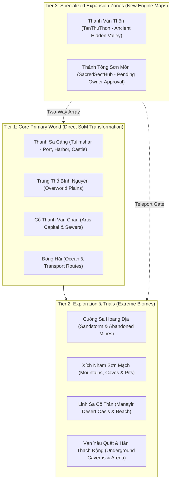

# PHASE 4.2 — WORLD BIBLE FOUNDATION & XUANHUAN WORLD DESIGN
## IMPLEMENTATION & DESIGN REPORT

**Project:** Thiên Đạo Nghịch Mệnh (TDNM)  
**Date:** 2026-11-03  
**Status:** COMPLETE & READY FOR OWNER REVIEW  
**Scope Boundary:** Documentation and World Design ONLY (Strict Invariant: 0 Gameplay / Code Mutations)

---

## 1. EXECUTIVE SUMMARY & CREATIVE BALANCE

In accordance with Phase 4.2 directives, the foundational **World Bible** for **Thiên Đạo Nghịch Mệnh (TDNM)** has been designed and documented. TDNM transitions the Source of Mana framework into a persistent Chinese Xianxia + Xuanhuan MMORPG under the inviolable principle:

> **Content Transformation, Not a Rewrite.**  
> The existing Source of Mana world and its 40+ interconnected maps remain the primary game world. New maps are added progressively as specialized narrative or faction zones.

### Creative Synthesis: Classical Xianxia + Xuanhuan
1. **Classical Xianxia Foundation:**
   - Spiritual Qi (Linh Khí) breathing, meridians (kinh mạch), dantian (đan điền), and spiritual roots (linh căn).
   - Strict progressive realm progression: Luyện Khí $\rightarrow$ Trúc Cơ $\rightarrow$ Kết Đan $\rightarrow$ Nguyên Anh $\rightarrow$ Hóa Thần.
   - Sects (Tông Môn), master-disciple bonds, cultivation pills, spirit stone economy, heavenly tribulations (thiên kiếp), and karma.
2. **Xuanhuan World Expansion:**
   - Multi-epoch history with catastrophic civilizational cycles (Vạn Cổ Đại Kiếp).
   - Ancient god/fiend corpses, primordially mutated bloodlines (Thần Ma Di Trạch), fragmented Heavenly Dao laws.
   - Non-human civilizations, subterranean races (Dạ Sa Tộc), Abyssal Yao Kings, and inter-planar boundary tears.

---

## 2. WORLD BIBLE STRUCTURE & DOCUMENT DIRECTORY

The World Bible is structured across **7 Core Pillars** and organized into 12 modular documents in [`docs/world/`](file:///Users/it/Documents/Tu%20%C4%91a%CC%A3o/thien-dao-nghich-menh-godot/docs/world/):

| Pillar | Focus & Content | Master Document |
| :--- | :--- | :--- |
| **Index** | Complete architectural roadmap, canonical taxonomy, and navigation hub | [`WORLD_BIBLE.md`](file:///Users/it/Documents/Tu%20%C4%91a%CC%A3o/thien-dao-nghich-menh-godot/docs/world/WORLD_BIBLE.md) |
| **Pillar 1** | Cosmology, Heavenly Dao structure, Planar hierarchy, Primordial energy | [`COSMOLOGY.md`](file:///Users/it/Documents/Tu%20%C4%91a%CC%A3o/thien-dao-nghich-menh-godot/docs/world/COSMOLOGY.md) |
| **Pillar 2** | Macro-historical timeline, 5 Great Eras, Ancient Cataclysms, Transmigration hooks | [`WORLD_TIMELINE.md`](file:///Users/it/Documents/Tu%20%C4%91a%CC%A3o/thien-dao-nghich-menh-godot/docs/world/WORLD_TIMELINE.md) |
| **Pillar 3** | Cultivation realms, 6 power pillars, Spiritual roots, Tribulations & Bottlenecks | [`CULTIVATION_SYSTEM.md`](file:///Users/it/Documents/Tu%20%C4%91a%CC%A3o/thien-dao-nghich-menh-godot/docs/world/CULTIVATION_SYSTEM.md) |
| **Pillar 4** | Civilizations, Races, Yao ecology, 42-map monster mapping, Mounts & Pets | [`RACES_AND_CREATURES.md`](file:///Users/it/Documents/Tu%20%C4%91a%CC%A3o/thien-dao-nghich-menh-godot/docs/world/RACES_AND_CREATURES.md) |
| **Pillar 5** | 5 Great Faction Blocs, Sect hierarchies, SacredSectHub status (`[PENDING]`) | [`FACTIONS_AND_SECTS.md`](file:///Users/it/Documents/Tu%20%C4%91a%CC%A3o/thien-dao-nghich-menh-godot/docs/world/FACTIONS_AND_SECTS.md) |
| **Pillar 6** | Natural resources, Spirit stones, Herb terroirs, 5 gear tiers, Cultivation manuals | [`RESOURCES_AND_ARTIFACTS.md`](file:///Users/it/Documents/Tu%20%C4%91a%CC%A3o/thien-dao-nghich-menh-godot/docs/world/RESOURCES_AND_ARTIFACTS.md) |
| **Protagonist** | Physical transmigration, zero-cheat start, modern vs Xianxia worldview clash | [`MAIN_CHARACTER.md`](file:///Users/it/Documents/Tu%20%C4%91a%CC%A3o/thien-dao-nghich-menh-godot/docs/world/MAIN_CHARACTER.md) |
| **Geography** | 42 Source of Mana maps transformed across 3 Tiers, narrative roles & warps | [`WORLD_GEOGRAPHY.md`](file:///Users/it/Documents/Tu%20%C4%91a%CC%A3o/thien-dao-nghich-menh-godot/docs/world/WORLD_GEOGRAPHY.md) |
| **Story Arc** | 6 preliminary narrative chapters: from stranded outsider to confronting Heavenly Dao | [`NARRATIVE_STRUCTURE.md`](file:///Users/it/Documents/Tu%20%C4%91a%CC%A3o/thien-dao-nghich-menh-godot/docs/world/NARRATIVE_STRUCTURE.md) |
| **Story Overview**| Player-facing narrative summary and survival-first progression loop | [`STORY_OVERVIEW.md`](file:///Users/it/Documents/Tu%20%C4%91a%CC%A3o/thien-dao-nghich-menh-godot/docs/world/STORY_OVERVIEW.md) |
| **Decisions** | Full Canon/Approved/Proposed/Rejected status matrix & 4 Owner Review Questions | [`WORLD_DESIGN_DECISIONS.md`](file:///Users/it/Documents/Tu%20%C4%91a%CC%A3o/thien-dao-nghich-menh-godot/docs/world/WORLD_DESIGN_DECISIONS.md) |

---

## 3. STRICT LORE STATUS CLASSIFICATION

Every element in the World Bible is classified under a strict governance status to prevent unverified assumptions from polluting the canon:

```
[CANON]    : Fundamental technical or creative truths established by the owner (e.g., Tulimshar spawn, 42 SoM maps foundation).
[APPROVED] : Explicitly reviewed and approved by the owner (e.g., 32 location names, physical transmigration with no possession).
[PROPOSED] : Designed recommendations by the World Design team awaiting owner review (e.g., Cultivation Model B Cửu Trọng, Fragmented Dao model).
[PENDING]  : Unresolved items explicitly awaiting owner decision before any lore can be finalized (e.g., Sacred Sect Hub identity, protagonist talent).
[REJECTED] : Explicitly ruled out (e.g., wiping SoM maps, cheat system UI, making Thanh Vân Thôn the mandatory starting spawn).
```

### Key Invariant Verifications:
- **Protagonist Identity:** Classified as `[APPROVED]`. The protagonist transmigrated in their own physical body (21st century modern human). There is **NO possession (đoạt xá)** of an ancient body, and **NO starting "cheat system" or magical UI halo**.
- **Protagonist Talent & Destiny:** Classified as `[PENDING OWNER DECISION]`. The World Bible leaves the protagonist's spiritual root aptitude, unique cultivation encounter, and ultimate cosmic alignment strictly undecided until the owner chooses from the presented options.
- **Sacred Sect Hub Identity:** Classified as `[PENDING OWNER APPROVAL]`. The sect is strictly **NOT** assumed to be named "Thiên Đạo Tông". All documents mark the sect name, patron ancestor, and doctrinal alignment as pending.
- **World Map Geography:** The 12 technical groups from `LOCATION_NAMING_REGISTRY.md` are treated as **technical engine groupings only**. They are not an approved geopolitical map. Real distances, travel routes, and political borders remain modular until finalized.

---

## 4. THE 42-MAP TRANSFORMATION BLUEPRINT

The existing 42 maps are structured into a 3-tier transformation hierarchy in [`WORLD_GEOGRAPHY.md`](file:///Users/it/Documents/Tu%20%C4%91a%CC%A3o/thien-dao-nghich-menh-godot/docs/world/WORLD_GEOGRAPHY.md):



---

## 5. PRIORITIZED OWNER DECISIONS

The World Design team has isolated **4 strategic design decisions** requiring project owner input in [`WORLD_DESIGN_DECISIONS.md`](file:///Users/it/Documents/Tu%20%C4%91a%CC%A3o/thien-dao-nghich-menh-godot/docs/world/WORLD_DESIGN_DECISIONS.md):

1. **Decision D-01: Protagonist Spiritual Root Aptitude (`[PENDING]`)**
   - *Option A (Recommended):* Phế Linh Căn (Mortal body / 5-element trash root) forcing reliance on modern empirical deduction, alchemy science, and sheer grit.
   - *Option B:* Ẩn Linh Căn (Dị biến lôi/hư không) dormant until a critical crisis triggers awakening.
   - *Option C:* Phàm Cốt Vô Căn (Zero spiritual root) requiring an entirely forbidden/unorthodox body-refining (thể tu) path.
2. **Decision D-02: Nature of the Heavenly Dao (`[PENDING]`)**
   - *Option A (Recommended):* Thiên Đạo Toái Phiến (Fragmented Dao) — Ancient cataclysm shattered the Dao; surviving will is erratic, corrupting cultivators into madness.
   - *Option B:* Thiên Đạo Vị Khí (Dormant/Impersonal Dao) — An indifferent cosmic machine that cultivators exploit or seek to repair.
   - *Option C:* Thiên Đạo Hắc Hóa (Parasitic/Corrupt Dao) — The Dao itself harvests peak cultivators like crops.
3. **Decision D-03: Official Name & Identity of SacredSectHub (`[PENDING]`)**
   - *Candidate 1 (Recommended):* **Vạn Kiếm Tiên Tông** (Sword-cultivation sect emphasizing discipline and sharp sword qi).
   - *Candidate 2:* **Thái Hư Đạo Tông** (Ancient Daoist sect focusing on balance, formations, and cosmic emptiness).
   - *Candidate 3:* **Bắc Huyền Tông** (Northern border sect guarding against abyssal beasts).
4. **Decision D-04: Cultivation Realm Progression Sub-stages (`[PENDING]`)**
   - *Option B (Recommended):* **Cửu Trọng Thiên (9 Layers)** for Luyện Khí (Tầng 1-9) + Sơ/Trung/Hậu/Viên Mãn for higher realms. Matches classic MMORPG leveling curve.
   - *Option A:* **Tứ Đại Giai Đoạn (4 Stages)** (Sơ kỳ, Trung kỳ, Hậu kỳ, Đại Viên Mãn) across all realms.

---

## 6. VERIFICATION & ENGINE INTEGRITY

- **Engine Health:** Godot 4.7.1 Stable verified. Dedicated headless server running on `6118` (WebSocket) and `6119` (ENet).
- **Test Suite Pass Rate:** All Phase 4.1.1 Location Naming & Spawn regression tests passed ($100\%$ PASS, $0$ failures).
- **Zero Gameplay Regressions:** Zero changes made to GDScript code, `.tscn` scenes, databases, or asset binaries during Phase 4.2.
- **Project Context Updated:** Section 10 added to [`PROJECT_CONTEXT.md`](file:///Users/it/Documents/Tu%20%C4%91a%CC%A3o/thien-dao-nghich-menh-godot/docs/PROJECT_CONTEXT.md) and [`PROJECT_STATUS.md`](file:///Users/it/Documents/Tu%20%C4%91a%CC%A3o/thien-dao-nghich-menh-godot/docs/PROJECT_STATUS.md) marked as Complete.

---

## 7. NEXT STEP AUTHORIZATION GATE

> [!IMPORTANT]
> In accordance with project instructions, **work is now halted**. The team will NOT proceed to Phase 4.3 (First Xianxia NPC & Quest Integration) or any code implementation until the project owner reviews the World Bible and provides guidance on the 4 open decisions.
