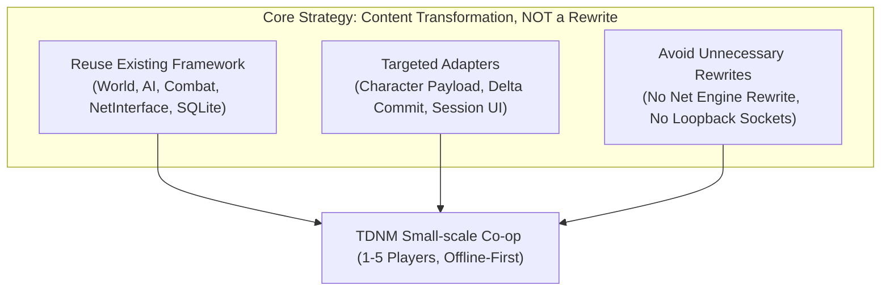
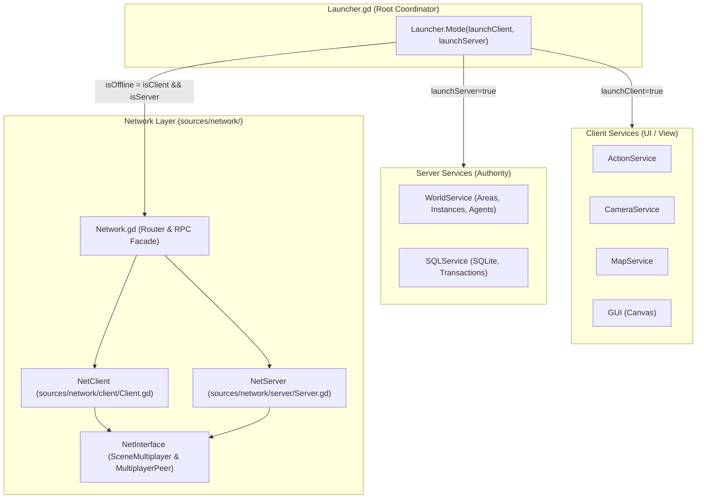
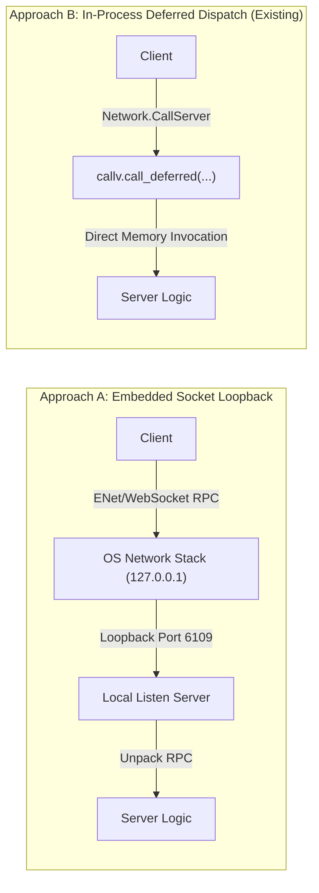
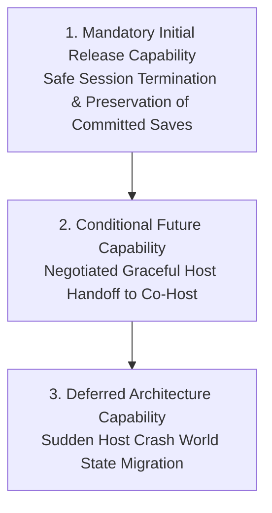
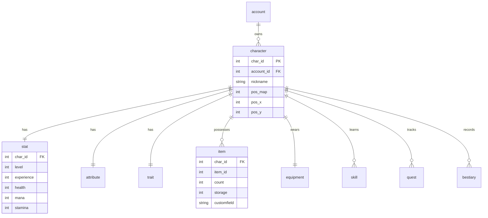
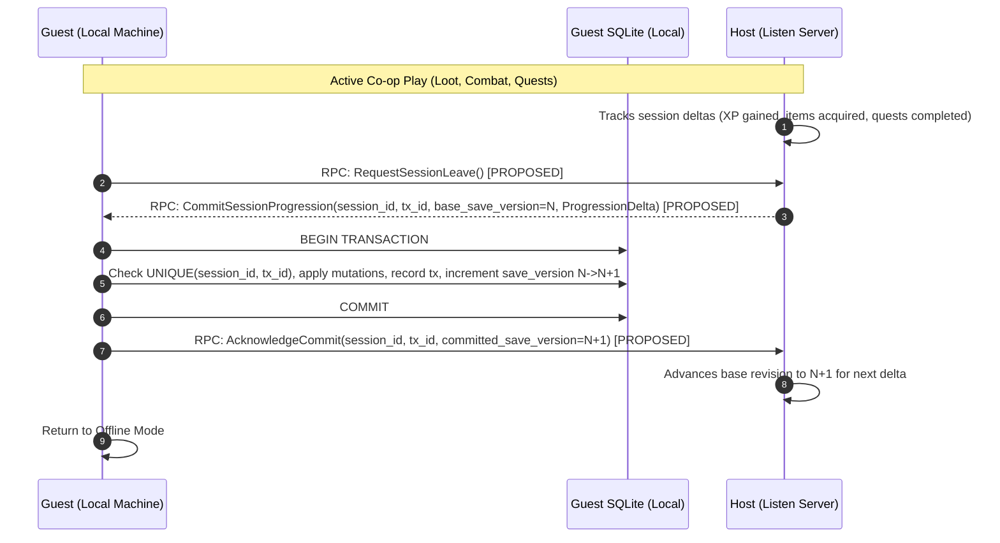
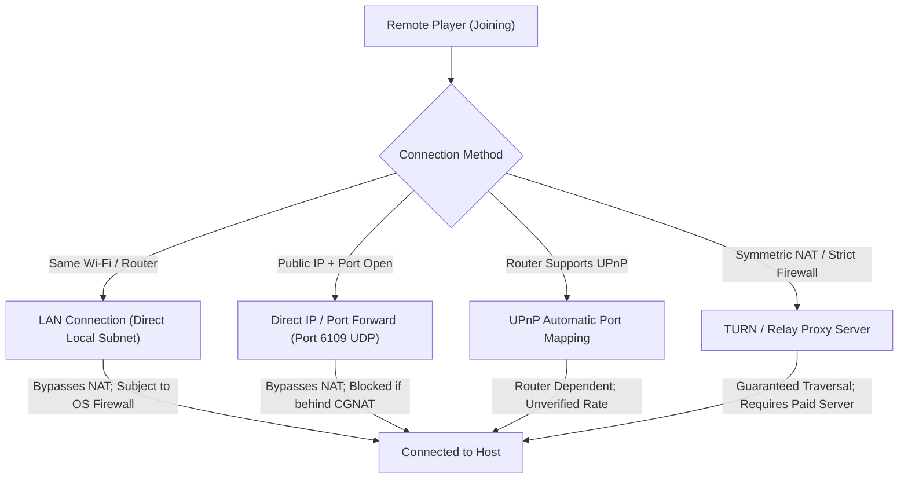
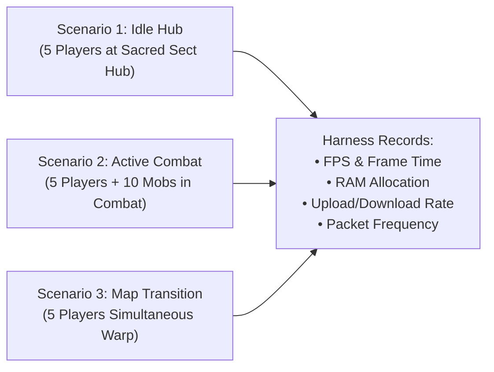
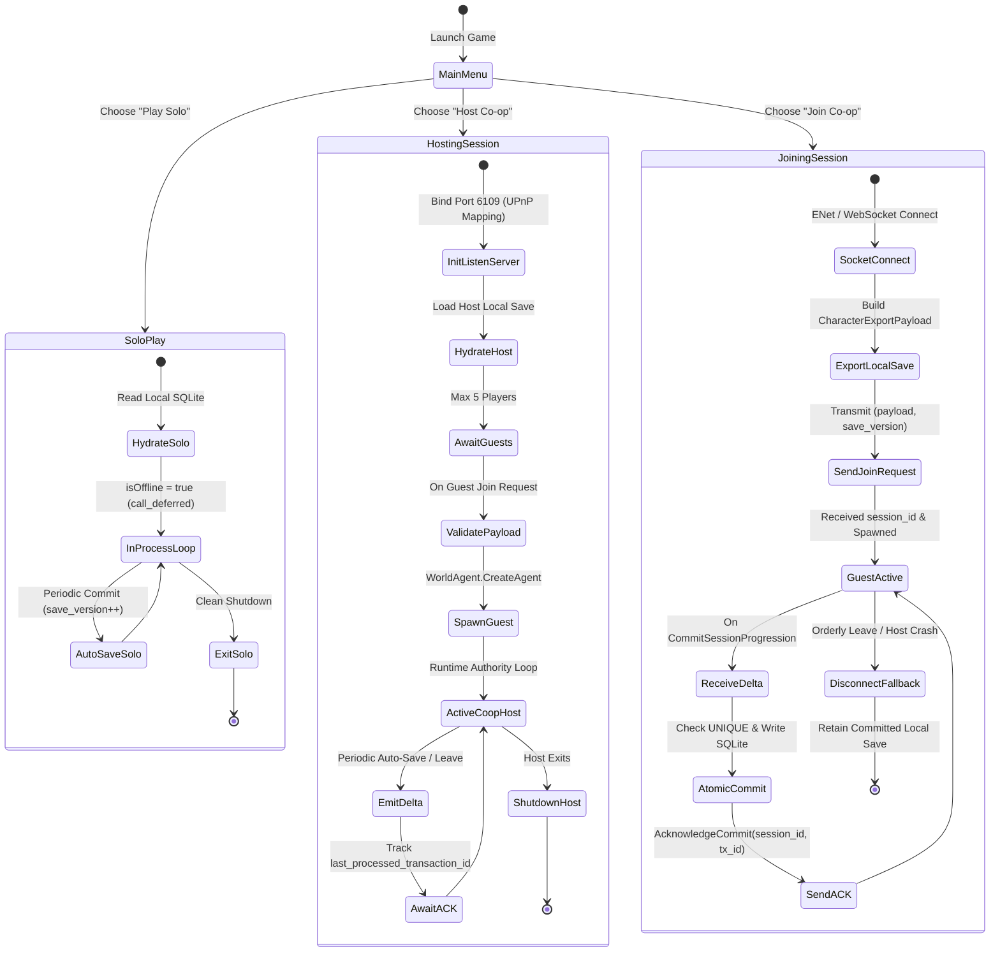

# TDNM — PHASE A: MULTIPLAYER ARCHITECTURE FEASIBILITY AUDIT
# SMALL-SCALE ONLINE CO-OP CULTIVATION RPG (1–5 PLAYERS, OFFLINE-FIRST)
## MASTER ARCHITECTURE AUDIT & CONTENT TRANSFORMATION SPECIFICATION

**Project:** Thiên Đạo Nghịch Mệnh (TDNM)  
**Engine:** Godot 4.7.1 Stable  
**Foundation Base:** Source of Mana (Godot 4 MMO Architecture)  
**Product Model:** Small-scale Online Co-op Cultivation RPG (1–5 Players, Offline-First)  
**Release Model:** Free Release (Personal Project)  
**Target Document:** `docs/PHASE_A_MULTIPLAYER_ARCHITECTURE_FEASIBILITY_AUDIT.md`  
**Execution Mode:** Comprehensive Repository Audit & Master Specification Consolidation  
**Baseline Git Commit:** `1933bd66caf2c59fd5d9b5df410d19838059b243` (`v0.1.0-baseline-1933bd6`)  
**Audit Status:** Accepted Subject to Documentation Corrections (Final Quality-Gated Version)  
**Implementation Authorization:** NOT GRANTED (Phase B Pending Formal Approval)  

---

## TABLE OF CONTENTS

1. [Section 1: Executive Summary](#section-1-executive-summary)
   - [1.1 Context and Mission](#11-context-and-mission)
   - [1.2 Core Architectural Discoveries & Transformation Principles](#12-core-architectural-discoveries--transformation-principles)
2. [Section 2: Actual Source of Mana Architecture Findings](#section-2-actual-source-of-mana-architecture-findings)
   - [2.1 Launcher & Service Topology](#21-launcher--service-topology)
   - [2.2 Network Architecture & Multiplexing](#22-network-architecture--multiplexing)
   - [2.3 Server and Client Execution Lifecycles](#23-server-and-client-execution-lifecycles)
   - [2.4 World Hierarchy & SubViewport Instance Model](#24-world-hierarchy--subviewport-instance-model)
   - [2.5 Database Persistence & SQLite Schema Model](#25-database-persistence--sqlite-schema-model)
   - [2.6 Source of Mana Subsystem Reuse & Transformation Boundary Matrix](#26-source-of-mana-subsystem-reuse--transformation-boundary-matrix)
3. [Section 3: Offline Execution Architecture Comparison](#section-3-offline-execution-architecture-comparison)
   - [3.1 Approach A: Embedded Loopback Listen Server (127.0.0.1 Socket)](#31-approach-a-embedded-loopback-listen-server-127001-socket)
   - [3.2 Approach B: Direct Local In-Process Dispatch (isOffline Deferred Calls)](#32-approach-b-direct-local-in-process-dispatch-isoffline-deferred-calls)
   - [3.3 Comprehensive Comparative Evaluation Matrix](#33-comprehensive-comparative-evaluation-matrix)
   - [3.4 Definitive Recommendation & Rationale](#34-definitive-recommendation--rationale)
4. [Section 4: Host Migration Feasibility Assessment](#section-4-host-migration-feasibility-assessment)
   - [4.1 Categorization Framework (4 Strict Tiers)](#41-categorization-framework-4-strict-tiers)
   - [4.2 Comprehensive 12-Sub-Capability Evaluation Matrix](#42-comprehensive-12-sub-capability-evaluation-matrix)
   - [4.3 Entity Lifecycles and Failure Scenarios: Graceful Exit vs Sudden Crash](#43-entity-lifecycles-and-failure-scenarios-graceful-exit-vs-sudden-crash)
   - [4.4 Commitment Boundaries and Progress Loss Window](#44-commitment-boundaries-and-progress-loss-window)
   - [4.5 Phased Operational Migration Hierarchy](#45-phased-operational-migration-hierarchy)
5. [Section 5: Shared Character Persistence Assessment](#section-5-shared-character-persistence-assessment)
   - [5.1 SQLite Schema & Data Layout Analysis](#51-sqlite-schema--data-layout-analysis)
   - [5.2 Ownership Boundary: Local Machine Authority vs Session Host Authority](#52-ownership-boundary-local-machine-authority-vs-session-host-authority)
   - [5.3 Character Export/Import Payload Architecture](#53-character-exportimport-payload-architecture)
   - [5.4 Delta Synchronization & Session Commit Protocol](#54-delta-synchronization--session-commit-protocol)
   - [5.5 Transaction Safety, Atomic Deduplication, and Protocol Invariants](#55-transaction-safety-atomic-deduplication-and-protocol-invariants)
   - [5.6 Anti-Duplication & Threat Model for Casual Co-op](#56-anti-duplication--threat-model-for-casual-co-op)
6. [Section 6: ENet / WebSocket / Browser Compatibility Matrix](#section-6-enet--websocket--browser-compatibility-matrix)
   - [6.1 Evidence-Based Platform Compatibility Matrix](#61-evidence-based-platform-compatibility-matrix)
   - [6.2 Browser Runtime Constraints (WASM Sandbox, TLS & Mixed Content Realities)](#62-browser-runtime-constraints-wasm-sandbox-tls--mixed-content-realities)
   - [6.3 Dual-Transport Listen Server Architecture & Port Configurations](#63-dual-transport-listen-server-architecture--port-configurations)
7. [Section 7: NAT and Internet Connectivity Limitations](#section-7-nat-and-internet-connectivity-limitations)
   - [7.1 Connectivity Methods Analysis (LAN, Direct IP, UPnP, STUN/TURN)](#71-connectivity-methods-analysis-lan-direct-ip-upnp-stunturn)
   - [7.2 Cost & Infrastructure Implications for a Free Personal Project](#72-cost--infrastructure-implications-for-a-free-personal-project)
   - [7.3 Pragmatic Connectivity Strategy for TDNM](#73-pragmatic-connectivity-strategy-for-tdnm)
8. [Section 8: Performance Measurement Plan](#section-8-performance-measurement-plan)
   - [8.1 Baseline Constraint: Absolute Prohibition of Unsubstantiated Claims](#81-baseline-constraint-absolute-prohibition-of-unsubstantiated-claims)
   - [8.2 Key Performance Indicators (KPIs) & Target Thresholds](#82-key-performance-indicators-kpis--target-thresholds)
   - [8.3 Standardized 5-Player Reproducible Benchmark Scenarios](#83-standardized-5-player-reproducible-benchmark-scenarios)
   - [8.4 Automated Benchmarking Harness Design](#84-automated-benchmarking-harness-design)
9. [Section 9: Technical Risks and Dependencies](#section-9-technical-risks-and-dependencies)
   - [9.1 Formal Risk Registry](#91-formal-risk-registry)
   - [9.2 Architectural Dependency Map](#92-architectural-dependency-map)
10. [Section 10: Recommended Architecture](#section-10-recommended-architecture)
    - [10.1 Synthesized TDNM 1–5 Player Architecture Overview](#101-synthesized-tdnm-15-player-architecture-overview)
    - [10.2 Service Topology & Component Boundaries](#102-service-topology--component-boundaries)
    - [10.3 Comprehensive Character Lifecycle & Session Flow](#103-comprehensive-character-lifecycle--session-flow)
11. [Section 11: Decisions Requiring Owner Approval](#section-11-decisions-requiring-owner-approval)
    - [11.1 ADR-A01 through ADR-A06 Decision Dossier](#111-adr-a01-through-adr-a06-decision-dossier)
12. [Section 12: Evidence Limitations](#section-12-evidence-limitations)
    - [12.1 Static Forensic Boundaries](#121-static-forensic-boundaries)
    - [12.2 Dynamic Benchmark & Network Requirements](#122-dynamic-benchmark--network-requirements)
13. [Section 13: Final Phase A Acceptance Recommendation](#section-13-final-phase-a-acceptance-recommendation)
    - [13.1 Compliance Verification Checklist](#131-compliance-verification-checklist)
    - [13.2 Formal Phase A Final Acceptance Recommendation](#132-formal-phase-a-final-acceptance-recommendation)

---

# SECTION 1: EXECUTIVE SUMMARY

### 1.1 Context and Mission
On 2026-11-03, the Project Owner issued the official **Phase A Authorization: Multiplayer Architecture Audit**, accepting the core product direction set forth in `PRODUCT SCOPE & MULTIPLAYER ARCHITECTURE DECISION PROPOSAL — V2`. 

The accepted product definition is:
- **Product Type:** Small-scale Online Co-op Cultivation RPG (maximum 5 players per session including Host [1 Host + up to 4 Guests]; note that vanilla SoM engine capacity is `MaxPlayerCount = 128` [`sources/network/NetworkCommons.gd:14`](file:///Users/it/Documents/Tu%20%C4%91a%CC%A3o/thien-dao-nghich-menh-godot/sources/network/NetworkCommons.gd#L14), but TDNM explicitly sets a product policy and session configuration limit of 5 players).
- **Primary Mode:** Standalone Offline-first gameplay (complete single-player experience with zero internet dependency).
- **Multiplayer Mode:** Optional Online Co-op hosted directly by players (Listen Server).
- **Progression Model:** Shared character progression between Offline and Online sessions.
- **Commercial Model:** Free release, personal small-scale project.
- **Core Strategy:** **Content Transformation, NOT a Rewrite.**

This audit executes Phase A under the strict mandate: **Documentation & Evidence Only** (0 modifications to source scripts, scene trees, resources, or SQLite databases). This document consolidates all forensic source inspections, architectural trade-offs, and transformation boundaries into one definitive technical baseline.

### 1.2 Core Architectural Discoveries & Transformation Principles



1. **Native Offline In-Process Loopback Already Exists:**
   Contrary to initial assumptions that an offline mode would require spawning a loopback network socket server on `127.0.0.1`, Source of Mana **already contains a native in-process dispatch mechanism** via `Launcher.Mode(true, true)` and `Network.isOffline = true`. When active, RPC calls bypass OS networking sockets entirely and dispatch directly in-process via `callv.call_deferred(...)` ([Network.gd:584-606](file:///Users/it/Documents/Tu%20%C4%91a%CC%A3o/thien-dao-nghich-menh-godot/sources/network/Network.gd#L584-L606)). This eliminates socket buffer latency and avoids OS firewall security alerts without requiring an embedded socket server. (Note: `call_deferred` provides asynchronous in-process dispatch on the main thread message queue; simulation determinism across variable physics steps is a separate property and has not been established).

2. **The Fundamental Persistence Disconnect:**
   In Source of Mana's baseline dedicated MMO design, the server holds the authoritative SQLite database (`sources/sql/SQL.gd`). When a client joins, the server reads the character from the *server's* database. For TDNM's co-op vision, Guest players maintain their character saves on their *own local machines*. Host's database has zero prior record of Guest's character. To bridge this gap without rewriting the networking core, TDNM specifies a **Character Export/Import Payload Protocol** and a **Session Delta Synchronization Protocol** (`[PROPOSED — NOT IMPLEMENTED]`) so that Guests hydrate their character into the Host's runtime world and commit authoritative progression deltas back to their local SQLite file upon session exit.

3. **Host Migration Reality in Godot 4.7.1:**
   Source of Mana has zero built-in state snapshotting or dynamic authority transfer. A systematic audit of 12 sub-capabilities reveals:
   - **Directly Reusable:** 0 sub-capabilities.
   - **Feasible with Modifications:** 6 sub-capabilities (Peer discovery, host election, player entity recreation via payload, quest sync, ground item sync, graceful departure protocol).
   - **Requires New Architecture:** 4 sub-capabilities (World instance state capture, monster/NPC state transfer, rolling periodic snapshots, sudden crash recovery).
   - **Not Feasible:** 2 sub-capabilities (Frame-accurate combat aggro continuity, seamless in-place authority reconnection without scene reloading).
   - **Total:** 12 sub-capabilities.
   Full seamless host migration during sudden host crashes is classified as **Requires New Architecture** and is disproportionately complex for a free personal project. The mandatory baseline for release is **safe session termination and preservation of committed local character progression**, with negotiated **Graceful Host Departure** as a conditional future capability. Full sudden-crash recovery is deferred.

4. **Browser Runtime Transport Limitations:**
   Godot 4.7.1 Web exports execute inside the browser WebAssembly/JS sandbox and **cannot bind listening TCP/UDP sockets**. Therefore, a browser client can never act as a Listen Server without a dedicated public signaling/relay infrastructure. Desktop clients, however, can natively host via ENet (UDP) and WebSocket (TCP) concurrently, providing architectural support for Desktop Host <-> Browser Client play (subject to HTTPS/WSS TLS requirements). Browser Hosting remains strictly outside initial scope.

---

# SECTION 2: ACTUAL SOURCE OF MANA ARCHITECTURE FINDINGS

Forensic source examination of the repository establishes the exact architectural mechanisms governing services, networking, world simulation, and persistence.



### 2.1 Launcher & Service Topology
The entire application lifecycle is governed by [sources/launcher/Launcher.gd](file:///Users/it/Documents/Tu%20%C4%91a%CC%A3o/thien-dao-nghich-menh-godot/sources/launcher/Launcher.gd#L1-L68):
- **Decoupled Service Model:** Services inherit from `ServiceBase` (`sources/launcher/Service.gd`) and are categorized into client services (`Action`, `Audio`, `GUI`, `Debug`, `Camera`, `Map`) and server services (`World`, `SQL`, `Discord`, `Email`).
- **Dynamic Mode Switching:** `Launcher.Mode(launchClient: bool, launchServer: bool)` ([Launcher.gd:30-46](file:///Users/it/Documents/Tu%20%C4%91a%CC%A3o/thien-dao-nghich-menh-godot/sources/launcher/Launcher.gd#L30-L46)) resets active subsystems, instantiates required services, registers them onto `Launcher.Root`, initializes the database via `DB.Init()`, and executes `Network.Mode(launchClient, launchServer)`.
- **Default Startup Modes:**
  - Dedicated Server (`--server` CLI flag): Instantiates `Server.tscn`, locks engine to `LauncherCommons.ServerMaxFPS` (30 FPS), sets `startServer = true`, `startClient = false` ([Launcher.gd:150-155](file:///Users/it/Documents/Tu%20%C4%91a%CC%A3o/thien-dao-nghich-menh-godot/sources/launcher/Launcher.gd#L150-L155)).
  - Client Application: Instantiates `Client.tscn`, sets `startClient = true`. In debug desktop builds (`not isWeb and OS.is_debug_build() and not NetworkCommons.IsLocal`), it automatically sets `startServer = true` ([Launcher.gd:166](file:///Users/it/Documents/Tu%20%C4%91a%CC%A3o/thien-dao-nghich-menh-godot/sources/launcher/Launcher.gd#L166)), entering offline dual-service execution.

### 2.2 Network Architecture & Multiplexing
Networking is routed through `Network.gd` ([sources/network/Network.gd](file:///Users/it/Documents/Tu%20%C4%91a%CC%A3o/thien-dao-nghich-menh-godot/sources/network/Network.gd)) and configured by `NetworkCommons.gd` ([sources/network/NetworkCommons.gd](file:///Users/it/Documents/Tu%20%C4%91a%CC%A3o/thien-dao-nghich-menh-godot/sources/network/NetworkCommons.gd)):
- **Constants & Network Addressing:**
  - `ENetPort`: `6109` (Release), `6119` (Testing).
  - `WebSocketPort`: `6108` (Release), `6118` (Testing).
  - `PeerAuthorityID`: `1` (Server identity).
  - `PeerOfflineID`: `-1` (Offline client identity).
  - `PeerUnknownID`: `-2` (Unassigned peer).
  - `MaxPlayerCount`: `128` (Vanilla MMO engine capacity, `sources/network/NetworkCommons.gd:14`). *(Note: TDNM product target is maximum 5 players including Host [1 Host + up to 4 Guests]; this 5-player limit is a product configuration and session policy, not an engine constraint).*
- **Transport Abstraction:** `NetInterface` ([sources/network/Interface.gd](file:///Users/it/Documents/Tu%20%C4%91a%CC%A3o/thien-dao-nghich-menh-godot/sources/network/Interface.gd#L1-L52)) encapsulates Godot 4's `SceneMultiplayer` (`MultiplayerAPI.create_default_interface()`) and supports three concrete `MultiplayerPeer` implementations:
  1. `ENetMultiplayerPeer` (Standard low-latency UDP for desktop).
  2. `WebSocketMultiplayerPeer` (TCP/WS for browser and web-friendly connections).
  3. `WebRTCMultiplayerPeer` (Peer-to-peer data channels via STUN/ICE).
- **Packet Batching (Bulks):** `NetInterface.Bulk()` and `_process()` ([Interface.gd:24-65](file:///Users/it/Documents/Tu%20%C4%91a%CC%A3o/thien-dao-nghich-menh-godot/sources/network/Interface.gd#L24-L65)) batch non-urgent RPCs into dictionaries. When fewer than `BulkMinSize` (3) items are queued, they dispatch individually; larger batches dispatch via `Network.BulkCall` to optimize packet overhead.
- **Protocol Verification:** `NetworkCommons.ComputeProtocolVersion()` ([NetworkCommons.gd:66-84](file:///Users/it/Documents/Tu%20%C4%91a%CC%A3o/thien-dao-nghich-menh-godot/sources/network/NetworkCommons.gd#L66-L84)) hashes the sorted names and configurations of all RPC methods on `Network.gd`, ensuring client and server builds reject connections if RPC signatures differ.

### 2.3 Server and Client Execution Lifecycles
The implementation of `NetServer` and `NetClient` features an explicit branching path for offline execution:

- **Server Initialization ([sources/network/server/Server.gd:535-585](file:///Users/it/Documents/Tu%20%C4%91a%CC%A3o/thien-dao-nghich-menh-godot/sources/network/server/Server.gd#L535-L585)):**
  ```gdscript
  func _enter_tree():
      if isOffline:
          interfaceID = NetworkCommons.PeerAuthorityID # 1
          ConnectPeer(interfaceID)
          return
      # Socket setup (ENet / WebSocket / WebRTC) follows only if not isOffline
  ```
  When `isOffline` is true, the server skips socket binding, sets its interface ID to `1`, and immediately invokes `ConnectPeer(1)`. No UDP/TCP ports are opened.

- **Client Initialization ([sources/network/client/Client.gd:487-535](file:///Users/it/Documents/Tu%20%C4%91a%CC%A3o/thien-dao-nghich-menh-godot/sources/network/client/Client.gd#L487-L535)):**
  ```gdscript
  func _enter_tree():
      if not IsActiveClient():
          return
      if isOffline:
          interfaceID = NetworkCommons.PeerOfflineID # -1
          ConnectServer.call_deferred()
          return
      # Client socket connection to remote host follows only if not isOffline
  ```
  When `isOffline` is true, the client sets its interface ID to `-1` and defers `ConnectServer()`.

- **In-Process Loopback Routing ([sources/network/Network.gd:581-606](file:///Users/it/Documents/Tu%20%C4%91a%CC%A3o/thien-dao-nghich-menh-godot/sources/network/Network.gd#L581-L606)):**
  ```gdscript
  func CallServer(methodName : StringName, args : Array, peerID : int, actionDelta : int = NetworkCommons.DelayDefault) -> bool:
      if not Peers.Footprint(peerID, methodName, actionDelta):
          return false
      if Client and not Client.isOffline:
          Client.multiplayerAPI.rpc(peerID, self, methodName, args + [Client.interfaceID])
      else:
          ENetServer.callv.call_deferred(methodName, args + [peerID])
      return true

  func CallClient(methodName : StringName, args : Array, peerID : int):
      if ENetServer and not ENetServer.isOffline and Peers.IsUsingENet(peerID):
          ENetServer.multiplayerAPI.rpc(peerID, self, methodName, args + [peerID])
      elif Client:
          Client.callv.call_deferred(methodName, args + [peerID])
  ```
  In offline mode, `CallServer` directly executes the method on `ENetServer` via `call_deferred`, and `CallClient` directly executes the method on `Client` via `call_deferred`.

### 2.4 World Hierarchy & SubViewport Instance Model
The world simulation in [sources/world/](file:///Users/it/Documents/Tu%20%C4%91a%CC%A3o/thien-dao-nghich-menh-godot/sources/world/) uses an instance-based model:
- **Spatial Hierarchy:** `WorldService` (`World.gd`) manages `areas: Dictionary[int, WorldMap]`. Each `WorldMap` (`WorldMap.gd`) owns one or more `instances: Dictionary[int, WorldInstance]` ([World.gd:5](file:///Users/it/Documents/Tu%20%C4%91a%CC%A3o/thien-dao-nghich-menh-godot/sources/world/World.gd#L5)).
- **SubViewport Isolation:** `WorldInstance` inherits from `SubViewport` ([WorldInstance.gd:1-2](file:///Users/it/Documents/Tu%20%C4%91a%CC%A3o/thien-dao-nghich-menh-godot/sources/world/WorldInstance.gd#L1-L2)). Each instance owns its navigation polygon, physics space, and collections of `players`, `mobs`, `npcs`, and `drops`.
- **Dynamic Processing Toggle:** When an instance has zero active players (`players.is_empty()`), `RefreshProcessMode()` disables process execution (`PROCESS_MODE_DISABLED`) and pauses AI timers to preserve CPU cycles ([WorldInstance.gd:67-82](file:///Users/it/Documents/Tu%20%C4%91a%CC%A3o/thien-dao-nghich-menh-godot/sources/world/WorldInstance.gd#L67-L82)).
- **Spatial Relevance & Visibility:** Network sync uses viewport bounds checking (`NetworkCommons.IsVisible`) and area broadcasting (`NotifyArea`, `NotifyInstance`, `NotifyNeighbours`), minimizing unnecessary entity updates ([NetworkCommons.gd:24-27](file:///Users/it/Documents/Tu%20%C4%91a%CC%A3o/thien-dao-nghich-menh-godot/sources/network/NetworkCommons.gd#L24-L27)).

### 2.5 Database Persistence & SQLite Schema Model
Persistence is managed by `SQLService` ([sources/sql/SQL.gd](file:///Users/it/Documents/Tu%20%C4%91a%CC%A3o/thien-dao-nghich-menh-godot/sources/sql/SQL.gd)):
- **SQLite Engine:** Uses SQLite via `Path.SQLDatabasePath` (pointing to `res://data/db/testing.db` or `live.db`).
- **Relational Schema:** Normalized tables linked by integer primary keys:
  - `account` (`account_id`, `username`, `password`, `password_salt`, `permission`, `last_timestamp`).
  - `character` (`char_id`, `account_id`, `nickname`, `pos_map`, `pos_x`, `pos_y`, `respawn_map`, `respawn_x`, `respawn_y`, `total_time`).
  - `stat` (`char_id`, `level`, `experience`, `gp`, `health`, `mana`, `stamina`, `karma`).
  - `attribute` (`char_id`, `strength`, `vitality`, `agility`, `endurance`, `concentration`).
  - `trait` (`char_id`, `hairstyle`, `haircolor`, `race`, `skintone`, `gender`, `shape`, `spirit`).
  - `item` (`char_id`, `item_id`, `count`, `storage`, `customfield`).
  - `equipment` (`char_id`, slot columns for weapon, armor, etc.).
  - `skill` (`char_id`, `skill_id`, `level`).
  - `quest` (`char_id`, `quest_id`, `state`).
  - `bestiary` (`char_id`, `mob_id`, `killed_count`).
- **Transaction Safety:** `RefreshCharacter(player: PlayerAgent)` ([SQL.gd:139-155](file:///Users/it/Documents/Tu%20%C4%91a%CC%A3o/thien-dao-nghich-menh-godot/sources/sql/SQL.gd#L139-L155)) wraps all updates in `queryMutex.lock()`, `BEGIN TRANSACTION;`, and `COMMIT;`.

### 2.6 Source of Mana Subsystem Reuse & Transformation Boundary Matrix

To satisfy the primary directive (**Content Transformation, NOT a Rewrite**), every major subsystem in the repository is evaluated to identify what is directly reused, what is extended with targeted modifications, what genuinely requires new adapter architecture, and what falls outside the product scope.

| # | Major Subsystem | Repository Evidence | Classification | Reuse vs Transformation Boundary |
|---|---|---|:---:|---|
| 1 | **Launcher & Service Topology** | `sources/launcher/Launcher.gd:1-68` | **Directly Reusable** | Decoupled client/server service trees (`Client()`, `Server()`, `Launcher.Mode()`) directly reused to drive both Solo and Listen Server modes. |
| 2 | **Offline Execution Architecture** | `sources/network/Network.gd:584-606`, `Server.gd:536`, `Client.gd:491` | **Directly Reusable** | In-process deferred loopback (`isOffline = true`) bypasses sockets completely. Directly reused for standalone offline cultivation gameplay. |
| 3 | **Network RPC Routing** | `sources/network/Network.gd:1-648`, `NetworkCommons.gd:66-84` | **Reusable with Modifications** | Preserves all core RPC routing facades (`CallServer`, `CallClient`, `BulkCall`). Requires new RPC endpoints for co-op session handshakes (`RequestJoinSession`, `CommitSessionProgression`, `AcknowledgeCommit`) `[PROPOSED — NOT IMPLEMENTED]`. |
| 4 | **ENet & WebSocket Transports** | `sources/network/Interface.gd:30-52` | **Reusable with Configuration** | `NetInterface` wraps Godot 4 `ENetMultiplayerPeer` (port 6109) and `WebSocketMultiplayerPeer` (port 6108). Desktop-to-desktop play directly reuses ENet. Desktop-to-browser requires TLS/WSS setup. |
| 5 | **World & WorldInstance Lifecycle** | `sources/world/World.gd:1-169`, `WorldInstance.gd:1-82` | **Directly Reusable** | `SubViewport` instance isolation, dynamic CPU sleep toggle (`RefreshProcessMode`), and spatial visibility filtering are directly reused for party instances. |
| 6 | **Player & Entity Creation / Destruction** | `sources/world/WorldAgent.gd:1-120`, `sources/actor/entity/Entity.gd` | **Reusable with Modifications** | `WorldAgent.CreateAgent` and `RemoveAgent` directly reused. Spawning flow adapted to hydrate remote peers from `CharacterExportPayload` `[PROPOSED — NOT IMPLEMENTED]` instead of server-local SQL queries. |
| 7 | **Monster & NPC Simulation** | `sources/actor/agent/variants/AIAgent.gd`, `sources/world/WorldMap.gd:30-36` | **Directly Reusable** | Monster AI, navigation polygons (`NavigationServer2D`), spawn cycles, and aggro loops execute host-authoritatively and synchronize via existing public state RPCs. |
| 8 | **Combat & Authority** | `sources/actor/entity/Entity.gd`, `sources/gui/BossTrackerBar.gd` | **Directly Reusable** | Hit detection, damage math, cooldown timers, and boss tracker signals (hardened in Phase 4.2.1/4.2.2) run host-authoritatively. Reusable without changes. |
| 9 | **Inventory & Item Drops** | `sources/actor/Inventory.gd:323-370`, `sources/world/WorldDrop.gd` | **Reusable with Modifications** | Reuses `ExportInventory`, `ImportInventory`, `ExportEquipment`, `ImportEquipment`. Requires transactional drop logic (deducting item locally before drop spawn) to prevent duplication on crash. |
| 10 | **Quest Progression** | `sources/actor/Progress.gd:1-107`, `ProgressCommons.gd` | **Reusable with Modifications** | Reuses `ActorProgress` quest and bestiary tracking. Adapted so guest progression is accumulated during the co-op session and committed locally via `ProgressionDelta` `[PROPOSED — NOT IMPLEMENTED]`. |
| 11 | **SQLite Persistence** | `sources/sql/SQL.gd:1-518`, `SQLCommons.gd` | **Requires New Adapter** | Reuses normalized SQLite table schemas (`character`, `stat`, `item`, etc.) and query patterns. Requires a new `LocalSaveAdapter` `[PROPOSED — NOT IMPLEMENTED]` to manage local single-player databases without dedicated server account dependencies. |
| 12 | **Character Serialization** | `sources/actor/agent/variants/PlayerAgent.gd:58-74` | **Requires New Adapter** | Reuses underlying serialization helpers. Requires a formal `CharacterPayloadAdapter` `[PROPOSED — NOT IMPLEMENTED]` to package, sanitize, and validate full character data during co-op session handshakes. |
| 13 | **UI & Session Lifecycle** | `sources/gui/Gui.gd`, `sources/launcher/Launcher.gd:178-281` | **Requires New Subsystem** | SoM MMO login screen is replaced with a **Co-op Session Manager UI** `[PROPOSED — NOT IMPLEMENTED]` providing "Play Solo", "Host Co-op Session" (with UPnP status), and "Join Co-op Session" (Direct IP input). |

---

# SECTION 3: OFFLINE EXECUTION ARCHITECTURE COMPARISON

The Owner Directive mandates a rigorous comparison between two candidate offline execution models:
- **Approach A:** Embedded Loopback Listen Server (Spawning a local socket server binding to `127.0.0.1`).
- **Approach B:** Direct Local In-Process Dispatch (Source of Mana's existing `isOffline = true` deferred dispatch).



### 3.1 Approach A: Embedded Loopback Listen Server (127.0.0.1 Socket)
In Approach A, the offline client spins up an actual `ENetMultiplayerPeer` or `WebSocketMultiplayerPeer` binding to `127.0.0.1:6109`. The client connects to `127.0.0.1` as a remote peer over the loopback network adapter.

**Characteristics:**
- **Network Stack Traversal:** Every player input, attack, position sync, and inventory action is serialized into binary packets, passed to the operating system's networking stack, routed through the loopback interface, deserialized by the server peer, and processed.
- **Socket Allocation:** Requires the OS to grant socket binding rights on port 6109. If another process (or a zombie instance) occupies port 6109, initialization fails.
- **OS Security Overhead:** On macOS and Windows, binding a listening socket frequently triggers OS firewall prompts ("Allow Godot to accept incoming network connections?"), creating user friction during offline single-player play.

### 3.2 Approach B: Direct Local In-Process Dispatch (isOffline Deferred Calls)
In Approach B, `Launcher.Mode(true, true)` sets `isOffline = true`. No network peers or sockets are created ([Server.gd:536-539](file:///Users/it/Documents/Tu%20%C4%91a%CC%A3o/thien-dao-nghich-menh-godot/sources/network/server/Server.gd#L536-L539), [Client.gd:491-495](file:///Users/it/Documents/Tu%20%C4%91a%CC%A3o/thien-dao-nghich-menh-godot/sources/network/client/Client.gd#L491-L495)). 

**Characteristics:**
- **Zero Socket Creation:** `multiplayerAPI.multiplayer_peer` remains empty. The operating system network stack is completely bypassed.
- **Direct Deferred Invocation:** When `Network.CallServer` is invoked, it routes directly to `ENetServer.callv.call_deferred(methodName, args + [peerID])` ([Network.gd:594](file:///Users/it/Documents/Tu%20%C4%91a%CC%A3o/thien-dao-nghich-menh-godot/sources/network/Network.gd#L594)). When `Network.CallClient` is invoked, it routes directly to `Client.callv.call_deferred(methodName, args + [peerID])` ([Network.gd:605](file:///Users/it/Documents/Tu%20%C4%91a%CC%A3o/thien-dao-nghich-menh-godot/sources/network/Network.gd#L605)).
- **Preserved Asynchrony:** By using `call_deferred`, execution is posted to the main thread's message queue for dispatch during the next idle frame. This preserves the asynchronous caller/callee structure of network RPCs, ensuring no synchronous call-stack recursion occurs. However, `call_deferred` does not equate to deterministic lockstep simulation; variable frame deltas, dispatch order of independent deferred calls, and engine processing timing mean gameplay determinism is not implied by deferred dispatch alone.

### 3.3 Comprehensive Comparative Evaluation Matrix

| Evaluation Dimension | Approach A: Embedded Socket Loopback (`127.0.0.1`) | Approach B: In-Process Deferred Dispatch (`isOffline`) | Winner |
|---|---|---|:---:|
| **1. Latency & CPU Overhead** | Overhead of packet serialization, memory copies, OS socket buffer traversals, and deserialization. Packet loss is 0%, but latency jitter exists across OS task switches. | Zero serialization overhead; direct object reference and Variant passing in memory; minimal CPU overhead by avoiding network socket buffers. | **Approach B** |
| **2. OS Permissions & Firewall** | Frequently triggers macOS Application Firewall and Windows Defender Firewall dialogs. Requires port binding permissions. Fails if port is already bound. | Zero OS permissions required; zero ports bound; immune to network port collisions and firewall dialogs by bypassing the network stack entirely. | **Approach B** |
| **3. RPC Semantics & API Preservation** | Uses native `MultiplayerAPI.rpc`. Identical RPC calls used online and offline. | Uses `callv.call_deferred(...)`. Preserves existing RPC method names and argument signatures without modifications. | **Tie** |
| **4. Maintenance & Code Complexity** | Requires maintaining socket lifecycle, port selection logic, loopback retry timers, and handshake timeouts in single-player mode. | Already implemented and verified in Source of Mana baseline. Requires zero new code. | **Approach B** |
| **5. Execution Model & Debuggability** | Packet sequencing subject to OS loopback socket buffering and thread synchronization. Harder to step through with debugger across client/server threads. | In-process queue execution on Godot's main thread message queue. Stack traces preserve caller context across deferred steps. Eliminates networking stack failure modes for solo play. | **Approach B** |

### 3.4 Definitive Recommendation & Rationale
**Definitive Recommendation: Adopt Approach B (Direct Local In-Process Dispatch).**

*Rationale:* Approach B is not a theoretical proposal; **it is the existing, working architecture of Source of Mana**. It provides the optimal offline experience: instant startup, zero socket overhead, zero firewall warnings, and complete immunity to port conflicts. Introducing a loopback socket server would add latency, failure modes, and code complexity with zero gameplay benefit for an offline single-player experience.

---

# SECTION 4: HOST MIGRATION FEASIBILITY ASSESSMENT

The Owner Directive requires an objective feasibility audit of Host Migration: allowing remaining players (2–5) to continue a session if the Host departs.

### 4.1 Categorization Framework (4 Strict Tiers)
Each sub-capability is classified into one of four strict tiers:
- **[REUSABLE]:** Existing Source of Mana capability directly reusable without architectural changes.
- **[FEASIBLE WITH MODIFICATIONS]:** Can be supported within the current architecture via targeted modifications.
- **[REQUIRES NEW ARCHITECTURE]:** Not supported by the baseline; requires designing and implementing new subsystems.
- **[NOT FEASIBLE]:** Technically impractical or cost-prohibitive within Godot 4.7.1 and TDNM project scope.

> [!IMPORTANT]
> **Baseline Migration Finding:**
> **None of the 12 capabilities is classified as directly reusable without modifications.** Baseline Source of Mana contains zero built-in migration, snapshotting, or dynamic authority transfer logic.

**Total Evaluated Sub-Capabilities: 12**
- **Directly Reusable:** 0
- **Feasible with Modifications:** 6 (Sub-capabilities 1, 2, 5, 7, 8, 10)
- **Requires New Architecture:** 4 (Sub-capabilities 3, 4, 9, 11)
- **Not Feasible:** 2 (Sub-capabilities 6, 12)

### 4.2 Comprehensive 12-Sub-Capability Evaluation Matrix

| # | Sub-Capability | Classification | Current Implementation Evidence & Architectural Gap | Feasibility & Risk Analysis |
|---|---|:---:|---|---|
| 1 | **Peer Discovery & Session Enumeration** | **[FEASIBLE WITH MODS]** | `sources/network/Peers.gd` maintains active peer IDs in memory on the server. Clients receive peer updates via `OnlineList.gd`. | To elect a new host, clients must maintain a synchronized peer priority list (e.g., oldest joined peer ID becomes Host Candidate). |
| 2 | **Host Election Algorithm** | **[FEASIBLE WITH MODS]** | Baseline has no election logic (`Server.gd` assumes it is perpetual authority). | A deterministic election rule (e.g., Lowest Peer ID or Designated Co-Host) can be implemented in GDScript with minimal code. |
| 3 | **World Instance & Map State Capture** | **[REQUIRES NEW ARCH]** | `WorldInstance.gd` manages live entities in `SubViewport`, but has **zero snapshot serialization functions**. | Requires creating a `WorldSnapshot` data structure that serializes active instance ID, map ID, weather, and dynamic tile states. |
| 4 | **Non-Player Entity (Monster/NPC) State Transfer** | **[REQUIRES NEW ARCH]** | Mobs have live AI states (`AIAgent.gd`, `FSM`), target aggro, and health. No serialization exists for runtime AI memory. | Serializing complete mob FSM states is high-risk. A pragmatic compromise is serializing mob ID, health, position, and resetting aggro. |
| 5 | **Player Entity Recreation via Payload (Despawn & Respawn)** | **[FEASIBLE WITH MODS]** | `WorldAgent.CreateAgent` spawns players from `SpawnObject` ([Server.gd:200](file:///Users/it/Documents/Tu%20%C4%91a%CC%A3o/thien-dao-nghich-menh-godot/sources/network/server/Server.gd#L200)). | This is **entity recreation via payload, NOT seamless in-place authority handoff**. When the session transfers, existing player nodes in the old instance are despawned, and the new host instantiates fresh `PlayerAgent` nodes hydrated from their serialized `CharacterPayload`. True seamless handoff without despawning is not supported. |
| 6 | **Combat State & Aggro Table Continuity** | **[NOT FEASIBLE]** | Active attacks, cooldown timers, active hitboxes, and Boss aggro tables are transient frame-dependent variables in `Entity.gd`. | Attempting frame-accurate combat handoff mid-boss-fight during a host disconnect will lead to desyncs. Combat state cannot be seamlessly migrated; encounters must reset to combat-idle. |
| 7 | **Quest State & World Flag Synchronization** | **[FEASIBLE WITH MODS]** | `ActorProgress.gd` stores quests in `quests: Dictionary[int, int]`. | Highly feasible. Quest state is small relational data and can be easily transferred via payload. |
| 8 | **Loot Drop & Ground Item Continuity** | **[FEASIBLE WITH MODS]** | `WorldInstance.gd:9` holds `drops: Dictionary[int, Drop]`. | Feasible to snapshot ground item IDs, positions, and counts, restoring them in the new host instance. |
| 9 | **Rolling Periodic Snapshotting Mechanism** | **[REQUIRES NEW ARCH]** | Baseline has zero periodic snapshot broadcasts. | Requires Host to periodically serialize world state (e.g., every 30s or on map change) and transmit it to the Co-Host candidate. |
| 10 | **Graceful Host Departure Protocol** | **[FEASIBLE WITH MODS]** | `DisconnectPeer` handles departures, but treats host disconnect as a fatal session termination. | Feasible. Host initiates a departure handshake: freezes world input, takes final snapshot, transfers authority, then shuts down. |
| 11 | **Sudden Host Crash Detection & Recovery** | **[REQUIRES NEW ARCH]** | Client detects timeout via `multiplayerAPI.server_disconnected` ([Client.gd:503](file:///Users/it/Documents/Tu%20%C4%91a%CC%A3o/thien-dao-nghich-menh-godot/sources/network/client/Client.gd#L503)). | Requires remaining peers to detect silence, agree on new Host, promote new Host to start `NetServer`, and reconnect without data loss. |
| 12 | **Seamless In-Place Reconnection (No Map Reload)** | **[NOT FEASIBLE]** | Godot's `SceneMultiplayer` requires unbinding and rebinding the `multiplayer_peer`. Dynamic scene graph authority switch without reloading causes entity RID mismatches. | Impractical. The new Host must instantiate its own `WorldService`, and clients must perform a fast soft-reconnect (re-entering the instance). |

### 4.3 Entity Lifecycles and Failure Scenarios: Graceful Exit vs Sudden Crash

To establish architectural rigor, the distinction between entity lifecycles and migration failure modes must be explicitly recognized:
1. **Character Payload Transfer & Entity Respawning:** Serializing player attributes, inventory, and equipment into a dictionary, transmitting it over RPC, and calling `WorldAgent.CreateAgent` to spawn a new node in the Host's scene tree. This is an entity recreation lifecycle, not a seamless node transfer.
2. **Entity Restoration vs Seamless In-Place Authority Migration:** In Godot 4.7.1 `SceneMultiplayer`, transferring authority of an existing live `Node` dynamically across network peers without unbinding and rebinding the multiplayer peer is unsupported. Reconnection requires instance recreation.
3. **Graceful Host Departure:** The Host initiates an orderly exit handshake, notifying peers, serializing world/progression snapshots, and either handing off authority to a candidate or cleanly terminating the session.
4. **Unexpected Host Crash Recovery:** The Host drops abruptly (crash, power loss, network partition). No departure handshake occurs. Remaining peers must rely on local state and rolling snapshots if available.

```mermaid
sequenceDiagram
    autonumber
    participant Host as Host (Player 1)
    participant Peer2 as Peer 2 (Co-Host)
    participant Peer3 as Peer 3

    Note over Host, Peer3: Scenario A: Graceful Host Exit (Negotiated Transfer)
    Host->>Host: Host clicks "Leave Session"
    Host->>Peer2: RPC: PrepareHostTransfer(WorldSnapshot)
    Host->>Peer3: RPC: PrepareHostTransfer(WorldSnapshot)
    Host->>Host: Saves local progression; closes NetServer
    Peer2->>Peer2: Starts NetServer(ENetPort); loads WorldSnapshot
    Peer3->>Peer2: Connects to Peer 2 IP
    Peer2-->>Peer3: Session Resumed!

    Note over Host, Peer3: Scenario B: Sudden Host Crash (Emergency Fallback)
    Host--xHost: Process Crashes / Power Loss
    Peer2->>Peer2: ENet Timeout: Server Disconnected
    Peer3->>Peer3: ENet Timeout: Server Disconnected
    alt Fallback to Standalone Offline (Mandatory Baseline)
        Peer2->>Peer2: Retain last committed local progression; Return to Offline Hub
        Peer3->>Peer3: Retain last committed local progression; Return to Offline Hub
    else Automatic Election (High Complexity / Deferred)
        Note over Peer2, Peer3: Requires rolling snapshots + NAT punchthrough between peers
    end
```

### 4.4 Commitment Boundaries and Progress Loss Window
To prevent misleading architectural claims, the persistence boundaries during host termination must be formally defined:
- **Committed Local Character Progression:** Data already written and committed to the player's local SQLite database (`user://data/db/save.db`). This includes character state at session start, plus any progression committed during periodic auto-save intervals.
- **Pending / Transient Progression:** Ephemeral session progression (XP gained, items looted, quest objectives updated, currency collected) tracked by the Host during the current sync window that has *not yet been transmitted, acknowledged, and committed to local SQLite*.
- **The Loss Window during Unexpected Host Termination:** Absolute zero progress loss **cannot be guaranteed** in an unexpected crash. If the Host terminates abruptly, any pending progression accumulated *since the last successful local commit* is permanently lost. The client safely retains all previously committed data, but loses the uncommitted delta.

### 4.5 Phased Operational Migration Hierarchy



1. **Mandatory Initial Release Capability (Safe Session Termination):**
   - Safe session termination and preservation of committed local character progression.
   - When a host disconnects (graceful or abrupt), all clients retain their last locally committed save and return safely to Standalone Offline Mode.
   - *Note:* Safe disconnection is **NOT** equivalent to Host Migration; it is a safe fallback mechanism.
2. **Conditional Future Capability (Graceful Host Handoff):**
   - When the Host clicks "Leave Session", authority and a world snapshot are handed off to an eligible Co-Host with open ports.
   - The new Host initializes its own `WorldService`, hydrates entities from serialized payloads, and remaining clients reconnect.
3. **Deferred Capability (Sudden Crash World Migration):**
   - Full sudden-crash world migration. Requires complex rolling distributed snapshots, split-brain arbitration, and peer-to-peer NAT punchthrough; deferred beyond Phase A and Phase B.

---

# SECTION 5: SHARED CHARACTER PERSISTENCE ASSESSMENT

### 5.1 SQLite Schema & Data Layout Analysis
Source of Mana stores all character state in relational tables ([sources/sql/SQL.gd](file:///Users/it/Documents/Tu%20%C4%91a%CC%A3o/thien-dao-nghich-menh-godot/sources/sql/SQL.gd)):



Every record is keyed to `char_id`. In a dedicated MMO, `char_id` is unique across the server's single database. In an offline-first co-op model, Player A's local database and Player B's local database both contain characters with `char_id = 1`.

### 5.2 Ownership Boundary: Local Machine Authority vs Session Host Authority
To preserve single-player autonomy and data integrity, TDNM must establish strict ownership boundaries:

- **Local Machine Authority (The Player's Database):**
  - The local SQLite database (`user://data/db/save.db`) is the ultimate source of truth for the player's character.
  - The remote Host **NEVER** writes directly to a Guest's SQLite file.
- **Session Host Authority (The Runtime Simulation):**
  - While inside the co-op session, the Host's runtime simulation is authoritative over:
    - Monster health, AI, and damage output.
    - Ground drops, chest spawns, and environmental triggers.
    - Quest progression step completion.
  - The Guest client simulates client-side prediction, but validates all combat and loot events against the Host.

### 5.3 Character Export/Import Payload Architecture [PROPOSED — NOT IMPLEMENTED]
Instead of relying on the Host's database to look up character records, TDNM will utilize the existing serialization capabilities in `PlayerAgent.gd` and `Inventory.gd` wrapped in a new `CharacterPayloadAdapter` (`[PROPOSED — NOT IMPLEMENTED]`):

- **Join Handshake Flow:**
  1. Guest connects to Host's listen server.
  2. Guest serializes local character state into a structured `CharacterExportPayload` (`[PROPOSED — NOT IMPLEMENTED]`):
     - `Identity`: Nickname, visual traits (`hairstyle`, `haircolor`, `race`, `gender`, `shape`, `spirit`).
     - `Attributes & Stats`: Level, attributes (`strength`, `vitality`, `agility`, `endurance`, `concentration`), stats (`experience`, `gp`, `karma`).
     - `Inventory & Equipment`: Serialized via `agent.inventory.ExportInventory()` ([Inventory.gd:342-346](file:///Users/it/Documents/Tu%20%C4%91a%CC%A3o/thien-dao-nghich-menh-godot/sources/actor/Inventory.gd#L342-L346)) and `ExportEquipment()` ([Inventory.gd:359-370](file:///Users/it/Documents/Tu%20%C4%91a%CC%A3o/thien-dao-nghich-menh-godot/sources/actor/Inventory.gd#L359-L370)).
     - `Skills & Quests`: Serialized skills map and quest states.
     - `Save Revision`: Base `save_version` integer.
  3. Guest transmits `RequestJoinSession(payload, save_version)` (`[PROPOSED — NOT IMPLEMENTED]`).
  4. Host validates the payload:
     - Sanitizes nickname and verifies stat points match level formulas ([PlayerAgent.gd:61](file:///Users/it/Documents/Tu%20%C4%91a%CC%A3o/thien-dao-nghich-menh-godot/sources/actor/variants/PlayerAgent.gd#L61): `stat.ResetAttributesIfOverBudget()`).
     - Rejects malformed or corrupted item hashes.
  5. Host spawns a runtime `PlayerAgent` and hydrates it via `agent.SetCharacterInfo(...)`.

### 5.4 Delta Synchronization & Session Commit Protocol [PROPOSED — NOT IMPLEMENTED]
When the session ends (or periodically during rolling auto-save intervals), progression must be committed back to the Guest's local database:



- **Sequential save_version Handshake & State Transition ($N \to N+1$):**
  1. **Initial Baseline ($N$):** Upon joining (or following a previous successful commit), Guest character has `save_version = N`. Host records Guest's acknowledged base revision as $N$.
  2. **Host Delta Generation (Delta $N$):** Host generates `ProgressionDelta` with `base_save_version = N` and transmits via `CommitSessionProgression(session_id, transaction_id, base_save_version = N, ProgressionDelta)`.
  3. **Local Commit ($N \to N+1$):** Guest verifies local `save_version == N`. In an atomic SQLite transaction, Guest applies the delta mutations, inserts `(session_id, transaction_id)` into `transaction_history`, and increments `save_version` to $N + 1$.
  4. **ACK Transmission ($N+1$):** Guest transmits `AcknowledgeCommit(session_id, transaction_id, committed_save_version = N + 1)` to Host.
  5. **Host Base Revision Advance:** Host receives ACK, advances its recorded base revision for that Guest to $N + 1$, and clears the acknowledged transient delta. **The Host MUST NOT repeatedly send the old base version $N$ after $N+1$ is acknowledged.**
  6. **Lost ACK & Safe Retry Behavior:** If the ACK packet is lost in transit, the Host retransmits Delta $N$. Upon receiving the duplicate delta, Guest queries `transaction_history` with `(session_id, transaction_id)`. Detecting that the transaction was already committed, Guest **does NOT reapply** the progression mutations; instead, it immediately re-transmits `AcknowledgeCommit(session_id, transaction_id, committed_save_version = N + 1)`, safely resolving the lost ACK without progression duplication.

- **Host-Authoritative Delta Semantics:**
  - In the current baseline, `ProgressionDelta` is an **unsigned, Host-authoritative RPC delta** (`[PROPOSED — NOT IMPLEMENTED]`).
  - If cryptographic signing were introduced in the future, it would require:
    - *Algorithm:* e.g., Ed25519 (asymmetric) or HMAC-SHA256 (symmetric).
    - *Key Ownership:* Host holds private signing key; guest holds public verification key or shared session secret.
    - *Key Lifecycle:* Ephemeral keypair generated on session creation, public key exchanged during join handshake, invalidated on session close.
    - *Verification Procedure:* Client computes signature verification over `ProgressionDelta` bytes before executing SQLite transactions.
    *(Note: This cryptographic infrastructure is currently NOT implemented; deltas are currently Host-authoritative GDScript RPC calls).*
- **Delta Payload Structure (`ProgressionDelta` `[PROPOSED — NOT IMPLEMENTED]`):**
  - Unique `session_id`: UUIDv4 string generated by Host upon session creation.
  - Unique `transaction_id`: Monotonically increasing integer counter per commit event.
  - Base character revision (`save_version`): Integer revision of the character save upon which this delta is applied.
  - Experience & Currency Delta (`delta_exp`, `delta_gp`).
  - Inventory Mutations (`items_added`, `items_consumed`).
  - Quest Progress Advances (`quests_updated: Dictionary[quest_id, new_state]`).
  - Bestiary Kills (`bestiary_increments: Dictionary[mob_id, count]`).

### 5.5 Transaction Safety, Atomic Deduplication, and Protocol Invariants [PROPOSED — NOT IMPLEMENTED]
To prevent data corruption, desynchronization, and duplication, the persistence protocol must enforce the following operational requirements:

1. **Atomic SQLite Transaction Boundaries & Schema Invariant:**
   - The local database must maintain a dedicated tracking table with a compound unique constraint (`[PROPOSED — NOT IMPLEMENTED]`):
     ```sql
     CREATE TABLE IF NOT EXISTS transaction_history (
         id INTEGER PRIMARY KEY AUTOINCREMENT,
         session_id TEXT NOT NULL,
         transaction_id INTEGER NOT NULL,
         committed_timestamp INTEGER NOT NULL,
         UNIQUE (session_id, transaction_id)
     );
     ```
   - Character progression mutations and `last_processed_transaction_id` must be persisted in the **exact same SQLite transaction**:
     ```sql
     BEGIN TRANSACTION;
     INSERT INTO transaction_history (session_id, transaction_id, committed_timestamp) VALUES (?, ?, ?);
     UPDATE stat SET experience = experience + ?, gp = gp + ? WHERE char_id = ?;
     -- Insert/update inventory items
     -- Update quest states & bestiary counts
     UPDATE character SET last_processed_transaction_id = ?, save_version = save_version + 1 WHERE char_id = ? AND save_version = ?;
     COMMIT;
     ```
   - A successful `COMMIT;` atomically persists both the progression changes and the transaction deduplication state. If the process terminates mid-write, SQLite rolls back the entire block, leaving the save in its pre-transaction state. Optimistic locking check (`WHERE char_id = ? AND save_version = ?`) guarantees that if local save state was altered concurrently, 0 rows are updated, prompting an immediate transaction abort and reconciliation.
2. **Duplicate Transaction Detection & Idempotent Commits:**
   - When receiving a delta, the client queries `SELECT 1 FROM transaction_history WHERE session_id = ? AND transaction_id = ?`.
   - If found (or if an insert violates the `UNIQUE (session_id, transaction_id)` constraint), the client immediately re-transmits `AcknowledgeCommit(session_id, transaction_id, committed_save_version = save_version)` and discards the mutation payload. This guarantees logical idempotency under the specified transactional deduplication constraints if an ACK was lost over the network or if duplicate packets arrive.
3. **Multi-Session Concurrency & Scoped Deduplication Policy:**
   - **Single Active Session Policy:** For the initial release, TDNM strictly enforces a single active co-op session per character. A character cannot be loaded concurrently into multiple online sessions or simultaneous solo and co-op instances.
   - **Scoped Deduplication Record:** Deduplication cannot rely solely on a single global `last_processed_transaction_id` scalar across multiple independent sessions, because transaction counters reset per session. The `transaction_history` table, scoped by the compound key `UNIQUE (session_id, transaction_id)`, serves as the definitive deduplication record. Even if different sessions issue identical transaction IDs, `session_id` uniqueness isolates them completely.
   - **Stale Write Prevention:** The optimistic revision check (`WHERE char_id = ? AND save_version = ?`) guarantees that out-of-order or stale transactions cannot overwrite newer local progress.
4. **Character Save Revisioning & Stale Conflict Handling:**
   - The local SQLite `character` table maintains a `save_version` integer (`[PROPOSED — NOT IMPLEMENTED]`).
   - When joining, the client presents its current `save_version`. All subsequent deltas emitted by the Host reference this base `save_version`. If a delta arrives referencing an obsolete or mismatched base `save_version` (e.g. if the local save was modified out-of-band or out of sequence), the client rejects the delta and initiates a reconciliation handshake rather than overwriting newer local progress.
5. **Multiple Process File Access:**
   - SQLite file locking prevents concurrent write access across processes. If a user launches multiple client processes pointing to `user://data/db/save.db`, the secondary process will encounter lock contention (`SQLITE_BUSY`). A single-instance application lock is required at the OS level.
6. **Disconnect During Commit & Three-Way Handshake:**
   - Commit follows a three-stage sequence: `PREPARE` (payload received) -> `COMMIT` (local SQLite write) -> `ACK` (host notified).
   - If a disconnect occurs between `COMMIT` and `ACK`, the client has safely committed; upon reconnection, the client presents `last_processed_transaction_id`, allowing the Host to recognize that the delta was successfully processed.
7. **SQLite WAL Crash Resilience Boundaries:**
   - SQLite Write-Ahead Logging (`PRAGMA journal_mode=WAL;`) ensures atomic commits and protects against database corruption at the SQLite page level during unexpected process or power crashes. If a crash occurs mid-write, SQLite recovers page integrity on the next database connection.
   - However, WAL does *not* prevent application-level state inconsistencies if an application terminates before a transaction block is initiated, nor does it resolve logic desyncs between client and host.
8. **Substantiated SQL Query Preservation:**
   - The core character reading queries (`GetCharacterInfo`, `GetStorage`, `GetEquipment`, `GetSkills`, `GetQuests`, `GetBestiaries`) and writing queries (`UpdateAttribute`, `UpdateTrait`, `UpdateStat`, `AddItem`, `SetItem`, `SetQuest`, `SetBestiary`, `SetSkill`) in [`sources/sql/SQL.gd`](file:///Users/it/Documents/Tu%20%C4%91a%CC%A3o/thien-dao-nghich-menh-godot/sources/sql/SQL.gd) are directly reusable on the client side for local save hydration and commits.
   - The modifications required are:
     1. Replacing server-side account-bound lookups (`GetCharacters(accountID)`) with local profile-based character selection.
     2. Implementing delta-application queries (`UPDATE stat SET experience = experience + ?`, etc.).
     3. Adding transaction tracking table (`transaction_history`) and character tracking columns (`last_processed_transaction_id`, `save_version`) (`[PROPOSED — NOT IMPLEMENTED]`).
     4. Removing dedicated server account authentication tables (`account`) from the local single-player save schema.

### 5.6 Anti-Duplication & Threat Model for Casual Co-op
- **Threat Model Reality:** TDNM is a free personal cultivation RPG designed for 1–5 friends. The threat model is **casual co-op integrity**, not hardened anti-cheat against malicious decompilers.
- **The "Drop and Crash" Duplication Vector:**
  - *Vector:* Player A drops a rare sword on the ground for Player B. Player B picks it up. Player A immediately terminates their process (Alt+F4) so their save does not record the loss.
  - *Mitigation:* **Synchronous Transactional Drops**. When a player drops an item or initiates a trade, the client commits the item removal locally *before* the Host spawns the ground drop. If the client crashes, the item is gone from inventory, preventing duplication.

---

# SECTION 6: ENET / WEBSOCKET / BROWSER COMPATIBILITY MATRIX

Godot 4.7.1 provides native multiplayer abstractions, but platform sandbox rules impose strict transport constraints.

### 6.1 Evidence-Based Platform Compatibility Matrix

| Combination | Host Platform | Client Platform | Transport Protocol | Operational Feasibility & Evidence Classification | Architectural Requirements & Constraints |
|---|---|---|---|:---:|---|
| **1** | **Desktop** (Win/Mac/Linux) | **Desktop** (Win/Mac/Linux) | **ENet** (UDP) | **ARCHITECTURALLY SUPPORTED & STATIC SOURCE EVIDENCED** | Native Godot `ENetMultiplayerPeer`. Instantiated in `sources/network/Interface.gd:48` and `Server.gd:576`. Port `6109` UDP. |
| **2** | **Desktop** (Win/Mac/Linux) | **Browser** (WebAssembly) | **WebSocket** (TCP) | **ARCHITECTURALLY SUPPORTED & STATIC SOURCE EVIDENCED; RUNTIME UNVERIFIED ACROSS WAN** | Desktop Host runs `WebSocketMultiplayerPeer` on port `6108` (`Interface.gd:42`, `Server.gd:574`). Browser connects via `ws://` (LAN/HTTP) or `wss://` (public HTTPS with valid CA TLS cert). Runtime WAN cross-play unverified. |
| **3** | **Browser** (WebAssembly) | **Browser** (WebAssembly) | **WebRTC** (DataChannels) | **FEASIBLE ONLY WITH EXTERNAL SIGNALING & STUN/TURN INFRASTRUCTURE; OUTSIDE INITIAL SCOPE** | Browser **cannot** bind listening sockets. Peer-to-peer data channel connections require an external WebSocket signaling server to exchange SDP offers/answers, plus public STUN/TURN servers to traverse symmetric NATs. Source of Mana contains WebRTC stubs (`Interface.gd:70-115`), but operational deployment requires dedicated external server infrastructure. Outside initial scope. |
| **4** | **Browser** (WebAssembly) | **Desktop** (Win/Mac/Linux) | WebSocket / WebRTC | **FEASIBLE ONLY WITH WEBRTC SIGNALING OR RELAY PROXY; OUTSIDE INITIAL SCOPE** | Browsers cannot act as standard TCP/UDP listen servers for desktop clients. Desktop clients could theoretically connect via WebRTC data channels or a central relay proxy, but both require external infrastructure and are outside the initial product scope. |

### 6.2 Browser Runtime Constraints (WASM Sandbox, TLS & Mixed Content Realities)
- **Zero Socket Listening Rights:** In accordance with W3C web security standards, WebAssembly execution environments inside browsers (Chrome, Firefox, Safari) have **zero access to raw TCP/UDP listening sockets**. A browser instance can **never** execute `currentPeer.create_server(port)`. It can only act as a client connecting outwards via `WebSocket` or establish a peer-to-peer data connection via `WebRTCPeerConnection`.
- **Mixed Content Security Policies & TLS Requirements:**
  - Modern web browsers enforce strict Mixed Content blocking: when a web game is served over HTTPS (standard on itch.io, GitHub Pages, or private web servers), the browser **strictly blocks** unencrypted `ws://` WebSocket connections.
  - It requires `wss://` (WebSocket Secure).
  - To support `wss://`, the Desktop Host must possess a valid, CA-signed TLS certificate (e.g. Let's Encrypt) matching a domain name pointing to the host's IP.
  - Self-signed certificates are rejected by modern browsers during WebSocket handshakes without manual user overrides in the operating system trust store.
  - Consequently, Desktop Host <-> Browser Client cross-play over the public Internet is constrained: it is feasible only in unencrypted local LAN environments (`ws://` allowed over HTTP) or if reverse-proxy / tunneling services with valid TLS termination are utilized.
- Browser Hosting remains strictly outside initial scope.

### 6.3 Dual-Transport Listen Server Architecture & Port Configurations
Because TDNM targets player-hosted sessions, **the Host will always be a Desktop instance**. 
A Desktop Host can take advantage of Source of Mana's built-in dual-transport support ([Network.gd:616-620](file:///Users/it/Documents/Tu%20%C4%91a%CC%A3o/thien-dao-nghich-menh-godot/sources/network/Network.gd#L616-L620)):
- `ENetServer` binds UDP port `6109` (release) or `6119` (testing) for Desktop peers.
- `WebSocketServer` binds TCP port `6108` (release) or `6118` (testing) for Browser peers.
- `Network.gd` routes RPCs to the correct peer using `Peers.GetTransport(peerID)` ([Server.gd:208](file:///Users/it/Documents/Tu%20%C4%91a%CC%A3o/thien-dao-nghich-menh-godot/sources/network/server/Server.gd#L208)).
- While architecturally supported in source code, live cross-play between Desktop and Web players over the public Internet has not been empirically verified in test runs.

---

# SECTION 7: NAT AND INTERNET CONNECTIVITY LIMITATIONS

Player-hosted multiplayer must address consumer router Network Address Translation (NAT).

### 7.1 Connectivity Methods Analysis



1. **Local Area Network (LAN):**
   - Direct connection via internal IP (e.g., `192.168.1.50`).
   - *Feasibility:* Direct local subnet communication without NAT; subject to local OS firewall and network isolation policies. Ideal for players in the same household or over virtual LANs (ZeroTier, Hamachi, Tailscale).
2. **Direct IP with Router Port Forwarding:**
   - Host forwards port `6109` UDP on their home router to their local PC. Remote players connect to Host's public IP.
   - *Feasibility:* Standard IP routing; bypasses NAT if port 6109 UDP is forwarded, but fails if Host is behind ISP Carrier-Grade NAT (CGNAT) without a public IPv4 address. Requires technical setup by host player.
3. **UPnP (Universal Plug and Play):**
   - Godot 4 features a built-in `UPNP` class (`var upnp = UPNP.new(); upnp.discover(); upnp.add_port_mapping(6109)`).
   - *Operational Realities:*
     - ENet-only desktop hosting requires mapping UDP port `6109`.
     - Dual-transport hosting (Desktop + Browser) requires attempting to map both UDP port `6109` and TCP port `6108`.
     - UPnP does **not** guarantee compatibility with every router (often disabled by default on ISP-provided routers).
     - UPnP does **not** resolve Carrier-Grade NAT (CGNAT).
     - UPnP does **not** provide TLS termination required for browser HTTPS/WSS.
   - *Feasibility:* Automated port mapping via Godot `UPNP` class; success rate depends heavily on router hardware, firmware defaults, and ISP configurations. Unverified for TDNM players.
4. **STUN / TURN / Cloud Relays:**
   - STUN allows two clients behind friendly NATs to discover their public IP/port and punch a hole directly.
   - TURN relays all game traffic through a central cloud server when symmetric NAT blocks direct punching.
   - *Limitation:* Running TURN servers incurs ongoing bandwidth and hosting costs.

### 7.2 Cost & Infrastructure Implications for a Free Personal Project
- **Infrastructure Cost Reality:** Player-hosted networking eliminates the recurring compute and hosting costs of dedicated gameplay servers. However, it does not guarantee zero operational costs for all possible distribution and connectivity solutions.
- If future matchmaking services, lobby directories, WebRTC signaling servers, TURN relay proxies, domain names, or TLS certificates are introduced, those components will incur operational or maintenance expenses.
- A zero-cost model is strictly maintained only when players connect directly via IP, LAN, or via free third-party ecosystem transports (such as Steam Datagram Relay via Steamworks).

### 7.3 Pragmatic Connectivity Strategy for TDNM
1. **Primary Transport:** Ship with built-in **UPnP Automatic Port Mapping**. When the Host clicks "Host Online Session", the game attempts UPnP discovery and port mapping silently for UDP port 6109 (and TCP port 6108 if web browser client support is enabled).
2. **Fallback:** If UPnP fails, provide a clear UI indicator displaying:
   - Host's local and public IP addresses.
   - Friendly instruction guide to forward ports:
     - For **ENet-only Desktop hosting**: forward **UDP port 6109**.
     - For **Dual-transport hosting (Desktop + Browser)**: forward **UDP port 6109 AND TCP port 6108**.
3. **ZeroTier / LAN Support:** Full support for Direct IP input, allowing friends to play effortlessly via virtual LAN tools (Tailscale, ZeroTier) without touching router settings.
4. **Future Steam Integration Option:** If released on Steam, Godot's `godotsteam` plugin allows Godot's `MultiplayerAPI` to use Steam Datagram Relay (SDR), offering free NAT traversal backed by Valve's infrastructure.
5. **Product Player Limit vs Engine Capacity:**
   - Source of Mana baseline defines `const MaxPlayerCount : int = 128` (`sources/network/NetworkCommons.gd:14`).
   - TDNM explicitly sets a product session limit of maximum 5 players (1 Host + up to 4 Guests).
   - This 5-player constraint is a product configuration and gameplay policy decision tailored for small-scale cooperative cultivation play, not a claim about the original SoM engine capacity.

---

# SECTION 8: PERFORMANCE MEASUREMENT PLAN

### 8.1 Baseline Constraint: Absolute Prohibition of Unsubstantiated Claims
In accordance with the Owner Directive, this audit **strictly avoids declaring speculative performance numbers** as established facts. 
Instead, this section establishes a **rigorous, reproducible empirical measurement plan** to be executed in Phase B before production sign-off.

### 8.2 Key Performance Indicators (KPIs) & Target Thresholds

> [!NOTE]
> **Proposed Target Metrics (Not Measured Performance):**
> The performance metrics listed below (such as 60 FPS, < 12.0 ms frame time, and < 150 MB RAM delta) are **proposed benchmark targets for Phase B acceptance criteria**, NOT measured or achieved results. Actual performance under 5-player load will be measured empirically during Phase B execution using the harness defined in Section 8.4.

1. **Host Processing Metrics:**
   - `Performance.TIME_FPS` (Proposed Target: Stable 60 FPS on host).
   - `Performance.TIME_PROCESS` and `Performance.TIME_PHYSICS_PROCESS` (Proposed Target: < 12.0 ms total frame time).
   - Host Core CPU Utilization (% across logical cores).
   - `Performance.MEMORY_STATIC` and OS Committed Working Set RAM (Proposed Target: RAM delta < 150 MB for 5 players).
2. **Network Bandwidth Metrics:**
   - Upstream bandwidth per connected peer (bytes/sec).
   - Downstream bandwidth per connected peer (bytes/sec).
   - Peak burst bandwidth during map transitions and boss spawns.
   - Packet generation rate (packets/sec via `MultiplayerAPI.get_peer(id).get_statistic(...)`).
3. **Simulation Latency Metrics:**
   - Round-trip time (RTT / Ping) across simulated 50ms and 100ms artificial network latency.
   - Entity interpolation error / visual jitter under packet jitter.

### 8.3 Standardized 5-Player Reproducible Benchmark Scenarios



- **Scenario 1: Idle Gathering in Sacred Sect Hub (Map ID: Hub)**
  - 5 Player characters standing in close proximity (< 200 pixels) in Sacred Sect Hub.
  - Idle breathing animations, aura visual effects, chat heartbeat.
  - *Measurement Duration:* 60 seconds continuous recording.
- **Scenario 2: High-Intensity Co-op Combat**
  - 5 Players actively engaged in combat against 10 monsters (or 1 Boss + minions).
  - Continuous skill casting, sword slash projectile spawns, floating combat text, health bar sync via `BossTrackerBar.gd`, and drop loot generation.
  - *Measurement Duration:* 120 seconds of continuous combat.
- **Scenario 3: Simultaneous Map Transition Stress Test**
  - All 5 players trigger a map warp simultaneously (`WarpGlobal.gd`).
  - Measures peak network spike as 5 instances despawn and respawn entities, preload character assets via `WorldService.BulkPreload`, and stream tile navigation meshes.

### 8.4 Automated Benchmarking Harness Design
To ensure tests are strictly reproducible without requiring 5 human players:
- Create a test script `tests/benchmark_coop_load.gd`.
- The harness launches 1 Host process in headless or windowed mode.
- Launches 4 headless lightweight Godot client subprocesses using `--headless --benchmark-peer`.
- Subprocesses execute automated scripted behaviors (move circle, auto-attack, request stats).
- A central performance logger captures engine metrics every 1.0 second, exporting a structured CSV file (`benchmark_results_5p.csv`).

---

# SECTION 9: TECHNICAL RISKS AND DEPENDENCIES

### 9.1 Formal Risk Registry

| Risk ID | Risk Description | Severity | Impact | Likelihood | Mitigation Strategy |
|:---:|---|:---:|---|:---:|---|
| **RISK-01** | **SQLite File Lock Contention during Concurrent Writes** | **HIGH** | Corrupted character save or transaction rollback failure. | Low | Enable SQLite WAL mode (`PRAGMA journal_mode=WAL;`). Protect all DB accesses behind `SQLService.queryMutex`. Enforce OS single-process lock. Host never writes directly to Guest DB. |
| **RISK-02** | **Host Sudden Crash Data Loss Window** | **HIGH** | Guest players lose uncommitted transient progression gained since the last local commit. | Medium | Implement rolling auto-save intervals (e.g. every 60s) committing Host-authoritative deltas to local storage. On abrupt disconnect, safely preserve all committed state and return to Solo mode. |
| **RISK-03** | **Router NAT Traversal Failure for Non-Technical Users** | **MEDIUM** | Players unable to connect over the Internet without complex router setup. | High | Implement automatic UPnP port forwarding via Godot `UPNP`. Provide clear UI instructions and virtual LAN (ZeroTier) guides as fallback. |
| **RISK-04** | **Item Duplication via Intentional Client Crash** | **MEDIUM** | Economic/progression imbalance in co-op. | Medium | Enforce transactional drops: items are subtracted from local inventory *before* being dropped into the host's world. |
| **RISK-05** | **Browser Client Inability to Host** | **LOW** | Players expecting to host games from web browsers are blocked. | Certain | Clear UI distinction: Web export displays "Join Session Only"; Hosting is restricted to Desktop builds. |
| **RISK-06** | **Godot 4.7.1 SceneMultiplayer RPC Configuration Mismatch** | **MEDIUM** | Clients rejected during connection handshake. | Low | Retain `NetworkCommons.ComputeProtocolVersion` hash check; automated CI verification of RPC signatures. |

### 9.2 Architectural Dependency Map
The co-op cultivation architecture depends strictly on the following baseline subsystems:
1. `sources/network/Network.gd`: RPC routing and offline loopback dispatch.
2. `sources/network/Interface.gd`: `SceneMultiplayer` wrapping ENet and WebSocket.
3. `sources/sql/SQL.gd`: Relational persistence, transactions, and mutex locking.
4. `sources/world/World.gd` & `WorldInstance.gd`: Instance spatial management and agent lifecycle.
5. `sources/actor/Inventory.gd` & `Stats.gd`: Payload serialization and attribute validation.

---

# SECTION 10: RECOMMENDED ARCHITECTURE

### 10.1 Synthesized TDNM 1–5 Player Architecture Overview
The recommended architecture honors the project's guiding principle: **Content Transformation, NOT a Rewrite**. It preserves Source of Mana's existing networking, spatial partitioning, and RPC protocols, introducing only the minimal adapter layer required for local-first co-op persistence.

```mermaid
flowchart TD
    subgraph SinglePlayer ["Standalone Offline Mode (Single-Player)"]
        OfflineClient["Client (GUI / Visuals / Input)"]
        OfflineServer["ENetServer (isOffline = true)"]
        OfflineWorld["WorldService (Local SubViewport)"]
        LocalDBSingle["Local SQLite (user://data/db/save.db)"]

        OfflineClient <-->|callv.call_deferred| OfflineServer
        OfflineServer --> OfflineWorld
        OfflineServer <--> LocalDBSingle
    end

    subgraph MultiPlayer ["Online Co-op Session (1-5 Players)"]
        HostDesktop["Host (Player 1 Desktop)"]
        HostServer["NetServer (Listen Server)"]
        HostWorld["WorldService (Shared World)"]
        HostDB["Host Local SQLite"]

        RemotePeer2["Peer 2 (Desktop / ENet)"]
        RemotePeer3["Peer 3 (Browser / WebSocket)"]
        LocalDBPeer2["Peer 2 Local SQLite"]

        HostDesktop <--> HostServer
        HostServer --> HostWorld
        HostServer <--> HostDB

        RemotePeer2 <-->|ENet Port 6109| HostServer
        RemotePeer3 <-->|WebSocket Port 6108| HostServer

        RemotePeer2 <-->|ProgressionDelta (Host-Authoritative)| LocalDBPeer2
    end
```

### 10.2 Service Topology & Component Boundaries
1. **Offline Mode:**
   - Executed via `Launcher.Mode(true, true)` with `isOffline = true`.
   - Bypasses network sockets completely.
   - Authoritative simulation runs in-process. Persistence reads and writes directly to local SQLite.
2. **Online Co-op Mode:**
   - Host launches as Listen Server (`isOffline = false`, `launchClient = true`, `launchServer = true`).
   - Host runs `ENetServer` (port 6109) and optionally `WebSocketServer` (port 6108).
   - Guests connect via standard `MultiplayerPeer`.
   - Host holds authority over world simulation, monsters, and loot generation.
   - Guests hold authority over their local SQLite saves, synchronizing state via export payloads and session deltas.

### 10.3 Comprehensive Character Lifecycle & Session Flow

The complete runtime session flow articulates every phase of character interaction across Solo, Host, and Guest execution modes, preserving existing Source of Mana primitives while introducing minimal adapter logic:



#### Detailed Phase-by-Phase Technical Specifications:

1. **Solo Offline Lifecycle:**
   - **Invocation:** Game invokes `Launcher.Mode(true, true)` with `isOffline = true`.
   - **Database Hydration:** `SQLService` opens `user://data/db/save.db`. Reads character attributes, traits, inventory, and quests via standard queries ([SQL.gd:130](file:///Users/it/Documents/Tu%20%C4%91a%CC%A3o/thien-dao-nghich-menh-godot/sources/sql/SQL.gd#L130)).
   - **Execution Loop:** RPC facades route via `callv.call_deferred(...)` directly in-process. Zero network sockets or loopback buffers are created.
   - **Autosave & Exit:** Mutations write directly to local SQLite via `BEGIN TRANSACTION; ... COMMIT;` ([SQL.gd:145-151](file:///Users/it/Documents/Tu%20%C4%91a%CC%A3o/thien-dao-nghich-menh-godot/sources/sql/SQL.gd#L145-L151)). Clean shutdown frees resources with zero lingering network threads.

2. **Host Session Creation & Listen Server Lifecycle:**
   - **Invocation:** Host invokes `Launcher.Mode(true, true)` with `isOffline = false`.
   - **Socket Binding:** `NetServer` binds ENet UDP port `6109` (and optionally WebSocket TCP port `6108` if browser client support is enabled) ([Server.gd:576](file:///Users/it/Documents/Tu%20%C4%91a%CC%A3o/thien-dao-nghich-menh-godot/sources/network/server/Server.gd#L576)).
   - **Port Mapping:** Godot's built-in `UPNP` class attempts mapping UDP port `6109` (and TCP port `6108` if dual-transport is active).
   - **World Initialization:** `WorldService` creates instance `0` (Sacred Sect Hub) via `WorldInstance.Create(...)` ([WorldInstance.gd:38](file:///Users/it/Documents/Tu%20%C4%91a%CC%A3o/thien-dao-nghich-menh-godot/sources/world/WorldInstance.gd#L38)). Host character is hydrated directly from the Host's local SQLite file.
   - **Session Tracking:** Generates a unique UUIDv4 `session_id`. Initializes peer tracking tables (`Peers.gd`) with capacity capped at `MaxPlayerCount = 5` by TDNM product policy (1 Host + up to 4 Guests), contrasting with the vanilla engine capacity `MaxPlayerCount = 128` ([sources/network/NetworkCommons.gd:14](file:///Users/it/Documents/Tu%20%C4%91a%CC%A3o/thien-dao-nghich-menh-godot/sources/network/NetworkCommons.gd#L14)).

3. **Guest Session Join & Handshake Flow:**
   - **Concurrency Constraint:** A character is strictly restricted to a single active co-op session at any given time; concurrent sessions for the same character save are prohibited.
   - **Socket Connection:** Guest selects "Join Co-op Session", inputs Host IP and port, and initializes `NetClient` with `ENetMultiplayerPeer` (or `WebSocketMultiplayerPeer` for web builds).
   - **Local Save Extraction:** Guest queries local `save.db` via `LocalSaveAdapter` to serialize its character into a `CharacterExportPayload` (`[PROPOSED — NOT IMPLEMENTED]`, containing visual traits, stats, inventory, equipment, and current base `save_version = N`).
   - **Join Transmission:** Client transmits `RequestJoinSession(payload, save_version = N)` (`[PROPOSED — NOT IMPLEMENTED]`) over reliable RPC channel.

4. **Host Validation & Runtime Spawning:**
   - **Validation:** Host inspects `CharacterExportPayload` (`[PROPOSED — NOT IMPLEMENTED]`): validates that attribute points match level formulas, runs `stat.ResetAttributesIfOverBudget()` ([PlayerAgent.gd:61](file:///Users/it/Documents/Tu%20%C4%91a%CC%A3o/thien-dao-nghich-menh-godot/sources/actor/variants/PlayerAgent.gd#L61)), and sanitizes item IDs against `DB.ItemsDB`.
   - **Entity Spawning:** Host invokes `WorldAgent.CreateAgent(...)` ([Server.gd:200](file:///Users/it/Documents/Tu%20%C4%91a%CC%A3o/thien-dao-nghich-menh-godot/sources/network/server/Server.gd#L200)), hydrates the new node via `agent.SetCharacterInfo(...)`, and assigns the guest's `peerID`.
   - **Peer Broadcast:** Host notifies existing peers via `WorldService.BulkPreload` ([World.gd:33](file:///Users/it/Documents/Tu%20%C4%91a%CC%A3o/thien-dao-nghich-menh-godot/sources/world/World.gd#L33)).
   - **Handshake Response:** Host returns `JoinSessionAccepted(session_id, base_save_version = N)` (`[PROPOSED — NOT IMPLEMENTED]`) to the joining guest.

5. **Active Co-op Simulation & Delta Accumulation:**
   - **Authority Boundary:** Host simulates monster AI, hitboxes, boss tracker bars, and ground drops. Guest sends movement inputs (`SetMovePos`) and skill requests (`Attack`, `UseSkill`).
   - **Delta Tracking:** For each connected guest, the Host tracks accumulated session progression in memory: `delta_exp`, `delta_gp`, items looted, quest objectives updated, and bestiary counts incremented.

6. **Periodic Sync & Session Commit Flow:**
   - **Trigger:** Triggers at rolling auto-save intervals (e.g. every 60 seconds) or when Guest requests `RequestSessionLeave()` (`[PROPOSED — NOT IMPLEMENTED]`).
   - **Commit RPC:** Host emits `CommitSessionProgression(session_id, transaction_id, base_save_version = N, ProgressionDelta)` (`[PROPOSED — NOT IMPLEMENTED]`).

7. **Guest Local SQLite Commit & Atomic Deduplication:**
   - **Revision Verification:** Guest verifies that `base_save_version == character.save_version (N)`. If mismatched, Guest rejects the delta and initiates a reconciliation handshake.
   - **Atomic Execution:** Guest executes an atomic transaction block using `transaction_history` (`[PROPOSED — NOT IMPLEMENTED]`):
     ```sql
     BEGIN TRANSACTION;
     INSERT INTO transaction_history (session_id, transaction_id, committed_timestamp) VALUES (?, ?, ?);
     UPDATE stat SET experience = experience + ?, gp = gp + ? WHERE char_id = ?;
     -- Apply inventory additions/removals
     -- Apply quest advances & bestiary increments
     UPDATE character SET last_processed_transaction_id = ?, save_version = save_version + 1 WHERE char_id = ? AND save_version = ?;
     COMMIT;
     ```
   - Both progression updates and the deduplication record commit together. If interrupted or if the optimistic lock condition fails (`save_version != N`), SQLite rolls back the entire block. Local `save_version` transitions from $N \to N+1$.

8. **Acknowledgment & Retry Handling:**
   - **ACK Emission:** Guest transmits `AcknowledgeCommit(session_id, transaction_id, committed_save_version = N + 1)` (`[PROPOSED — NOT IMPLEMENTED]`) to the Host.
   - **Host Base Revision Advance:** Host confirms the ACK and advances its recorded base revision for that Guest to $N + 1$. Host clears the accumulated delta window. **The Host MUST NOT re-send the old base version $N$ after $N+1$ is acknowledged.**
   - **Lost ACK Safe Retry:** If the ACK packet is dropped, the Host retries Delta $N$. Upon receiving the duplicate delta, Guest queries `transaction_history` with `(session_id, transaction_id)`. Detecting the existing entry, Guest skips mutations and immediately re-emits `AcknowledgeCommit(session_id, transaction_id, committed_save_version = N + 1)`.

9. **Disconnect Handling (Orderly vs Abrupt):**
   - **Orderly Departure:** Client requests leave -> Host flushes final delta -> Client commits & ACKs ($N \to N+1$) -> Socket disconnects -> Client returns safely to Solo mode.
   - **Abrupt Disconnect (Host Crash / Timeout):** Client detects timeout via `server_disconnected`. All uncommitted transient progress earned since the last successful commit is lost. All previously committed local saves remain intact. Client returns safely to Solo mode without database corruption.

10. **Reconnect & Reconciliation Flow [PROPOSED — NOT IMPLEMENTED]:**
    - Guest reconnects presenting `session_id`, `last_processed_transaction_id`, and current `save_version`.
    - If the Host session is still active, the Host reconciles unacknowledged transactions, re-spawns the entity, and resumes active co-op play without duplicate progression.

---

# SECTION 11: DECISIONS REQUIRING OWNER APPROVAL

> [!IMPORTANT]
> **Decision Register Namespace & Approval Status Reconciliation:**
> In Phase 4.2 (`docs/PHASE_4_2_CHARACTER_ANIMATION_COMBAT_MASTER_AUDIT.md`), decisions **DP-01 through DP-06** were established for combat and character animation policies (e.g., Swordsman baseline, 8-dir movement, monster classifications) and remain in their established status.
> To eliminate identifier collision, all Phase A multiplayer architecture decisions are designated as **ADR-A01 through ADR-A06** (Architecture Decision Records — Phase A).
>
> **Formal Status:** All six decisions remain **[PENDING OWNER CONFIRMATION]**.
> The proposals below represent the structured decision package prepared for Owner confirmation. In accordance with governance principles, no fabricated signatures, approval timestamps, or claims of formal Owner sign-off are recorded until explicit confirmation is provided by the Owner.

### 11.1 Proposed Owner Decision Package

| ADR | Proposed Decision | Formal Status |
|---|---|:---:|
| **ADR-A01** | **ACCEPT** — Desktop Player-hosted Listen Server, maximum 5 players including Host | `[PENDING OWNER CONFIRMATION]` |
| **ADR-A02** | **ACCEPT** — Existing Source of Mana In-Process Deferred Dispatch for Offline | `[PENDING OWNER CONFIRMATION]` |
| **ADR-A03** | **ACCEPT WITH CONDITIONS** — Local SQLite ownership + Character Export/Import + Host-authoritative ProgressionDelta | `[PENDING OWNER CONFIRMATION]` |
| **ADR-A04** | **ACCEPT** — Safe Session Termination mandatory; Graceful Host Handoff conditional future; Sudden Crash Migration deferred | `[PENDING OWNER CONFIRMATION]` |
| **ADR-A05** | **ACCEPT** — ENet + WebSocket, Direct IP/LAN/UPnP; no mandatory cloud relay | `[PENDING OWNER CONFIRMATION]` |
| **ADR-A06** | **ACCEPT** — Casual Co-op Trust Model, without heavy anti-cheat architecture | `[PENDING OWNER CONFIRMATION]` |

### 11.2 ADR-A01 through ADR-A06 Decision Dossier

#### ADR-A01: Session Hosting Model
- **Proposed Decision:** ACCEPT — Desktop Player-hosted Listen Server, maximum 5 players including Host.
- **Core Question:** Should session hosting be restricted strictly to Desktop players running Listen Servers, avoiding dedicated cloud servers?
- **Product Limit vs Engine Capacity:** Vanilla Source of Mana baseline defines `const MaxPlayerCount : int = 128` ([sources/network/NetworkCommons.gd:14](file:///Users/it/Documents/Tu%20%C4%91a%CC%A3o/thien-dao-nghich-menh-godot/sources/network/NetworkCommons.gd#L14)). The 5-player limit (1 Host + up to 4 Guests) is a product policy and session configuration decision tailored for small-scale cooperative cultivation play, not an engine constraint.
- **Tradeoffs:** Eliminates dedicated gameplay server compute/hosting costs entirely; limits session availability to when the host is actively running the game. (Note: External distribution services or platform integrations may have separate non-server operational fees; see Section 7.2).
- **Audit Finding:** Fully supported by Source of Mana baseline. Requires zero dedicated gameplay server hosting costs.
- **Formal Status:** `[PENDING OWNER CONFIRMATION]`

#### ADR-A02: Offline Execution Architecture
- **Proposed Decision:** ACCEPT — Existing Source of Mana In-Process Deferred Dispatch for Offline.
- **Core Question:** Should standalone offline mode utilize in-process deferred dispatch rather than an embedded loopback socket server on `127.0.0.1`?
- **Tradeoffs:** Zero socket overhead, zero port conflicts, zero OS firewall warnings; requires maintaining the `isOffline` branch in network facades.
- **Audit Finding:** Overwhelmingly superior to an embedded socket loopback. Native to SoM baseline, lower CPU and latency overhead compared to socket loopback by bypassing network serialization.
- **Formal Status:** `[PENDING OWNER CONFIRMATION]`

#### ADR-A03: Shared Character Persistence
- **Proposed Decision:** ACCEPT WITH CONDITIONS — Local SQLite ownership + Character Export/Import + Host-authoritative ProgressionDelta.
- **Core Question:** Should player saves reside exclusively on the player's local machine, synchronizing with the Host via export/import payloads and session deltas?
- **Mandatory Architecture Conditions (ADR-A03 Conditions):**
  1. **Local Persistent Source of Truth:** Each player's local SQLite database (`user://data/db/save.db`) remains the sole persistent source of truth for their own character.
  2. **Host Runtime Simulation Authority:** Host controls authoritative runtime simulation (combat hit detection, monster AI, ground item drops, instance management, quest step completion) during the active co-op session.
  3. **Zero Direct Remote Database Access:** Host NEVER directly writes to a Guest's SQLite database file or database connection.
  4. **Atomic Mutation & Deduplication Commit:** Progression mutations and transaction deduplication record must commit together in the exact same local SQLite transaction (`BEGIN TRANSACTION; ... COMMIT;`).
  5. **Composite Unique Key Invariant:** The `transaction_history` tracking table requires a compound `UNIQUE (session_id, transaction_id)` constraint to guarantee transaction idempotency.
  6. **Conflict-Triggered Reconciliation:** Any `save_version` conflict (base revision mismatch) must reject the incoming delta and trigger an explicit reconciliation handshake.
  7. **Sequential Save Version Handshake ($N \to N+1$):** Host must receive the updated `save_version = N + 1` via successful `AcknowledgeCommit` before generating the next sequential delta for that Guest. Host is strictly prohibited from re-sending old base versions after an ACK.
  8. **Correctly Scoped Transaction Tracking:** Strict single active co-op session per character policy for initial release. Transaction tracking is scoped by `(session_id, transaction_id)` rather than a single global scalar, preventing collisions across independent sessions.
  9. **Proposed vs Implemented Status:** Components including `LocalSaveAdapter`, `CharacterPayloadAdapter`, `CharacterExportPayload`, `ProgressionDelta`, `RequestJoinSession`, `CommitSessionProgression`, `AcknowledgeCommit`, `transaction_history`, and reconnect reconciliation logic are designated as `[PROPOSED — NOT IMPLEMENTED]` architecture.
- **Tradeoffs:** Grants full offline player autonomy and prevents character loss; requires building the export/import handshake and delta commit adapter layer in Phase B.
- **Audit Finding:** Successfully bridges the gap between SoM's dedicated server model and TDNM's offline-first requirement without rewriting the underlying SQLite query library.
- **Formal Status:** `[PENDING OWNER CONFIRMATION]`

#### ADR-A04: Host Migration Scope
- **Proposed Decision:** ACCEPT — Safe Session Termination mandatory; Graceful Host Handoff conditional future; Sudden Crash Migration deferred.
- **Core Question:** Should sudden-crash migration be deferred in favor of a robust save-and-exit fallback that guarantees committed local saves are never corrupted?
- **Tradeoffs:** Acknowledges a transient progress loss window during sudden host crashes; avoids an expensive distributed-state engine rewrite.
- **Audit Finding:** Reconciles the 12-sub-capability matrix (0 reusable, 6 feasible with mods, 4 require new arch, 2 not feasible) into a realistic delivery roadmap.
- **Formal Status:** `[PENDING OWNER CONFIRMATION]`

#### ADR-A05: Network Transport and Connectivity
- **Proposed Decision:** ACCEPT — ENet + WebSocket, Direct IP/LAN/UPnP; no mandatory cloud relay.
- **Core Question:** Should the game rely primarily on UPnP and Direct IP rather than paying for cloud TURN relays or dedicated NAT punchthrough infrastructure?
- **Tradeoffs:** Eliminates mandatory monthly cloud server costs for direct connections (LAN, Direct IP, UPnP). Note: If public domain names, CA-signed TLS certificates for browser WSS, or third-party relay proxies (TURN) are utilized in the future, those specific external components would introduce recurring maintenance or infrastructure costs, as detailed in Section 7.2. Players behind symmetric or Carrier-Grade NAT (CGNAT) without UPnP must use virtual LANs (e.g. ZeroTier) or configure port forwarding manually.
- **Audit Finding:** Enables cross-play between Desktop and Browser clients in LAN/local contexts; provides a pragmatic zero-gameplay-server-cost solution for a personal project.
- **Formal Status:** `[PENDING OWNER CONFIRMATION]`

#### ADR-A06: Trust Model and Save Security
- **Proposed Decision:** ACCEPT — Casual Co-op Trust Model, without heavy anti-cheat architecture.
- **Core Question:** Should save security focus on casual co-op integrity (preventing accidental item duplication) rather than heavy anti-cheat / binary obfuscation?
- **Tradeoffs:** Minimizes code bloat and maintenance overhead; vulnerable to players deliberately hex-editing their local SQLite file.
- **Audit Finding:** Appropriate for a free, small-scale cultivation RPG played among 1–5 friends.
- **Formal Status:** `[PENDING OWNER CONFIRMATION]`

---

# SECTION 12: EVIDENCE LIMITATIONS

To maintain strict scientific integrity, this audit explicitly records the boundaries of its evidence:

### 12.1 Static Forensic Boundaries
1. **Source Inspection:** All architectural statements regarding `Launcher.gd`, `Network.gd`, `Server.gd`, `Client.gd`, `Interface.gd`, `World.gd`, and `SQL.gd` are verified against the concrete Godot 4.7.1 GDScript source code in the repository.
2. **Offline Mode Verification:** The in-process loopback mechanism was verified through static call-graph tracing and existing unit tests (`test_boss_tracker.gd`, `test_phase_4_1_1_naming.gd`).
3. **Absence of Code Modifications:** During this Phase A execution, **zero code, scene, resource, or database files were created or modified** outside of this audit document.

### 12.2 Dynamic Benchmark & Network Requirements
1. **Empirical 5-Player Network Load:** While Godot 4's `MultiplayerAPI` and ENet architecture are well-documented, real-world CPU, memory, and bandwidth figures for 5 simultaneous players casting skills with active particles in TDNM remain to be benchmarked dynamically using the Section 8 test harness during Phase B.
2. **Browser WAN Cross-Play:** While WebSocket server support exists statically in `Server.gd:574`, live cross-play between Desktop hosts and Web clients over the public Internet under strict HTTPS/WSS Mixed Content constraints has not been verified in a live network test.
3. **UPnP Router Compatibility Rate:** Real-world UPnP success rates vary by internet service provider and router firmware; actual empirical success rates will be gathered during playtest distribution.

---

# SECTION 13: FINAL PHASE A ACCEPTANCE RECOMMENDATION

### 13.1 Compliance Verification Checklist
- [x] **0 Code Modifications:** Preserved all `.gd`, `.tscn`, `.tres`, and project configurations.
- [x] **0 Asset Modifications:** Preserved 357 Asset Vault files intact.
- [x] **0 Database Mutations:** Preserved `testing.db` and SQLite schemas intact.
- [x] **13 Required Sections:** Every section mandated by the Owner Directive is comprehensively developed.
- [x] **Subsystem Reuse Boundary Matrix:** 13 major SoM subsystems systematically classified (reused vs extended vs new adapters).
- [x] **Classification Arithmetic Reconciled:** 0 Reusable, 6 Feasible with Modifications, 4 Requires New Architecture, 2 Not Feasible (Total: 12).
- [x] **Commitment & Loss Boundaries Defined:** Explicit distinction between committed local saves, pending transient deltas, and the crash loss window.
- [x] **Persistence Protocol Invariants Documented:** `session_id`, `transaction_id`, atomic SQLite commit of mutations and deduplication ID via `UNIQUE (session_id, transaction_id)`, revisioning (`save_version`), duplicate detection, and WAL crash limits detailed.
- [x] **Sequential Save Version & Lost ACK Retry:** Explicit $N \to \text{Delta } N \to \text{commit } N+1 \to \text{ACK } N+1 \to \text{Host advances base revision to } N+1$ sequence specified; host prohibited from re-sending old base versions after ACK; lost ACK retried without re-applying mutations.
- [x] **Multi-Session Concurrency & Scoped Deduplication:** Strict single active session per character policy recorded; `transaction_history` scoped by `(session_id, transaction_id)` rather than a global scalar; optimistic locking revision checks enforced.
- [x] **Product Player Limit vs Engine Baseline:** Maximum 5 players (1 Host + up to 4 Guests) clearly defined as a product configuration and session policy, distinguished from vanilla SoM engine capacity (`MaxPlayerCount = 128`).
- [x] **Proposed Architecture Demarcation:** All newly proposed adapters, payloads, RPC endpoints, and schema changes explicitly labeled `[PROPOSED — NOT IMPLEMENTED]`.
- [x] **Browser & Network Evidence Categorized:** Distinguishes architectural support, static source evidence, and unverified WAN cross-play.
- [x] **Dual-Transport Port Forwarding Specified:** Reconciles UDP 6109 (ENet) and TCP 6108 (WebSocket) mapping requirements.
- [x] **Decision Register Namespace Reconciled:** ADR-A01 through ADR-A06 designated with formal status `[PENDING OWNER CONFIRMATION]` (zero fabricated approvals/timestamps); Phase 4.2 DP-01 through DP-06 preserved.
- [x] **Performance Metrics Clarified:** Benchmark targets clearly separated from measured results; absolute performance claims removed.
- [x] **Section 10.3 Completed:** Full 10-phase specification covering Solo, Host, Guest, Join, Validation, Spawning, Deltas, Commits, Disconnects, and Reconnection.
- [x] **Single Master Deliverable:** Consolidated entirely into `docs/PHASE_A_MULTIPLAYER_ARCHITECTURE_FEASIBILITY_AUDIT.md`.

### 13.2 Formal Phase A Final Acceptance Recommendation
**Recommendation:** **ACCEPT Phase A — Multiplayer Architecture Feasibility Audit as COMPLETE.**

The technical feasibility of the accepted product vision (Small-scale Online Co-op Cultivation RPG, 1–5 players, Offline-First) is **confirmed**. 
The repository's existing in-process deferred dispatch mechanism solves the offline single-player requirement cleanly, and the proposed Character Export/Import and Session Delta protocols provide a clear, low-risk roadmap for co-op multiplayer without rewriting Source of Mana's core networking engine.

All six architecture decisions (**ADR-A01 through ADR-A06**) are formally compiled with mandatory architecture constraints and set to **`[PENDING OWNER CONFIRMATION]`**. 
Upon the Owner's formal confirmation of this decision package, the project will be ready to proceed to **Phase B: Implementation Architecture & Technical Specification**. In accordance with the Owner Directive, implementation remains unauthorized and Phase B remains unstarted until that explicit confirmation is granted.

---
*End of Master Audit Document — Phase A Complete (Final Quality-Gated Version).*
