# TDNM — COMPLETE ANIMATION INVENTORY & FRAME-LEVEL AUDIT
## Phase 4.2.2 Technical Investigation

**Project:** Thiên Đạo Nghịch Mệnh (TDNM)  
**Date:** 2026-11-03  
**Status:** VERIFIED & EMPIRICALLY AUDITED  
**Scope Boundary:** Documentation and Technical Audit ONLY

---

## 1. ANIMATION ARCHITECTURE DISCOVERY

The codebase possesses two coexisting, fundamentally divergent animation architectures:

```mermaid
graph TD
    subgraph ArchitectureA["Architecture A: Classic SoM (4 Directions, Modular Paperdoll)"]
        A_Player["Player.tscn"] --> A_AP["AnimationPlayer (18 Animations)"]
        A_AP --> A_AT["AnimationTree (4Directions.tscn)"]
        A_AT --> A_BS["BlendSpace2D (Down, Up, Left, Right)"]
        A_AP --> A_Layers["9x Sprite2D Layer Nodes (Body, Hair, Face, Chest, Legs, etc.)"]
        A_Layers --> A_Override["Dynamic ItemCell AnimationOverrides"]
    end

    subgraph ArchitectureB["Architecture B: TDNM Swordsman (8 Directions, Monolithic SpriteFrames)"]
        B_Preset["SwordsmanPreset.tscn"] --> B_Sprite["AnimatedSprite2D"]
        B_Sprite --> B_Frames["swordsman_frames.tres (56 Animations, 512 Frames)"]
        B_Visual["Visual.UpdateSwordsmanVisual()"] --> B_Angle["Vector2.angle() Octant Mapping (8 Directions)"]
        B_Angle --> B_Action["Action Selection (walk, attack, death, idle)"]
        B_Action --> B_Offset["SWORDSMAN_FOOT_OFFSETS Dynamic Anchoring"]
        B_Offset --> B_Play["animatedSprite.play('action_direction')"]
    end
```

### Architectural Contrast:
1. **Architecture A (Classic SoM):**
   - **Engine Nodes:** `AnimationPlayer` + `AnimationTree` (`BlendSpace2D`).
   - **Directionality:** Strictly 4 directions (`Down`, `Up`, `Left`, `Right`).
   - **Layering:** Modular 9-layer composite paperdoll. Enables equipment rendering by swapping textures and hframes/vframes on child `Sprite2D` nodes.
   - **Interpolation:** Godot Animation Player keyframes control frame index and position offsets.
2. **Architecture B (TDNM Swordsman — Current Player Preset):**
   - **Engine Nodes:** `AnimatedSprite2D` driven by `SpriteFrames` (`assets/characters/swordsman/swordsman_frames.tres`).
   - **Directionality:** True 8-directional isometric rendering (`east`, `south-east`, `south`, `south-west`, `west`, `north-west`, `north`, `north-east`).
   - **Layering:** Monolithic baked spritesheet. All clothing, hair, and weapons are rendered in a single pixel art raster.
   - **Anchoring:** Handled programmatically via `SWORDSMAN_FOOT_OFFSETS` dictionary in `Visual.gd`.

---

## 2. SWORDSMAN ANIMATION INVENTORY (56 ANIMATIONS, 512 FRAMES)

The Swordsman character asset suite contains **56 compiled animations** organized across 7 distinct actions and 8 directions:

| Action Category | Directions Supported | Frame Dimensions | Frames per Direction | Total Frames | Loop Setting | Runtime Status in `Visual.gd` & Tests |
|---|:---:|:---:|:---:|:---:|:---:|:---:|
| **Idle** | 8 directions | $40 \times 40$ px | 4 frames | **32** | Loop | `VERIFIED` (Runtime tested in `TestSwordsmanBinding.gd`) |
| **Walk** | 8 directions | $40 \times 40$ px | 6 frames | **48** | Loop | `VERIFIED` (Runtime tested in `TestSwordsmanBinding.gd`) |
| **Normal Attack** | 8 directions | $72 \times 72$ px | 10 frames | **80** | One-shot | `STATICALLY IDENTIFIED` (Active in code mapping; not in test script) |
| **Combo Attack** | 8 directions | $72 \times 72$ px | 16 frames | **128** | One-shot | `STATICALLY IDENTIFIED` (Unreachable in code) |
| **Qinggong / Sprint** | 8 directions | $72 \times 72$ px | 14 frames | **112** | Loop | `STATICALLY IDENTIFIED` (Unreachable in code) |
| **Hurt / Flinch** | 8 directions | $56 \times 56$ px | 6 frames | **48** | One-shot | `STATICALLY IDENTIFIED` (Unreachable in code / no state) |
| **Death** | 8 directions | $56 \times 56$ px | 8 frames | **64** | Hold last | `STATICALLY IDENTIFIED` (Active in code on 0 HP; not in test script) |
| **TOTALS** | **7 Actions $\times$ 8 Dirs** | — | — | **512 Frames** | — | **2 Runtime Tested (80 frames), 2 Active in Code (144 frames), 3 Unreachable (288 frames)** |

---

## 3. FRAME-LEVEL INSPECTION & MOTION CONTINUITY AUDIT

### 3.1. Spritesheet Specifications
- **`idle_sheet.png`:** $160 \times 320$ px. 4 columns $\times$ 8 rows. Cell size $40 \times 40$ px. Smooth breathing cycle. Pivot centered at `(20, 38)`. Zero jitter detected.
- **`walk_sheet.png`:** $240 \times 320$ px. 6 columns $\times$ 8 rows. Cell size $40 \times 40$ px. Good stride pacing; foot plant corresponds accurately to isometric ground plane.
- **`attack_sheet.png`:** $720 \times 576$ px. 10 columns $\times$ 8 rows. Cell size $72 \times 72$ px. Frames 1-3 provide strong sword drawback anticipation; Frames 4-6 deliver a sharp slash with a built-in white sword-arc smear; Frames 7-10 provide natural recovery. Foot offset shifted to `(36, 58)` to accommodate wider stance.
- **`combo_sheet.png`:** $1152 \times 576$ px. 16 columns $\times$ 8 rows. Cell size $72 \times 72$ px. A 2-strike combo sequence (diagonal slash followed by a horizontal spin slash). High animation quality; ready for activation.
- **`qinggong_sheet.png`:** $1008 \times 576$ px. 14 columns $\times$ 8 rows. Cell size $72 \times 72$ px. Rapid forward dash with wind trails and robe fluttering. Outstanding martial arts aesthetic.
- **`hurt_sheet.png`:** $336 \times 448$ px. 6 columns $\times$ 8 rows. Cell size $56 \times 56$ px. Stagger and head recoil.
- **`death_sheet.png`:** $448 \times 448$ px. 8 columns $\times$ 8 rows. Cell size $56 \times 56$ px. Collapsing to the ground, dropping the sword, and remaining static.

### 3.2. Identified Visual & Technical Anomalies
1. **Unreachable High-Value Animations:**
   - As audited in `Visual.gd:378-390`, `GetSwordsmanAction` only maps `walk`, `attack`, `death`, and `idle`.
   - `qinggong` (112 frames), `combo` (128 frames), and `hurt` (48 frames) — totaling **288 frames ($56.25\%$ of the entire artwork)** — are compiled in the `.tres` file but never called at runtime.
2. **Attack Pivot Discontinuity:**
   - Idle/Walk sprites are $40 \times 40$ px (foot offset `(20, 38)`). Attack sprites are $72 \times 72$ px (foot offset `(36, 58)`).
   - In `Visual.gd:405-407`, `animatedSprite.offset = -foot` dynamically shifts the offset when switching between states. This functions correctly in single-frame transitions, but rapid transitions between walk and attack can cause a 1-frame visual hitch if interpolation occurs.
3. **No Turn / Transition Frames:**
   - Changing direction (e.g. `south` to `north`) snaps instantly to the new angle. There are no turn anticipation frames. In an isometric pixel game, instantaneous directional snapping is standard, but rotational smoothing would enhance feel.

---

## 4. CLASSIC SOURCE OF MANA ANIMATION AUDIT (`Player.tscn`)

The fallback/legacy player scene contains **18 animations** in `AnimationPlayer`:

| Animation Name | Direction | Length (s) | Loop | Tracks Controlled |
|---|:---:|:---:|:---:|---|
| `AttackDown` | Down (South) | 0.4s | Loop | Body, Legs, Chest, Hair, Face, Head, Weapon, Shield (15 tracks) |
| `AttackLeft` | Left (West) | 0.4s | Loop | 15 tracks |
| `AttackRight` | Right (East) | 0.4s | Loop | 15 tracks |
| `AttackUp` | Up (North) | 0.4s | Loop | 15 tracks |
| `WalkDown` | Down (South) | 0.8s | Loop | 15 tracks |
| `WalkLeft` | Left (West) | 0.8s | Loop | 15 tracks |
| `WalkRight` | Right (East) | 0.8s | Loop | 15 tracks |
| `WalkUp` | Up (North) | 0.8s | Loop | 15 tracks |
| `IdleDown` | Down (South) | 1.0s | Loop | 15 tracks |
| `IdleLeft` | Left (West) | 1.0s | Loop | 15 tracks |
| `IdleRight` | Right (East) | 1.0s | Loop | 15 tracks |
| `IdleUp` | Up (North) | 1.0s | Loop | 15 tracks |
| `SitDown` | Down (South) | 1.0s | Loop | 15 tracks |
| `SitLeft` | Left (West) | 1.0s | Loop | 15 tracks |
| `SitRight` | Right (East) | 1.0s | Loop | 15 tracks |
| `SitUp` | Up (North) | 1.0s | Loop | 15 tracks |
| `Death` | South only | 1.0s | Hold | 15 tracks |
| `Trigger` | South only | 0.5s | One-shot | 15 tracks |

### Assessment of Classic SoM System:
- **Pros:** Full equipment paperdoll system. Every animation track modifies all 9 visual layers simultaneously.
- **Cons:** Strictly 4 directions; characters appear boxy and low-detail; medieval Western fantasy silhouette; completely incompatible with 8-directional isometric depth.

---

## 5. MONSTER & NPC ANIMATION AUDIT

### 5.1. 8-Directional Monsters (29 Animations Each)
- **Entities:** `Croc.tscn`, `Piou.tscn`, `Ratto.tscn`, `Turtle.tscn`.
- **Implementation:** `AnimationPlayer` controlling a single `Sprite2D` with discrete animations:
  - `AttackDown`, `AttackLeft`, `AttackLeftDown`, `AttackLeftUp`, `AttackRight`, `AttackRightDown`, `AttackRightUp`, `AttackUp` (8 anims).
  - `IdleDown` through `IdleUp` (8 anims).
  - `WalkDown` through `WalkUp` (8 anims).
  - `SitDown` through `SitUp` (4 anims).
  - `Death` (1 anim).
- **Quality:** Excellent 8-directional coverage. These 4 monsters are directly reusable as low/mid-tier Xianxia spiritual beasts and wild monsters.

### 5.2. 4-Directional Monsters (18 Animations Each)
- **Entities:** `Bat`, `Bird`, `Lizzy`, `Lynx`, `Skull`, `Slime`, `Splatyna`, `Skeleton`, `Snake`, `Scorpion`.
- **Implementation:** Standard 4-direction `AnimationPlayer` + `AnimationTree` (`4Directions.tscn`).

---

## 6. INVESTIGATION CATEGORIES AUDIT (ABSENT IN REPO)

To establish what must be developed in future phases:

| Animation Category | Swordsman (TDNM) | Classic SoM Player | Monsters | Production Requirement for TDNM |
|---|:---:|:---:|:---:|---|
| **Dodge / Roll** | NOT IMPLEMENTED | NOT IMPLEMENTED | NOT IMPLEMENTED | High (cultivator evasion) |
| **Block / Parry** | NOT IMPLEMENTED | NOT IMPLEMENTED | NOT IMPLEMENTED | Medium (sword parry) |
| **Skill Cast / Channelling** | NOT IMPLEMENTED | NOT IMPLEMENTED | NOT IMPLEMENTED | High (Daoist hand seals) |
| **Flying Sword (Ngự Kiếm)** | NOT IMPLEMENTED | NOT IMPLEMENTED | NOT IMPLEMENTED | High (core Xianxia traversal) |
| **Aerial Skills** | NOT IMPLEMENTED | NOT IMPLEMENTED | NOT IMPLEMENTED | Low (future expansion) |
| **Gathering / Mining** | NOT IMPLEMENTED | NOT IMPLEMENTED | NOT IMPLEMENTED | Medium (herb gathering loop) |
