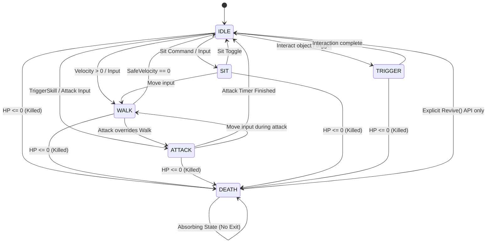
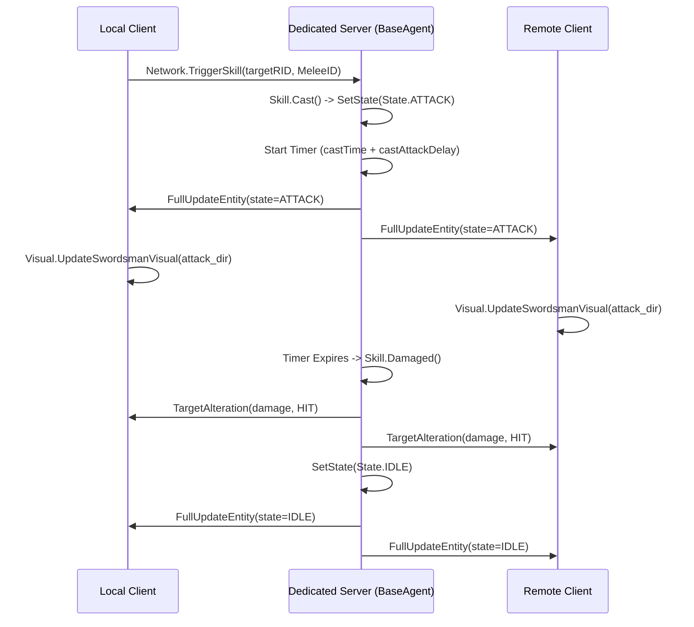

# TDNM — ANIMATION STATE MACHINE & TRANSITION AUDIT
## Phase 4.2.2 Technical Investigation

**Project:** Thiên Đạo Nghịch Mệnh (TDNM)  
**Date:** 2026-11-03  
**Status:** VERIFIED & EMPIRICALLY AUDITED  
**Scope Boundary:** Documentation and Technical Audit ONLY

---

## 1. STATE DEFINITIONS & THE 8x8 TRANSITION MATRIX

In Source of Mana, character state is managed by a centralized, table-driven state machine declared in [`sources/actor/ActorCommons.gd`](file:///Users/it/Documents/Tu%20%C4%91a%CC%A3o/thien-dao-nghich-menh-godot/sources/actor/ActorCommons.gd) (lines 134–165).

### 1.1. State Enums (`ActorCommons.State`)
Declared in `sources/actor/ActorCommons.gd:120-134`:
- `UNKNOWN` ($-1$) — Default uninitialized state (not indexed in transition matrix)
- `IDLE` ($0$)
- `WALK` ($1$)
- `SIT` ($2$)
- `ATTACK` ($3$)
- `DEATH` ($4$)
- `TO_TRIGGER` ($5$)
- `TRIGGER` ($6$)
- `FROM_TRIGGER` ($7$)
- `COUNT` ($8$) — Total number of operational states in matrix

### 1.2. The Authoritative $8 \times 8$ State Transition Matrix (`STATE_TRANSITIONS`)

```
CURRENT STATE \ WANTED STATE:
                 IDLE     WALK     SIT      ATTACK   DEATH    TO_TRIG  TRIGGER  FROM_TRIG
IDLE        -> [ IDLE,    WALK,    SIT,     ATTACK,  DEATH,   IDLE,    TRIGGER, IDLE      ]
WALK        -> [ IDLE,    WALK,    WALK,    ATTACK,  DEATH,   IDLE,    TRIGGER, IDLE      ]
SIT         -> [ SIT,     WALK,    IDLE,    ATTACK,  DEATH,   IDLE,    TRIGGER, IDLE      ]
ATTACK      -> [ IDLE,    WALK,    ATTACK,  ATTACK,  DEATH,   IDLE,    TRIGGER, IDLE      ]
DEATH       -> [ DEATH,   DEATH,   DEATH,   DEATH,   DEATH,   DEATH,   DEATH,   DEATH     ]
TO_TRIGGER  -> [ IDLE,    WALK,    SIT,     ATTACK,  DEATH,   TO_TRIG, TRIGGER, FROM_TRIG ]
TRIGGER     -> [ TRIGGER, TRIGGER, SIT,     ATTACK,  DEATH,   TRIGGER, IDLE,    TRIGGER   ]
FROM_TRIGGER-> [ IDLE,    WALK,    SIT,     ATTACK,  DEATH,   IDLE,    TRIGGER, FROM_TRIG ]
```

### 1.3. Transition Mechanism in Code
In [`sources/actor/agent/BaseAgent.gd`](file:///Users/it/Documents/Tu%20%C4%91a%CC%A3o/thien-dao-nghich-menh-godot/sources/actor/agent/BaseAgent.gd) (lines 61–70):
```gdscript
func SetState(wantedState : ActorCommons.State) -> bool:
	var stateIdx : int = state * ActorCommons.State.COUNT + wantedState
	var nextState : ActorCommons.State = ActorCommons.STATE_TRANSITIONS[stateIdx] as ActorCommons.State
	if nextState != state:
		requireFullUpdate = true
		state = nextState
		if self is AIAgent:
			set_physics_process(true)
	return state == wantedState
```

---

## 2. STATE TRANSITION FLOWCHART



---

## 3. STATE AUDIT FINDINGS & CONFLICT ANALYSIS

### 3.1. Death State is Strictly Absorbing
- **Finding:** Row 4 (`DEATH`) contains `State.DEATH` for all 8 target transitions.
- **Consequence:** Once a character dies (`Killed()` called or $HP \le 0$), **NO** regular gameplay inputs (movement, attack, sit, interaction) can transition the character out of death. Movement inputs are safely rejected.
- **Exit Mechanism:** Only an explicit call to `BaseAgent.Revive()` overrides `state = ActorCommons.State.IDLE`. This is a robust design that prevents zombie-state desync.

### 3.2. Movement Overrides Attack
- **Finding:** In row 3 (`ATTACK`), requesting `WALK` transitions the state to `State.WALK`.
- **Consequence:** If a player moves while attacking, `SetState(WALK)` succeeds immediately.
- **Skill Cancellation:** In `BaseAgent.WalkToward()` (line 102–104):
  ```gdscript
  if SkillCommons.IsStaticCasting(self):
      Skill.Stopped(self)
  ```
  If a skill has `castWalk = false` (static casting), movement cancels the skill timer and sets cast ID to `UnknownHash`. If `castWalk = true`, the character walks while the skill timer continues.
- **Visual Hitch:** If an attack animation has played 3 frames and the player presses a directional movement key, the Swordsman abruptly snaps from `attack_dir` to `walk_dir` without attack recovery frames.

### 3.3. Absence of a Hurt / Stagger State
- **Critical Finding:** `ActorCommons.State` does **NOT** contain a `HURT` or `STAGGER` state.
- **Current Behavior:** When an entity takes damage, `Skill.Damaged()` calls `target.stat.SetHealth(-damage)` and sends `Network.TargetAlteration`. The client displays floating numbers via `interactive.DisplayAlteration()`.
- **Consequence:** Taking damage does not interrupt attacks, movement, or casting. Entities continue walking or attacking smoothly through incoming damage.
- **Artwork Impact:** The compiled 48 frames of `hurt_east` through `hurt_west` in `swordsman_frames.tres` are completely unused.

### 3.4. Absence of a Combo State
- **Finding:** Successive attacks do not trigger a sequence transition. Every attack request restarts the `ATTACK` state with the normal attack animation.
- **Artwork Impact:** The 128 frames of `combo_east` through `combo_west` in `swordsman_frames.tres` are completely unused.

### 3.5. Qinggong / Run Visual Decoupling
- **Finding:** Running is tracked as a boolean flag `stat.isRunning` in `ActorStats`, not as an independent state in `ActorCommons.State`.
- **Current Implementation:** When `isRunning = true`, `Formula.GetWalkSpeed(stat)` returns higher velocity ($1.6\times$), but `safeVelocity != 0` still sets `state = ActorCommons.State.WALK`.
- **In `Visual.gd:378`:** `GetSwordsmanAction` matches `State.WALK` to string `"walk"`, completely ignoring `stat.isRunning`.
- **Consequence:** The Swordsman runs faster across the map, but the sprite continues playing standard `walk_dir` at accelerated speed instead of the dedicated `qinggong_dir` animation.

---

## 4. NETWORK AUTHORITY & VISUAL REPLICATION



- **Authority:** 100% server-authoritative. Clients never set their own state or calculate damage.
- **Latency Resilience:** If a network packet is delayed, the client's `Entity.Update` receives the latest server frame ID (`NetworkCommons.FrameID()`). Out-of-order packets are discarded via `lastUpdateFrameID`.
