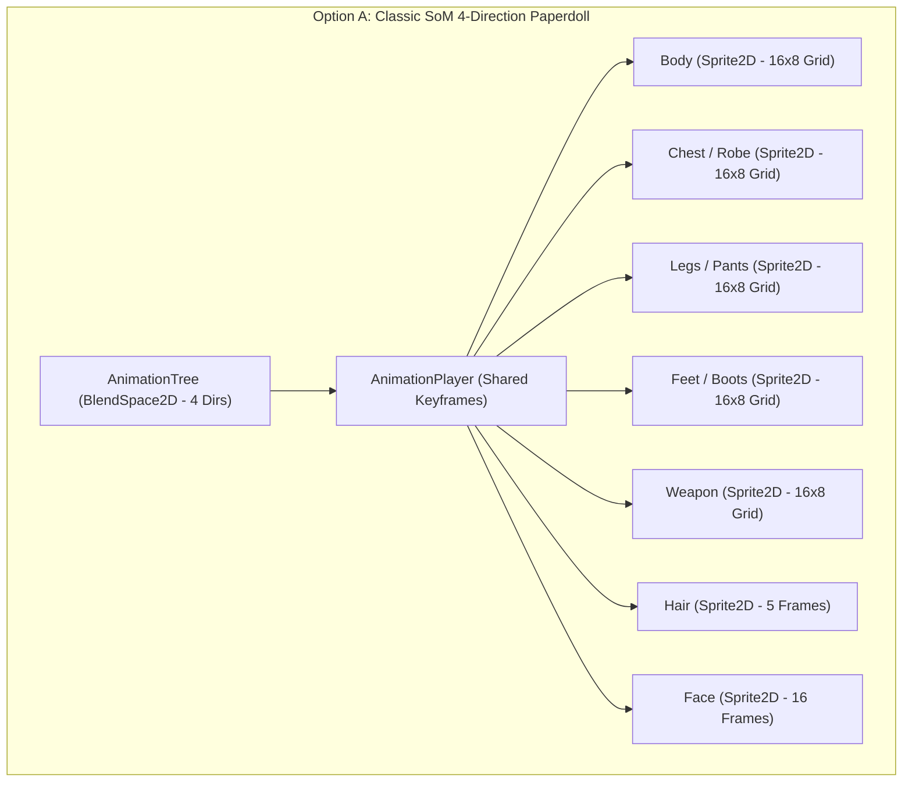
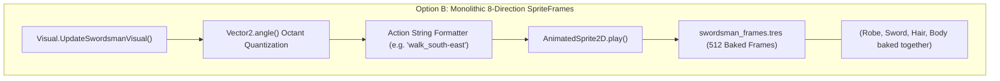
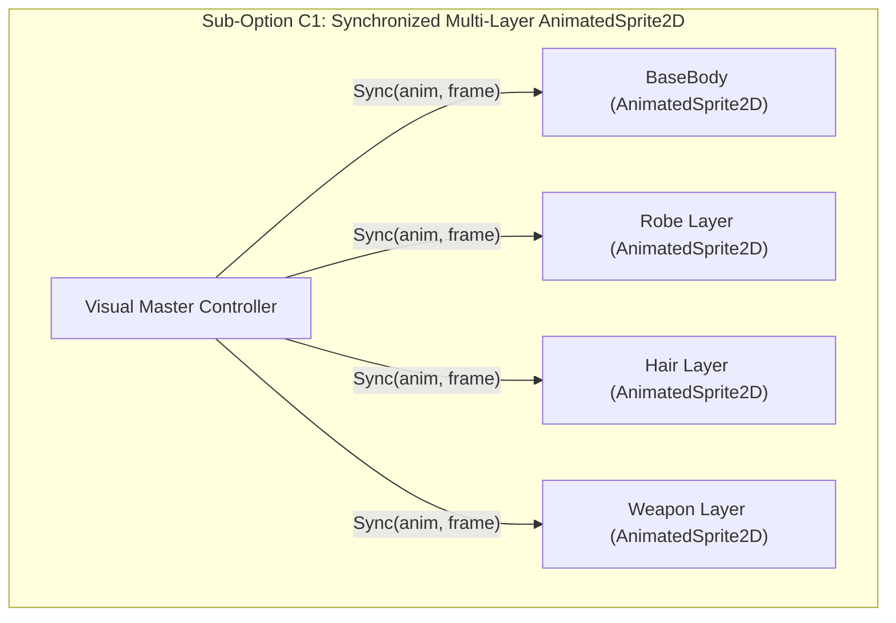
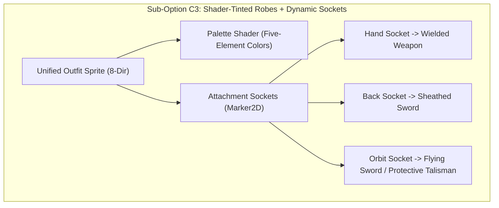

# WORKSTREAM A — CHARACTER RENDERING & CUSTOMIZATION ARCHITECTURE
**Project:** Thiên Đạo Nghịch Mệnh (TDNM)  
**Phase:** 4.3 — Character & Combat Architecture Design  
**Type:** Technical Architecture Investigation & Option Evaluation  
**Status:** ARCHITECTURAL PROPOSAL (`[PROPOSED]`) — SUBJECT TO OWNER REVIEW  

---

## 1. INVESTIGATION CONTEXT & MANDATE

A core tension identified during Phase 4.2.2 and Phase 4.2.3 is the coexistence of two divergent character rendering paradigms in the codebase:
1. **Classic Source of Mana (SoM) Paperdoll:** Modular 9-layer composite (`Sprite2D`) driven by `AnimationPlayer` and `AnimationTree` locked to 4 cardinal directions.
2. **TDNM Swordsman (Phase 3 Prototype):** Monolithic 8-directional raster (`AnimatedSprite2D`) driven by `swordsman_frames.tres` with 512 baked frames.

This document evaluates three architectural options for the future player character and humanoid NPC pipeline, analyzing their trade-offs across 9 rigorous engineering and art metrics.

---

## 2. OPTION A: CLASSIC SOM MODULAR PAPERDOLL (4-DIRECTIONAL BASELINE)

### 2.1 Technical Anatomy in Existing Codebase
As verified in [`presets/entities/sprites/Player.tscn`](file:///Users/it/Documents/Tu%20%C4%91a%CC%A3o/thien-dao-nghich-menh-godot/presets/entities/sprites/Player.tscn) and [`sources/actor/entity/components/Visual.gd:224-262`](file:///Users/it/Documents/Tu%20%C4%91a%CC%A3o/thien-dao-nghich-menh-godot/sources/actor/entity/components/Visual.gd#L224-L262):
- **Hierarchy:** 11 `Sprite2D` child nodes under a root `Node2D`: `Body`, `Face`, `Feet`, `Legs`, `Chest`, `Hair`, `Hands`, `Weapon`, `Shield`, `Neck`, `Head`.
- **Driver:** A centralized `AnimationPlayer` keyframing the `frame` and `offset` properties across all 11 child nodes simultaneously.
- **Blending:** Driven by an `AnimationTree` instantiating `4Directions.tscn` with a `BlendSpace2D` mapped to `Vector2(0, 1)` (Down), `Vector2(0, -1)` (Up), `Vector2(-1, 0)` (Left), and `Vector2(1, 0)` (Right).
- **Customization:** Equipping items calls `Visual.SetEquipment(slot, data)`, which updates `sprite.texture = cell.textures[gender]`. Because all equipment sheets follow a uniform $16 \times 8$ grid (128 cells), any piece of equipment automatically tracks the master body animation.



### 2.2 Technical Feasibility of Expanding Option A to 8 Directions
- **Animation Track Explosion:** In Godot's `AnimationPlayer`, each 4-direction action currently has 4 animations (e.g. `WalkDown`, `WalkUp`, `WalkLeft`, `WalkRight`). Expanding to 8 directions requires 8 animations per action $\times$ 11 tracks per animation = 88 track edits per action.
- **Spritesheet Grid Limitation:** The baseline $16 \times 8$ grid only accommodates 4 directions of 4-to-6 frame cycles. Adding 4 diagonal directions would double the required sheet dimensions ($32 \times 8$ or $16 \times 16$), breaking compatibility with all 300+ legacy SoM equipment spritesheets.
- **Verdict for Option A:** Highly cost-effective for 4 directions, but technically prohibitive and unwieldy if forced into 8 directions.

---

## 3. OPTION B: MONOLITHIC 8-DIRECTION SPRITEFRAMES (SWORDSMAN MODEL)

### 3.1 Technical Anatomy in Existing Codebase
As verified in [`presets/entities/sprites/SwordsmanPreset.tscn`](file:///Users/it/Documents/Tu%20%C4%91a%CC%A3o/thien-dao-nghich-menh-godot/presets/entities/sprites/SwordsmanPreset.tscn) and [`sources/actor/entity/components/Visual.gd:108-142`](file:///Users/it/Documents/Tu%20%C4%91a%CC%A3o/thien-dao-nghich-menh-godot/sources/actor/entity/components/Visual.gd#L108-L142):
- **Hierarchy:** Single `AnimatedSprite2D` node under a root `Node2D`.
- **Driver:** Direct string playback: `animatedSprite.play(action + "_" + dir_name)`.
- **Foot Anchoring:** Programmatically offset via `SWORDSMAN_FOOT_OFFSETS` dictionary based on action type (`idle`/`walk` at `(20, 38)`, `attack` at `(36, 58)`).
- **Current State:** 56 animations, 512 handcrafted frames across 7 actions and 8 isometric octants.



### 3.2 Combinatorial Asset Explosion Risk
- In Option B, all visual layers (body, robes, scabbard, sword blade, hair) are merged into a single flat raster.
- If a player equips a different sword or a different sect robe:
  - $\text{Total Frames per Outfit} = 512 \text{ frames}$.
  - Introducing 10 distinct sect robes = $5,120 \text{ handcrafted frames}$.
  - Introducing 5 distinct weapon types (Dao, Sword, Staff, Spear, Flute) $\times$ 10 robes = **50 full spritesheets (25,600 individual frames)**.
- **Verdict for Option B:** Delivers the absolute highest visual quality and fluid wuxia silhouette for a single fixed hero avatar, but imposes an impossible production cost for customizable MMORPG equipment.

---

## 4. OPTION C: HYBRID MODULAR 8-DIRECTION ARCHITECTURE

To bridge the visual brilliance of 8-directional combat with MMORPG equipment progression, three concrete sub-architectures are evaluated:

### 4.1 Sub-Option C1: Multi-Layer Synchronized AnimatedSprite2D
- **Concept:** Replace the single `AnimatedSprite2D` with 4 dedicated `AnimatedSprite2D` layers:
  1. `BaseBody` (Skin, undergarments, face)
  2. `Robe` (Daoist robes, martial tunics, armor)
  3. `Hair` (Topknot, flowing locks, hairpins)
  4. `Weapon` (Sword, saber, staff)
- **Synchronization Engine:** A single master driver sets `animation` and `frame` across all 4 nodes simultaneously in `_process()`:
  ```gdscript
  func SyncLayers(anim_name: String, current_frame: int):
      for layer in [base_body, robe_layer, hair_layer, weapon_layer]:
          if layer and layer.visible:
              layer.animation = anim_name
              layer.frame = current_frame
  ```
- **Asset Production Impact:**
  - Base body: 512 frames (drawn once for Male, once for Female).
  - Each new Daoist robe: 512 frames (only drawing the clothing overlay).
  - Weapon overlay: 512 frames per weapon archetype.
  - Linear scaling ($N + M$ sheets) rather than multiplicative ($N \times M$).



### 4.2 Sub-Option C2: 8-Directional Shared AnimationPlayer Paperdoll
- **Concept:** Re-engineer Option A's `AnimationPlayer` architecture for 8 directions.
- **Implementation:**
  - Build a custom `AnimationLibrary` containing 56 animations (7 actions $\times$ 8 directions).
  - Each animation keyframes `frame` across standard modular `Sprite2D` layers.
  - Requires authoring 56 master animations in Godot Editor. Once completed, any modular spritesheet conforming to the grid template works automatically.
- **Asset Production Impact:** Standardizes all clothing and weapons onto uniform 8-directional texture atlas sheets.

### 4.3 Sub-Option C3: Decoupled Robe + Dynamic Socket Attachment (Recommended Hybrid)
- **Concept:** Combine baked robe bodies with dynamic attachment sockets:
  - **Body & Robes:** Handled as unified base outfits (e.g. Beginner Robe, Disciple Robe, Elder Robe). Color variations and elemental affinities handled via **Palette Shaders** (Kim = Gold, Mộc = Cyan/Green, Hỏa = Crimson, Thủy = Deep Blue, Thổ = Ochre).
  - **Weapons & Artifacts:** Detached from the body raster. Attached via dynamic **`Marker2D` Sockets** (`Hand_R`, `Hand_L`, `Back_Scabbard`, `Floating_Orbit`).
  - **Flying Swords (Phi Kiếm) & Talismans (Đạo Phù):** Rendered as independent orbiting `Node2D` entities running procedural floating/rotation scripts rather than baked into body frames.
- **Asset Production Impact:** Drastically slashes frame count. A single sword sprite ($32 \times 32$ px) can be wielded, sheathed on the back, or flown as a mount with procedural rotation, requiring **zero extra body frames**.



---

## 5. COMPREHENSIVE ARCHITECTURAL COMPARISON MATRIX

| Evaluation Criteria | Option A: SoM Paperdoll (4-Dir) | Option B: Monolithic SpriteFrames (8-Dir) | Option C1: Multi-Layer AnimatedSprite2D | Option C3: Socket Attachments + Shader Robes |
| :--- | :---: | :---: | :---: | :---: |
| **1. Visual Quality & Fluidity** | Low (Chibi, 4-dir, stiff) | **Maximum** (Handcrafted wuxia strokes) | **Very High** (Handcrafted layers) | **Very High** (Smooth robe + dynamic gear) |
| **2. Equipment Customization** | **High** (Piece-by-piece gear) | **Zero** (Baked outfit) | **High** (Piece-by-piece layers) | **High** (Outfits + Weapon/Artifact Sockets) |
| **3. Animation Flexibility** | Low (Locked to 4-dir BlendSpace) | Medium (Baked to 7 actions) | High (Independent layer toggles) | **Maximum** (Procedural weapon motion) |
| **4. Engineering Dev Cost** | **Zero** (Already works in SoM) | Low (Current prototype state) | Medium (Sync controller required) | Medium (Socket tracking in `Visual.gd`) |
| **5. Asset Production Burden** | Low (Small 32x32 frames) | **Prohibitive** ($N \times M$ combinations)| High (512 frames per item piece) | **Moderate / Sustainable** (Linear scaling) |
| **6. Performance & Memory** | **Minimal** (~2 MB VRAM) | Medium (~12 MB per sheet) | High (~40 MB per character load) | Low-Medium (~15 MB VRAM) |
| **7. Multiplayer Sync** | **Verified** (4-dir replication) | **Verified** (8-dir octant angle sync) | **Verified** (Syncs identical angle/state)| **Verified** (Replicates socket state via ID)|
| **8. Migration Difficulty** | **Zero** (Existing engine baseline)| High (Bypasses equipment DB) | High (Re-authors equipment pipeline) | **Moderate** (Integrates with existing `ItemCell`) |
| **9. Long-Term Scalability** | Low (Cannot achieve Xianxia feel) | Low (Bottlenecked by art production)| Medium (Art-heavy maintenance) | **Maximum** (Supports flying swords, auras)|

---

## 6. WORKSTREAM A SUMMARY FOR OWNER DECISION

- If the Owner prioritizes **immediate asset preservation and legacy paperdoll compatibility above all else**, **Option A** remains the baseline, but sacrifices 8-directional combat fidelity.
- If the Owner prioritizes **single-hero bespoke martial arts visual perfection**, **Option B** represents the current state of the Swordsman prototype.
- If the Owner seeks a **scalable, production-viable MMORPG architecture supporting customizable Daoist robes, flying swords, and five-element cultivation visual progression**, **Option C3** offers the optimal balance between art sustainability and visual excellence.

---

*Authored by Senior Godot Engineer & Systems Architect — Thiên Đạo Nghịch Mệnh Phase 4.3.*
