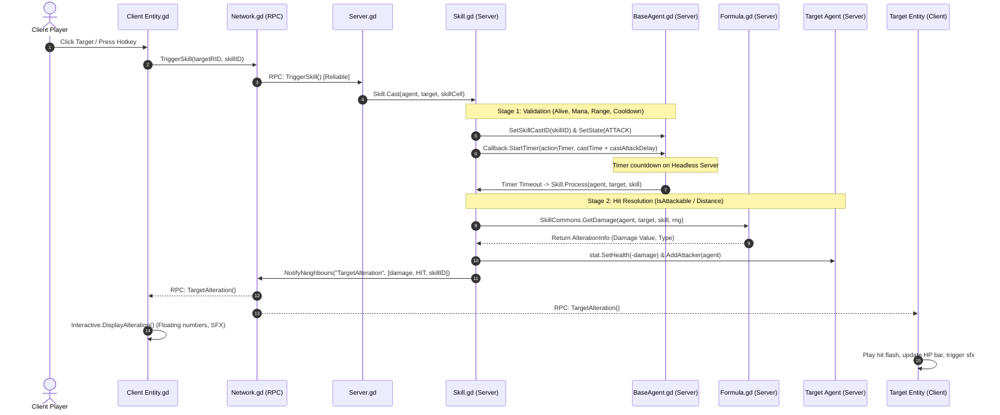

# WORKSTREAM D — COMBAT ENGINE, HIT RESOLUTION & DAMAGE PIPELINE
**Project:** Thiên Đạo Nghịch Mệnh (TDNM)  
**Phase:** 4.3 — Character & Combat Architecture Design  
**Type:** Technical Architecture Investigation & Combat Model Evaluation  
**Status:** ARCHITECTURAL PROPOSAL (`[PROPOSED]`) — SUBJECT TO OWNER REVIEW  

---

## 1. INVESTIGATION CONTEXT & CURRENT COMBAT FLOW TRACE

In Source of Mana, combat is strictly **server-authoritative** and **skill-driven**. Every melee strike, spell, or buff is executed through the universal `Skill` pipeline.

### Complete 10-Stage Authoritative Combat Flow



### Detailed Execution Breakdown in Source Code:
1. **Client Input:** In [`sources/actor/entity/Entity.gd:84-105`](file:///Users/it/Documents/Tu%20%C4%91a%CC%A3o/thien-dao-nghich-menh-godot/sources/actor/entity/Entity.gd#L84-L105):
   Player presses hotkey or clicks mouse. `Entity.Cast(skillID)` verifies the skill exists in `DB.SkillsDB`, resolves `targetRID`, and emits `Network.TriggerSkill(targetRID, skillID)`.
2. **Network Request:** Calls `@rpc("any_peer", "call_remote", "reliable") func TriggerSkill(...)` in `Network.gd:70`.
3. **Server Validation:** In [`sources/network/server/Server.gd:285-300`](file:///Users/it/Documents/Tu%20%C4%91a%CC%A3o/thien-dao-nghich-menh-godot/sources/network/server/Server.gd#L285-L300):
   Server verifies sender peer ID, checks that the agent is alive and not disabled, and invokes `Skill.Cast()`.
4. **Casting & Timing Setup:** In [`sources/skill/Skill.gd:20-37`](file:///Users/it/Documents/Tu%20%C4%91a%CC%A3o/thien-dao-nghich-menh-godot/sources/skill/Skill.gd#L20-L37):
   Server calls `SkillCommons.TryConsume(agent, Mana, skill)`. It sets `agent.SetSkillCastID(skill.id)` and sets an authoritative timer:
   ```gdscript
   Callback.StartTimer(agent.actionTimer, skill.castTime + agent.stat.current.castAttackDelay, Skill.Process.bind(agent, target, skill), true)
   ```
5. **Hit Resolution:** In [`sources/skill/Skill.gd:39-65`](file:///Users/it/Documents/Tu%20%C4%91a%CC%A3o/thien-dao-nghich-menh-godot/sources/skill/Skill.gd#L39-L65):
   When the timer expires, `Skill.Process()` checks `SkillCommons.IsAttackable(agent, target, skill)`.
6. **Damage Calculation:** In [`sources/skill/SkillCommons.gd:28-55`](file:///Users/it/Documents/Tu%20%C4%91a%CC%A3o/thien-dao-nghich-menh-godot/sources/skill/SkillCommons.gd#L28-L55):
   Executes `Formula.GetDamage()` factoring in attacker physical/magical attack vs target defense, elemental multipliers, and RNG variance.
7. **Damage Application:** In [`sources/skill/Skill.gd:105-115`](file:///Users/it/Documents/Tu%20%C4%91a%CC%A3o/thien-dao-nghich-menh-godot/sources/skill/Skill.gd#L105-L115):
   Deducts health via `target.stat.SetHealth(-info.value)`. Emits `agent_damaged`.
8. **Client Alteration Broadcast:** Calls `Network.NotifyNeighbours(agent, "TargetAlteration", [casterRID, targetRID, damage, type, skillID, true])`.
9. **Visual Feedback:** Client `Interactive.DisplayAlteration()` spawns floating combat text (`AlterationLabel`), triggers blood/spark VFX, and plays audio via `Sfx.gd`.

---

## 2. EVALUATION OF CURRENT DISTANCE-BASED HIT RESOLUTION

In [`sources/skill/SkillCommons.gd:95-105`](file:///Users/it/Documents/Tu%20%C4%91a%CC%A3o/thien-dao-nghich-menh-godot/sources/skill/SkillCommons.gd#L95-L105):
```gdscript
static func IsNear(agent : BaseAgent, target : BaseAgent, skillRange : int) -> bool:
	var filteredRange : float = skillRange + agent.data._radius + target.data._radius
	var distanceSquared : float = 0.0
	if not target.agent:
		distanceSquared = ActorCommons.GetDistanceSquared(agent, target.position)
	else:
		distanceSquared = agent.agent.distance_to_target()
```
And in `ActorCommons.GetDistanceSquared`:
```gdscript
static func GetDistanceSquared(actor : Actor, pos : Vector2) -> float:
	return Vector2.ZERO.distance_squared_to((actor.position - pos) * SkillCommons.PerspectiveIncrease)
```

### Critical Strengths of the Baseline Model:
1. **100% Deterministic & Cheat-Proof:** Evaluated exclusively on the dedicated headless server. Clients cannot inject fake hit events.
2. **Ultra-Low Server CPU Footprint:** Pure mathematical distance calculation ($(\Delta x)^2 + (\Delta y \times 2)^2 \le R^2$). No physics queries, no bounding box collisions, no broadphase tree overhead.
3. **Resilient to Network Latency:** Even if clients experience 150 ms ping jitter, the server evaluates spatial reachability at the exact moment of timer expiration without rubber-banding.

### Critical Limitations for Cultivation Fantasy:
1. **No Directional Skill-Shots:** An attack hits as long as the target is within radius $R$, even if the target is standing directly behind the attacker's back.
2. **Missing Sword Arc Slashes:** Classic martial arts sword beams (Kiếm Khí hình bán nguyệt) or thrusts (Đâm kiếm) cannot be represented; they function as circular range checks.
3. **Timing Desync with Animations:** If a sword animation slash apex occurs at frame 4 (0.24s) but the server `castAttackDelay` expires at 0.40s, the damage number pops 0.16s after the visual blade has already finished swinging.

---

## 3. COMPARATIVE EVALUATION OF FOUR COMBAT MODELS

To support the dynamic combat expectations of Xianxia martial arts, four combat architectures are evaluated:

```
┌────────────────────────────────────────────────────────────────────────┐
│ MODEL A: EXISTING DISTANCE-BASED COMBAT (Radial Point-to-Point)        │
│ Check: distance_to(target) <= range. Target lock required.             │
└────────────────────────────────────────────────────────────────────────┘

┌────────────────────────────────────────────────────────────────────────┐
│ MODEL B: DIRECTIONAL MATHEMATICAL GEOMETRY (Arcs, Cones, Sectors, Rays)│
│ Check: Vector angle_to() + distance. Supports front cleaves, lines.   │
└────────────────────────────────────────────────────────────────────────┘

┌────────────────────────────────────────────────────────────────────────┐
│ MODEL C: SERVER PHYSICS HITBOXES (Area2D / ShapeCast2D Collision)      │
│ Check: Physical Godot collision query on headless server physics ticks.│
└────────────────────────────────────────────────────────────────────────┘

┌────────────────────────────────────────────────────────────────────────┐
│ MODEL D: HYBRID AUTHORITATIVE COMBAT (Server Geometry + Frame Clocks)  │
│ Server checks geometric arcs; client predicts effects; event-synced.   │
└────────────────────────────────────────────────────────────────────────┘
```

### Detailed Evaluation of the Four Models:

#### Model A: Existing Radial Distance Check
- **Server Authority:** Absolute (Evaluated in `Skill.Process()`).
- **Hit Accuracy:** Low (Lacks directional orientation).
- **Network Latency Resilience:** **Maximum** (Zero physics desync).
- **Server Performance:** **Negligible CPU overhead** ($O(1)$ math).
- **Animation Sync:** Poor (Timer-driven decoupling).
- **Suitability for Xianxia:** Moderate (Works for tab-target spells, poor for swordplay).

#### Model B: Directional Geometric Checks (Cone / Arc / Ray)
- **Concept:** Replaces simple radius checks with 2D geometric vector math:
  - **Melee Slash (Trảm Kích):** Evaluates cone sector:
    ```gdscript
    var dir_to_target = (target.position - caster.position).normalized()
    var angle_diff = abs(caster.currentOrientation.angle_to(dir_to_target))
    var is_in_arc = angle_diff <= deg_to_rad(60.0) # 120-degree frontal arc
    var is_in_range = caster.position.distance_to(target.position) <= slash_range
    return is_in_arc and is_in_range
    ```
  - **Sword Thrust / Flying Sword Ray (Kiếm Kính / Phi Kiếm):** Evaluates segment distance to line:
    ```gdscript
    var hit = Geometry2D.segment_intersects_circle(caster.position, caster.position + orientation * ray_len, target.position, target_radius)
    ```
- **Server Authority:** Absolute (Server performs vector geometry).
- **Hit Accuracy:** **High** (Enables dodging by stepping behind the attacker).
- **Network Latency Resilience:** **High** (Pure math, zero physics simulation).
- **Server Performance:** **Extremely High** (Vector dot products take $<0.001$ ms).
- **Suitability for Xianxia:** **Outstanding** (Naturally models sword arcs, palm blasts, and spear thrusts).

#### Model C: Server Physics Hitboxes (`Area2D` / `CollisionShape2D`)
- **Concept:** Spawns physical Godot collision shapes attached to weapons or moving projectiles on the server.
- **Server Authority:** Absolute.
- **Hit Accuracy:** High on local machine; **Poor over WAN latency**.
- **Server Performance:** **Poor** (Godot 2D Physics Server overhead scales quadratically with 100+ active monsters on a single headless core).
- **Multiplayer Risks:** Physics tunneling at high speeds, collision layer desync, high tick rate requirements ($60$ Hz instead of current $30$ Hz).
- **Suitability for Xianxia:** Poor (Over-engineered for 2.5D pixel art).

#### Model D: Hybrid Authoritative Combat Engine (Recommended Architecture)
- **Concept:** 
  1. **Server Realm:** Uses **Model B's Directional Geometry** (Arcs for cleaves, Rays for flying swords, Circles for area spells). Slashes damage all enemies inside the arc simultaneously (True Cleave).
  2. **Timing Harmonization:** Server bases `actionTimer` on normalized animation percentages:
     - Damage trigger occurs at the exact **Impact Frame Ratio** ($\tau_{\text{hit}} = 0.50$ of animation length).
  3. **Client Realm:** Plays local visual slash trails, particle bursts, and screen micro-shake immediately upon receiving the `TargetAlteration` event.

---

## 4. COMPREHENSIVE COMBAT MODEL COMPARISON MATRIX

| Evaluation Criteria | Model A: Radial Distance | Model B: Directional Geometry | Model C: Server Physics Hitboxes | Model D: Hybrid Engine (Model B + Event Sync) |
| :--- | :---: | :---: | :---: | :---: |
| **1. Server Authority** | **100% Authoritative** | **100% Authoritative** | **100% Authoritative** | **100% Authoritative** |
| **2. Directional Accuracy** | None (360° radial) | **High** (Cones & Lines) | **Very High** (Exact hull) | **High** (Isometric Arcs) |
| **3. Latency Resilience** | **Maximum** | **Very High** | Low (Jitter / Tunneling) | **Very High** |
| **4. Headless Server Load** | **Minimal** ($O(1)$) | **Minimal** ($O(N)$ math) | **Heavy** (Physics queries) | **Minimal** ($O(N)$ math) |
| **5. Animation Sync** | Poor (Timer decoupled) | Medium | Medium | **High** (Impact frame aligned) |
| **6. Skill Authoring Ease**| High (Only radius) | **Very High** (Angle + range)| Low (Collision layer setup) | **High** (Config-driven shapes) |
| **7. 2.5D Pixel Art Fit** | Moderate | **Ideal** | Poor (3D depth mismatch) | **Ideal** |

---

## 5. SUMMARY RECOMMENDATION FOR OWNER DECISION

1. **Reject Model C (Server Physics Hitboxes):** Running full Godot 2D physics shapes for every sword swing on a dedicated server introduces unnecessary CPU overhead and network tunneling issues without adding real value to 2.5D pixel art.
2. **Transition from Model A to Model D:**
   - Retain mathematical server evaluation for ultra-lightweight, 100% cheat-proof combat.
   - Upgrade hit checks from radial distance to **Directional Arcs (Cones) and Piercing Lines (Rays)** in `SkillCommons.gd`.
   - Align server damage application with the **Impact Apex Frame** of the animation, eliminating the visual delay between blade contact and floating damage numbers.

---

*Authored by Senior Godot Engineer & Systems Architect — Thiên Đạo Nghịch Mệnh Phase 4.3.*
