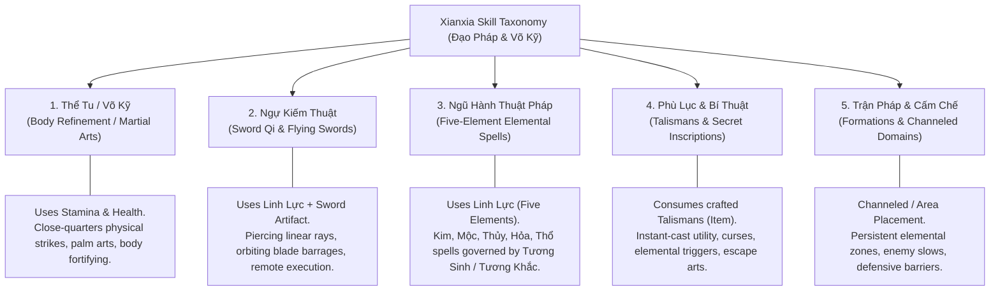
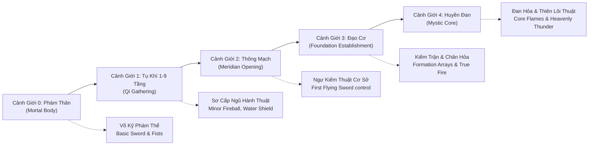

# WORKSTREAM E — XIANXIA SKILL ARCHITECTURE & FIVE-ELEMENT PROGRESSION
**Project:** Thiên Đạo Nghịch Mệnh (TDNM)  
**Phase:** 4.3 — Character & Combat Architecture Design  
**Type:** Technical Architecture Design & Data Modeling  
**Status:** ARCHITECTURAL PROPOSAL (`[PROPOSED]`) — SUBJECT TO OWNER REVIEW  

---

## 1. DESIGN PHILOSOPHY & AUTHORITATIVE INVARIANTS

The skill system of Thiên Đạo Nghịch Mệnh transforms the classical Western fantasy spell framework into a rich, strategic Xianxia/Xuanhuan martial and spiritual arts ecosystem. In accordance with project invariants:

1. **Content Transformation, NOT a Rewrite:** The existing `SkillCell`, `SkillCommons`, `Skill.gd`, and modifier frameworks in Source of Mana are preserved and incrementally extended.
2. **Alignment with Owner Decision D-01 (Ngũ Hành Tạp Căn):** The protagonist possesses all five elemental spiritual roots (Kim, Mộc, Thủy, Hỏa, Thổ). Cultivation is slow and demanding. The player can learn and activate skills across all five elements, but lacks high innate affinity multipliers unless specialized through rare cultivation arts, manual elixirs, or elemental balancing.
3. **Alignment with Owner Decision D-04 (Hybrid Progression Model):** Skill tiers, learning requirements, and spiritual energy consumption strictly map to the 9-realm hybrid progression (Phàm Thân $\rightarrow$ Tụ Khí 9 Tầng $\rightarrow$ Thông Mạch $\rightarrow$ Đạo Cơ $\rightarrow$ Huyền Đan $\rightarrow$ Nguyên Thần $\rightarrow$ Thiên Nhân $\rightarrow$ Quy Hư $\rightarrow$ Độ Kiếp).
4. **Retraction Discipline:** Unapproved skills or concepts (such as "Trường Sinh Quy Nguyên Công") remain retracted. All skill definitions in this document are initial proposals (`[PROPOSED]`).

---

## 2. XIANXIA SKILL TAXONOMY

In Source of Mana, `SkillCell.Category` is limited to:
```gdscript
enum Category { SPELL = 0, PHYSICAL = 1, ABILITY = 2 }
```

We extend this taxonomy into 5 distinct Xianxia combat traditions while preserving backward compatibility with the integer enum:



### Detailed Classifications:

| Category | Classical SoM Equivalent | Primary Resource | Target Type | Combat Role |
| :--- | :--- | :--- | :--- | :--- |
| **Thể Tu (Martial / Body)** | `PHYSICAL` (`Category.PHYSICAL`) | Stamina / Health | Single / Melee Arc | High sustained physical DPS, stagger, gap closing, damage mitigation. |
| **Ngự Kiếm (Flying Sword)** | `PHYSICAL` / `SPELL` | Linh Lực (Mana) + Equipped Sword | Directional Ray / Linear Piercing | Precision burst, long-range kiting, execute damage. |
| **Ngũ Hành (Elemental Spells)** | `SPELL` (`Category.SPELL`) | Linh Lực (Mana) | Cone / AoE / Projectile | Elemental status effects, elemental combo triggers, crowd control. |
| **Phù Lục (Talismans)** | `ABILITY` (`Category.ABILITY`) | Consumable Item + Minor Mana | Ground Point / Self Buff | Instant tactical response, stealth, anti-element shields, escape. |
| **Trận Pháp (Formations)** | `SPELL` (`Category.SPELL`) | Linh Lực Channeled (per sec) | Persistent Area Zone | Tactical territory control, party buffing, boss suppression. |

---

## 3. NGŨ HÀNH TẠP CĂN & ELEMENTAL SYSTEM DESIGN

### 3.1. The Elemental Cycle (Tương Sinh & Tương Khắc)

In accordance with classical Eastern metaphysics and Owner Decision D-01:

```mermaid
graph LR
    subgraph Tương Sinh (Mutual Generation)
        Kim_S["Kim (Metal)"] -->|Sinh| Thuy_S["Thủy (Water)"]
        Thuy_S -->|Sinh| Moc_S["Mộc (Wood)"]
        Moc_S -->|Sinh| Hoa_S["Hỏa (Fire)"]
        Hoa_S -->|Sinh| Tho_S["Thổ (Earth)"]
        Tho_S -->|Sinh| Kim_S
    end
```

```mermaid
graph LR
    subgraph Tương Khắc (Mutual Overcoming)
        Kim_K["Kim (Metal)"] -->|Khắc| Moc_K["Mộc (Wood)"]
        Moc_K -->|Khắc| Tho_K["Thổ (Earth)"]
        Tho_K -->|Khắc| Thuy_K["Thủy (Water)"]
        Thuy_K -->|Khắc| Hoa_K["Hỏa (Fire)"]
        Hoa_K -->|Khắc| Kim_K
    end
```

### 3.2. Damage Multiplier & Resistance Formula

When an elemental skill hits a target with elemental defense or elemental constitution:

$$\text{ElementalMultiplier} = \begin{cases} 
1.30 & \text{if Attacker Element KHẮC Target Element (Advantage)} \\
0.75 & \text{if Attacker Element BỊ KHẮC Target Element (Disadvantage)} \\
1.15 & \text{if Attacker Element SINH Target Element (Synergy / Overcharge)} \\
1.00 & \text{Neutral or Non-Elemental}
\end{cases}$$

### 3.3. Protagonist "Ngũ Hành Tạp Căn" Gameplay Dynamics (Owner D-01)
- **The Curse of Breadth:** A pure Fire spiritual root cultivator deals $+35\%$ innate Fire damage. The protagonist has no natural specialization bonus ($\pm 0\%$).
- **The Blessing of Flexibility:** Single-root cultivators are crippled when encountering an elemental counter (e.g., Pure Wood against Pure Metal). The protagonist can seamlessly switch between all 5 elemental arts to always exploit the target's elemental weakness.
- **Resource Bottleneck:** Upgrading five different elemental spiritual channels requires $5\times$ more cultivation resources (Dan dược, Linh thạch), faithfully reflecting the hardship of the Tạp Căn journey.

---

## 4. EXTENDING `SkillCell.gd` DATA MODEL

To implement Xianxia skills without breaking existing SoM logic, `SkillCell` is extended with optional, backward-compatible fields. Existing fields (`id`, `category`, `skillRange`, `cooldownTime`, `castPreset`, `castTime`, `buffPreset`) remain unchanged.

### Proposed Additions in `sources/cell/SkillCell.gd`:

```gdscript
# Xianxia Extension Fields (Phase 4.3 Proposed Architecture)
enum Element {
    NONE = 0,
    KIM  = 1, # Metal - Sharp, Armor Piercing, Critical
    MOC  = 2, # Wood  - Life, Regeneration, Poison, Entangle
    THUY = 3, # Water - Fluid, Chill, Slow, MP Absorption
    HOA  = 4, # Fire  - Explosive, Burn, Burst Damage
    THO  = 5, # Earth - Sturdy, Defense, Stagger, Quake
}

enum ShapeType {
    RADIAL_CIRCLE = 0,  # Standard SoM distance check
    DIRECTIONAL_ARC = 1,# Melee sweep / Sword cone (Model B/D)
    LINEAR_RAY = 2,     # Flying sword thrust / Qi beam
    GROUND_ZONE = 3     # Channeled array / Formation area
}

@export_category("Xianxia Parameters")
@export var element : Element = Element.NONE
@export var requiredRealm : int = 0             # 0=Phàm Thân, 1..9=Tụ Khí, 10=Thông Mạch, 11=Đạo Cơ
@export var shapeType : ShapeType = ShapeType.RADIAL_CIRCLE
@export var arcAngleDegrees : float = 90.0      # For DIRECTIONAL_ARC
@export var linearLength : float = 250.0        # For LINEAR_RAY
@export var linearWidth : float = 48.0          # For LINEAR_RAY
@export var requiredTalismanID : int = 0        # For Phù Lục skills consuming items
```

### Additive Modifiers in `CellCommons.Modifier`:

```gdscript
# Appended to CellCommons.Modifier enum (Non-breaking):
ElementalKimAttack,
ElementalMocAttack,
ElementalThuyAttack,
ElementalHoaAttack,
ElementalThoAttack,
ElementalKimDefense,
ElementalMocDefense,
ElementalThuyDefense,
ElementalHoaDefense,
ElementalThoDefense,
QiCost,
StaminaCost,
```

---

## 5. REALM PROGRESSION & SKILL LOCKING (D-04 INTEGRATION)

Skills have rigorous realm prerequisites. A mortal cultivator literally lacks the opened meridians and spiritual dantian required to circulate high-realm techniques:



---

## 6. INITIAL 15-SKILL REFERENCE CATALOG (PHASE 5 TARGET)

To guide future Phase 5 asset creation and skill script implementation, 15 core Xianxia skills are defined across the 5 categories:

| ID | Tên Kỹ Năng (Display Name) | Hệ (Element) | Phân Loại (Category) | Cảnh Giới (Realm Req.) | Mô Tả & Hiệu Ứng Cơ Bản |
| :--- | :--- | :--- | :--- | :--- | :--- |
| **SKL_101** | Bạt Kiếm Thuật (Iaido Strike) | Kim | Thể Tu / Võ Kỹ | Phàm Thân (0) | Chém kiếm chớp nhoáng hình quạt $60^\circ$, gây ST Vật lý, $+15\%$ bạo kích. |
| **SKL_102** | Toái Thạch Quyền (Rock-Crushing Fist) | Thổ | Thể Tu / Võ Kỹ | Phàm Thân (0) | Đấm cận chiến uy lực, phá vỡ $20\%$ giáp mục tiêu trong 4 giây. |
| **SKL_103** | Khinh Thân Bộ (Light-Body Stride) | Vô | Thể Tu / Thân Pháp | Phàm Thân (0) | Tăng $30\%$ tốc chạy trong 6 giây (kích hoạt frame Thanh Công). |
| **SKL_201** | Ngự Kiếm Thuật - Phá Không (Sky Piercer) | Kim | Ngự Kiếm | Tụ Khí 3 Tầng (1) | Phóng phi kiếm đường thẳng 200px, xuyên thấu tối đa 3 mục tiêu. |
| **SKL_202** | Ngự Kiếm Thuật - Hộ Thể (Blade Ward) | Kim | Ngự Kiếm | Tụ Khí 6 Tầng (1) | Phi kiếm xoay quanh thân thể tạo kết giới, phản $25\%$ sát thương cận chiến. |
| **SKL_203** | Vạn Kiếm Quy Tông (Ten Thousand Blades) | Kim | Ngự Kiếm | Thông Mạch (2) | Triệu hoán kiếm ảnh mưa rào trong bán kính 160px, gây ST Kim liên tục 3s. |
| **SKL_301** | Liệt Hỏa Thuật (Blazing Spark) | Hỏa | Ngũ Hành Pháp | Tụ Khí 1 Tầng (1) | Bắn hỏa cầu cự ly xa, gây ST Hỏa và thiêu đốt mục tiêu 3 giây. |
| **SKL_302** | Băng Trùy Thuật (Ice Spike) | Thủy | Ngũ Hành Pháp | Tụ Khí 2 Tầng (1) | Bắn gai băng làm chậm tốc chạy mục tiêu $40\%$ trong 3 giây. |
| **SKL_303** | Triền Nhiễu Thuật (Vines Entanglement) | Mộc | Ngũ Hành Pháp | Tụ Khí 2 Tầng (1) | Dây leo mọc từ lòng đất trói chân mục tiêu trong 2.5 giây. |
| **SKL_304** | Nham Giáp Thuật (Earthen Armor) | Thổ | Ngũ Hành Pháp | Tụ Khí 3 Tầng (1) | Tạo lớp giáp đá hấp thụ lượng sát thương tương đương $15\%$ HP tối đa. |
| **SKL_305** | Canh Kim Kiếm Khí (Metal Qi Edge) | Kim | Ngũ Hành Pháp | Tụ Khí 4 Tầng (1) | Phóng luồng kiếm khí sắc bén bỏ qua $30\%$ phòng ngự phép của địch. |
| **SKL_401** | Định Thân Phù (Immobilizing Talisman) | Vô | Phù Lục | Tụ Khí 1 Tầng (1) | Tiêu hao 1 lá Phù. Làm tê liệt mục tiêu trong 2 giây (bị phá vỡ khi trúng đòn). |
| **SKL_402** | Thần Hành Phù (God-Stride Talisman) | Phong | Phù Lục | Phàm Thân (0) | Tiêu hao 1 lá Phù. Dịch chuyển tức thời 120px về hướng nhìn. |
| **SKL_501** | Bát Quái Tụ Linh Trận (Spirit Gathering) | Vô | Trận Pháp | Tụ Khí 5 Tầng (1) | Vận công đặt trận pháp bán kính 200px, tăng $100\%$ hồi phục MP cho đồng đội. |
| **SKL_502** | Ngũ Hành Phong Ma Trận (Demon-Sealing) | Hỗn Hợp | Trận Pháp | Đạo Cơ (3) | Trận pháp duy trì liên tục, giảm $50\%$ sát thương và tốc độ của yêu ma trong vùng. |

---

## 7. SUMMARY & ARCHITECTURAL VERDICT

- **Zero Breaking Changes:** By sub-classing or extending `SkillCell` with additive properties and leveraging `CellCommons.Modifier`, existing baseline skills (`Melee`, `Run`, `Heal`) remain 100% operational.
- **Narrative Harmony:** Adherence to D-01 (Five-Element Mixed Root) ensures mechanical progression mirrors protagonist lore: broad versatility offset by higher resource investment.
- **Ready for Implementation:** The data structures and 15 cataloged skills provide an unambiguous blueprint for Phase 5 content development.
