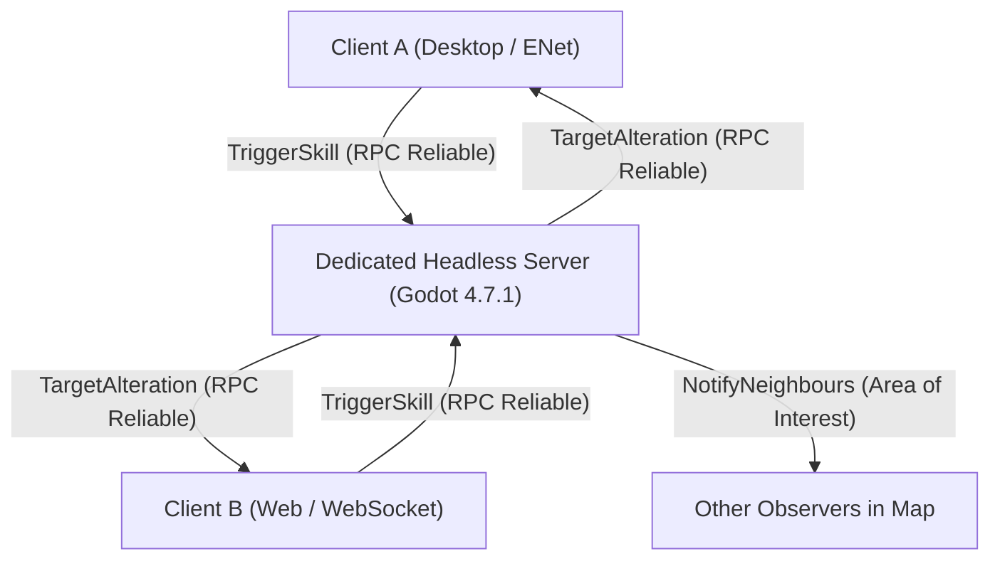
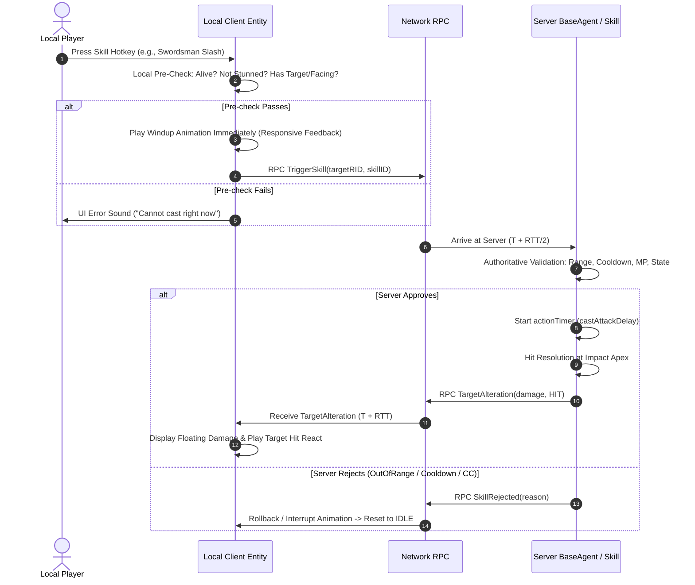

# WORKSTREAM F — MULTIPLAYER COMBAT SYNCHRONIZATION, LATENCY COMPENSATION & TIMING
**Project:** Thiên Đạo Nghịch Mệnh (TDNM)  
**Phase:** 4.3 — Character & Combat Architecture Design  
**Type:** Technical Architecture Investigation & Network Protocol Design  
**Status:** ARCHITECTURAL PROPOSAL (`[PROPOSED]`) — SUBJECT TO OWNER REVIEW  

---

## 1. INVESTIGATION CONTEXT & NETWORKING INVARIANTS

Source of Mana implements a dual-transport multiplayer architecture:
- **Desktop Clients (Windows, macOS, Linux):** Native UDP via Godot's `ENetMultiplayerPeer`.
- **Web Browser Clients (HTML5 / WebAssembly):** TCP/WebSocket via `WebSocketMultiplayerPeer`.
- **Server:** Headless Godot instance operating as the authoritative server (`peerID = 1`).

All combat state transitions, cooldown enforcements, damage calculations, and hit resolutions are strictly **server-authoritative**. No client possesses the authority to declare damage, inflict status effects, or alter HP.



---

## 2. MULTIPLAYER CHANNEL ARCHITECTURE & RPC TOPOLOGY

In [`sources/network/Network.gd:21-33`](file:///Users/it/Documents/Tu%20%C4%91a%CC%A3o/thien-dao-nghich-menh-godot/sources/network/Network.gd#L21-L33), network traffic is strictly isolated across dedicated channels:

```gdscript
enum EChannel {
    CONNECT = 0,
    ACTION,                 # Combat actions, skills, alterations (Reliable)
    MAP,                    # Static map loading, instances
    MAP_UNRELIABLE,         # Map ambient streaming
    NAVIGATION,             # Pathfinding, waypoints (Reliable)
    NAVIGATION_UNRELIABLE,  # High-frequency movement updates (Unreliable Ordered)
    ENTITY,                 # Spawns, despawns, equipment updates (Reliable)
    ENTITY_UNRELIABLE,      # Dynamic position/facing interpolation (Unreliable Ordered)
    BULK,                   # Large chunk transfers
    COUNT
}
```

### Combat RPC Contract:

1. **Client $\rightarrow$ Server:**
   - RPC: `TriggerSkill(targetRID : int, skillID : int)`
   - Channel: `EChannel.ACTION`
   - Mode: `MultiplayerPeer.TRANSFER_MODE_RELIABLE`
   - Rate Limit: Throttled by `NetworkCommons.DelayShort` ($\approx 50\text{ ms}$) to prevent packet spam.
2. **Server $\rightarrow$ Client:**
   - RPC: `TargetAlteration(agentRID : int, targetRID : int, value : int, alteration : ActorCommons.Alteration, skillID : int, hasFeedback : bool)`
   - Channel: `EChannel.ACTION`
   - Mode: `MultiplayerPeer.TRANSFER_MODE_RELIABLE`
   - Target Scope: Sent via `NotifyNeighbours()` only to clients within the Area of Interest (AOI grid).
3. **Movement & Facing Synchronization:**
   - Channel: `EChannel.ENTITY_UNRELIABLE` / `EChannel.NAVIGATION_UNRELIABLE`
   - Mode: `MultiplayerPeer.TRANSFER_MODE_UNRELIABLE_ORDERED`
   - Ensures continuous positional tracking at 20-30 Hz without head-of-line blocking.

---

## 3. CLIENT PREDICTION VS. SERVER CONFIRMATION

A major flaw in naive MMORPG architectures is "input lag": clicking an attack feels unresponsive because the character waits for a round-trip network response (RTT $\approx 60-150\text{ ms}$) before playing the attack swing.

### Proposed Responsive Prediction Lifecycle:



### Fail-Safe Rejection Handling:
If the server rejects a predicted skill, the client receives an authoritative state correction or `SkillRejected` event. The local entity immediately blends back to `State.IDLE`, displaying an unobtrusive error ("Mục tiêu ngoài phạm vi" / "Chưa hồi phục linh lực").

---

## 4. IMPACT FRAME SYNCHRONIZATION ($\tau_{\text{hit}}$)

In the Swordsman sprite sheet, the Attack animation consists of 10 frames running at 12 FPS:
- Frame 0 (0 ms): Initial anticipation/windup.
- Frame 5 ($\approx 416\text{ ms}$): **Apex Impact Frame** (Blade reaches maximum extension and connects with target).
- Frame 9 ($\approx 833\text{ ms}$): Follow-through and recovery.

### The Desync Hazard:
If the server executes damage calculation at Frame 0 ($t = 0$), the target takes damage and flashes red before the player's sword has even moved. Conversely, if damage is delayed until Frame 9, combat feels sluggish.

### The Impact Apex Equation:
$$\tau_{\text{hit}} = t_{\text{cast}} + t_{\text{apex}}$$
Where:
- $t_{\text{cast}}$ is the initial pre-cast channeling time (0 for instant melee).
- $t_{\text{apex}} = \frac{\text{ImpactFrameIndex}}{\text{FPS}} \approx \frac{5}{12} \approx 0.416\text{ seconds}$.

In `SkillCell.gd`:
```gdscript
@export var castAttackDelay : float = 0.416 # Matches Apex of 12 FPS animation
```

When the server starts `actionTimer`, it waits exactly `castAttackDelay` before evaluating geometry and emitting `TargetAlteration`. Accounting for one-way network latency ($\approx 30-50\text{ ms}$), the damage number appears on both the attacker's and victim's screens exactly as the blade visibly slices through the victim's sprite.

---

## 5. LATENCY COMPENSATION: FORWARD TOLERANCE WINDOW

### Rejection of Full Server Rollback (CS:GO / FPS Style):
- Full rollback requires storing seconds of past entity positions in circular buffers and rewinding physics states on headless servers.
- For an MMORPG running on Godot headless with 100+ entities per map instance, historical rewind introduces severe CPU load and creates jarring desynchronization for third-party observers.

### Recommended Strategy: Forward Tolerance Window (MMORPG Standard):
Instead of rolling back time, the server incorporates a dynamic network tolerance threshold into its directional geometry tests:

$$\text{ToleranceRadius} = \text{BaseRange} + \min(v_{\text{target}} \times \Delta t_{\text{RTT}}, \text{MaxToleranceMargin})$$

Where:
- $v_{\text{target}}$ is the target's current velocity.
- $\Delta t_{\text{RTT}}$ is the estimated round-trip time between client and server.
- $\text{MaxToleranceMargin}$ is capped at 64 pixels (approx. 1 tile) to prevent exploiters from hitting targets across the screen.

This prevents unfair misses caused by standard 50-100 ms network jitter when chasing a fleeing player or monster, while maintaining strict server authority.

---

## 6. WEB CLIENT (WEBSOCKET) VS. DESKTOP (ENET) CONSIDERATIONS

| Dimension | Desktop Client (ENet) | Web Client (WebSocket / HTML5) | Technical Mitigation |
| :--- | :--- | :--- | :--- |
| **Transport** | Native UDP | TCP via WebSocket proxy | ENet handles packet drop naturally; WebSocket relies on TCP stream. |
| **Latency & Jitter** | Low (20-60 ms), steady | Moderate (50-120 ms), occasional jitter | Client entity uses a 100 ms interpolation buffer for remote entity positions. |
| **Packet Overhead** | Minimal binary framing | WebSocket frame header + TLS wrapper | RPC payloads are compact integer RIDs and enum states (no verbose JSON). |
| **Thread Model** | Multi-threaded network I/O | Single-threaded JavaScript event loop | Keep network packet handling lightweight; avoid heavy allocations in RPC callbacks. |

---

## 7. SUMMARY & ARCHITECTURAL VERDICT

- **Architecture Preserved:** Zero modifications needed for underlying Godot high-level multiplayer or `EChannel` definitions.
- **Immediate Responsiveness:** Client-side visual prediction eliminates perceived input latency.
- **Frame-Perfect Impact:** Synchronizing server `actionTimer` with the animation impact apex ($\tau_{\text{hit}} \approx 416\text{ ms}$) guarantees visually satisfying hits.
- **Fair & Exploit-Proof:** Forward tolerance window provides smooth combat over mobile/web connections without expensive server rewinds.
