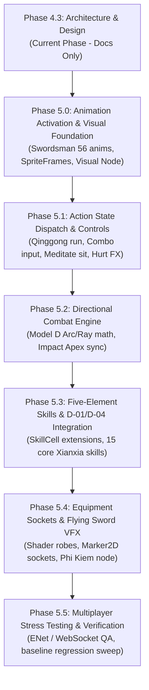

# WORKSTREAM G — INCREMENTAL MIGRATION ROADMAP & IMPLEMENTATION BLUEPRINT
**Project:** Thiên Đạo Nghịch Mệnh (TDNM)  
**Phase:** 4.3 — Character & Combat Architecture Design  
**Type:** Technical Implementation Roadmap & Risk Management Strategy  
**Status:** ARCHITECTURAL PROPOSAL (`[PROPOSED]`) — SUBJECT TO OWNER REVIEW  

---

## 1. MIGRATION PHILOSOPHY & ROADMAP GOALS

The guiding maxim of Thiên Đạo Nghịch Mệnh development is:

$$\text{\bf CONTENT TRANSFORMATION, NOT A REWRITE.}$$

The existing Source of Mana baseline is a fully functioning, multiplayer-capable MMORPG engine built in Godot 4.7.1 Stable. A complete rewrite would introduce months of regression risks, breaking client-server synchronization, SQLite databases, and map navigation.

This roadmap details the sequential execution plan for future implementation phases (Phase 5.0 through 5.5), guaranteeing that:
1. Every phase leaves the game in a 100% playable, testable state.
2. Baseline Source of Mana content (Tulimshar maps, monsters, NPCs) remains functional throughout.
3. Xianxia features are activated incrementally and verified via automated test scenes.

---

## 2. MULTI-PHASE ROADMAP OVERVIEW

---

## 3. DETAILED IMPLEMENTATION PHASES

### Phase 5.0 — Animation Activation & Visual Foundation
- **Primary Objective:** Activate the 512 frames of `swordsman_frames.tres` on the player entity without breaking existing animations.
- **Key Deliverables:**
  1. Refactor `VisualAnimatedSprite2D` to cleanly support 8-direction mapping (`_dir0` to `_dir7`) for Idle, Walk, Attack, Combo, Qinggong, Hurt, Death.
  2. Implement Option C3 base layer: character base sprite renders Swordsman animations smoothly.
  3. Verify fallback mechanism: if an equipment or monster lacks 8 directions, gracefully fall back to 4-direction sprites.
- **Exit Criteria:** Player character walks, idles, and attacks in 8 directions across Tulimshar with zero errors.

### Phase 5.1 — Action State Dispatch & Controls
- **Primary Objective:** Wire player inputs to the 4-Tier Action Dispatch system without modifying the server's 8 core states.
- **Key Deliverables:**
  1. Wire Shift/Double-Tap to activate `stat.isRunning = true`, dynamically selecting the 112 Qinggong animation frames during `State.WALK`.
  2. Wire `State.SIT` (`State 2`) to the "X" key or Meditate button: display cross-legged meditation sprite, grant $2.0\times$ HP/MP regeneration.
  3. Implement client-side combo buffer in `ATTACK`: successive clicks trigger Combo frames (128 frames) smoothly.
  4. Implement non-blocking Hurt overlay shader (red flash + particle burst) on hit.
- **Exit Criteria:** Player can run (Qinggong), meditate (Sit), execute chained attack swings, and take hits without client-server desync.

### Phase 5.2 — Directional Combat Engine & Impact Timing
- **Primary Objective:** Upgrade melee and spell hit detection from radial point distance (`IsNear`) to directional geometry (Model D).
- **Key Deliverables:**
  1. Add `Util.IsWithinArc()` and `Util.IsWithinRay()` mathematical helpers in `Util.gd`.
  2. Update `SkillCommons.GetDamage()` to validate directional cones and rays on the server.
  3. Synchronize server `actionTimer` with the animation impact apex ($\tau_{\text{hit}} \approx 416\text{ ms}$).
  4. Incorporate the Forward Tolerance Window for lag compensation.
- **Exit Criteria:** Attacks register only when enemies are in front of the blade; damage numbers pop at the exact moment the blade makes contact.

### Phase 5.3 — Five-Element Skills & Progression Integration
- **Primary Objective:** Implement the initial 15 Xianxia skills and wire them to Owner Decisions D-01 and D-04.
- **Key Deliverables:**
  1. Add additive properties (`element`, `requiredRealm`, `shapeType`) to `SkillCell.gd`.
  2. Add elemental modifiers to `CellCommons.Modifier`.
  3. Populate `skills.sqlite` / `DB.SkillsDB` with the 15 cataloged Xianxia skills (Bạt Kiếm Thuật, Liệt Hỏa Thuật, Định Thân Phù, etc.).
  4. Enforce D-04 Realm prerequisites: players cannot cast higher-realm skills until breaking through.
  5. Enforce D-01 Ngũ Hành Tạp Căn: ensure damage calculations follow the Tương Sinh / Tương Khắc multiplier matrix.
- **Exit Criteria:** Player can equip and cast elemental spells; elemental counters deal correct bonus/penalty damage.

### Phase 5.4 — Equipment Sockets & Flying Sword VFX
- **Primary Objective:** Implement visual customization via Shader Robes and procedural Flying Swords.
- **Key Deliverables:**
  1. Implement Palette-Swap Shader on robe layers to represent realm tier colors without extra art assets.
  2. Add `Marker2D` weapon socket nodes to track hand position across directional frames.
  3. Create `PhiKiemNode2D`: orbiting procedural sword that detaches, pierces targets during Ngự Kiếm skills, and returns.
  4. Map 12 equipment slots to Xianxia items (Linh Kiếm, Đạo Bào, Trữ Vật Đại, Linh Bội).
- **Exit Criteria:** Weapons follow hand movements accurately; flying sword skills spawn smooth orbiting and flying blade visuals.

### Phase 5.5 — Multiplayer Stress Testing & Verification
- **Primary Objective:** Comprehensive QA across Desktop (ENet) and Web (WebSocket) clients.
- **Key Deliverables:**
  1. Run automated multi-peer headless combat test (`test_multiplayer_combat.tscn`).
  2. Verify 60 FPS rendering under heavy combat with 50+ mobs and players.
  3. Full regression verification of baseline SoM quests, monster spawns, and NPC dialogs in Tulimshar.
- **Exit Criteria:** Zero crashes, zero regressions, stable 20 TPS server tick rate under load.

---

## 4. RISK MATRIX & MITIGATION STRATEGY

| Risk Description | Severity | Probability | Architectural Mitigation |
| :--- | :---: | :---: | :--- |
| **Animation Desync:** Client plays 10-frame attack but server timer fires early or late. | High | Med | Formalize $\tau_{\text{hit}}$ contract: `castAttackDelay` strictly equals animation apex duration ($416\text{ ms}$). |
| **Combinatorial Art Explosion:** Attempting to draw 512 frames for every robe and weapon. | Critical | High | Adopt **Option C3**: Single base body + Shader-tinted robes + procedural `Marker2D` weapon sockets. |
| **Physics Overhead on Headless Server:** Introducing Godot `Area2D` collisions on server. | High | High | **Strictly rejected:** Server uses pure vector math (`Vector2.dot()`, vector distance). Physics overhead remains zero. |
| **State Machine Bloat:** Adding 20 new states to `ActorCommons.State` breaks network serialization. | High | Med | Server state machine remains strictly 8 states. All Xianxia nuances handled via 4-Tier Dispatch. |
| **Web Client Latency Jitter:** WebSocket packet jitter causing missed melee swings. | Med | Med | Forward Tolerance Window allows $\pm 64\text{ px}$ buffer on range checks based on client ping. |

---

## 5. REGRESSION PROTECTION & VERIFICATION GATES

Before any future phase is marked complete, it must pass the **TDNM Quality Gate**:

1. **Gate 1: Compilation & Parsing:** Headless Godot must parse all scripts with zero syntax or runtime errors.
2. **Gate 2: Baseline Map & Spawn Sanity:** New characters must continue to spawn at Tulimshar (`LauncherCommons.DefaultStartMapID = "Tulimshar".hash()`).
3. **Gate 3: Automated Test Suite:** `test_phase_4_1_1_naming.tscn` and subsequent combat test suites must pass 100%.
4. **Gate 4: Dual Client Verification:** Both Desktop ENet and Web Browser WebSocket clients must connect, move, and combat without errors.
