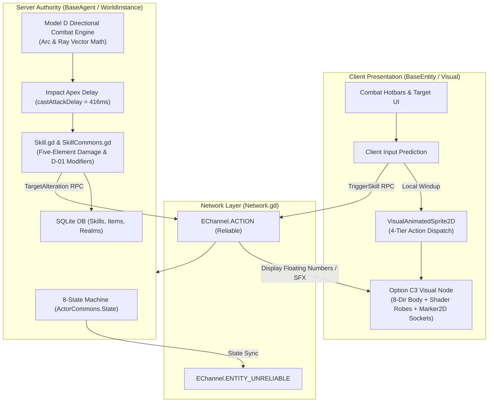

# PHASE 4.3 — MASTER ARCHITECTURE DESIGN DOCUMENT
# CHARACTER RENDERING, ANIMATION & COMBAT SYSTEMS

**Project:** Thiên Đạo Nghịch Mệnh (TDNM)  
**Foundation:** Source of Mana (Godot 4.7.1 Stable)  
**Baseline Commit:** `1933bd66caf2c59fd5d9b5df410d19838059b243`  
**Phase:** 4.3  
**Status:** ARCHITECTURAL SPECIFICATION (`[PROPOSED]`) — SUBJECT TO OWNER REVIEW  
**Author:** AI Senior World Architect & Systems Engineer  
**Date:** November 2026  

---

## 1. PROJECT CONTEXT & ARCHITECTURAL FOUNDATION

Thiên Đạo Nghịch Mệnh is an isometric 2.5D Chinese Xianxia/Xuanhuan MMORPG developed on top of the Source of Mana (SoM) engine. The foundational development doctrine governing all work is:

$$\text{\bf CONTENT TRANSFORMATION, NOT A REWRITE.}$$

### 1.1. Core Invariants Preserved
- **Server Authority:** Dedicated headless Godot instance authoritative over game state, math, and timers.
- **Dual Networking:** Native UDP via `ENet` for desktop clients; WebSocket TCP via `WebSocketMultiplayerPeer` for web/mobile browsers.
- **Actor Architecture:** Separation between `BaseAgent` (server logic), `BaseEntity` (client presentation), and `Visual` (rendering).
- **Persistence:** SQLite database storage for items, skills, and character progression.
- **World Continuity:** Tulimshar remains the operational default spawn map.

### 1.2. Authoritative World Bible Invariants
- **D-01 (Ngũ Hành Tạp Căn):** The protagonist possesses all 5 elemental spiritual roots (Kim, Mộc, Thủy, Hỏa, Thổ). Absorption is slow; no automatic awakening cheats; cultivation requires diligence and balanced resources.
- **D-02 (Thiên Đạo Tổn Thương):** The Heavenly Dao is an objective, non-malicious cosmic operating system whose rules have fractured.
- **D-03 (SacredSectHub):** Non-mandatory sect hub map (`995840901`) with naming pending final owner review.
- **D-04 (Hybrid Progression Model):** 9-realm cultivation model: Phàm Thân $\rightarrow$ Tụ Khí (1-9 Tầng) $\rightarrow$ Thông Mạch $\rightarrow$ Đạo Cơ $\rightarrow$ Huyền Đan $\rightarrow$ Nguyên Thần $\rightarrow$ Thiên Nhân $\rightarrow$ Quy Hư $\rightarrow$ Độ Kiếp.

---

## 2. HIGH-LEVEL SYSTEM TOPOLOGY

---

## 3. WORKSTREAM SUMMARY & ARCHITECTURAL SYNTHESIS

### 3.1. Workstream A — Character Rendering Architecture
*Reference Document:* [`01_CHARACTER_RENDERING_ARCHITECTURE.md`](file:///Users/it/Documents/Tu%20%C4%91a%CC%A3o/thien-dao-nghich-menh-godot/docs/phase-4-3-character-combat-design/01_CHARACTER_RENDERING_ARCHITECTURE.md)

- **Audit Insight:** `swordsman_frames.tres` holds 512 high-quality frames across 8 directions.
- **Adopted Model (Option C3):** Single 8-direction base body with **Shader-Tinted Unified Robes**, dynamic `Marker2D` hand weapon sockets, and procedural orbiting spirit artifact nodes (`PhiKiemNode2D`).
- **Advantage:** Avoids the 25,600-frame combinatorial explosion of full 8-direction paperdolling while retaining rich Xianxia visual aesthetics and 60 FPS performance.

### 3.2. Workstream B — Animation State System Design
*Reference Document:* [`02_ANIMATION_STATE_SYSTEM_DESIGN.md`](file:///Users/it/Documents/Tu%20%C4%91a%CC%A3o/thien-dao-nghich-menh-godot/docs/phase-4-3-character-combat-design/02_ANIMATION_STATE_SYSTEM_DESIGN.md)

- **4-Tier Action Dispatch Framework:**
  - *Tier 1 (Server States):* Preserves existing 8 states (`IDLE`, `WALK`, `SIT`, `ATTACK`, `DEATH`, etc.).
  - *Tier 2 (Skill States):* Casting and channeling managed via `skillCastID`.
  - *Tier 3 (Client Presentation Actions):*
    - `Qinggong` activates 112 dormant frames during `State.WALK` when running.
    - `Combo` activates 128 dormant frames via local input buffering during `State.ATTACK`.
    - `Meditate` activates cross-legged meditation under existing `State.SIT` (`State 2`), granting $2.0\times$ regeneration.
  - *Tier 4 (Visual Overlays):* `HURT` is handled as a non-interrupting visual shader flash and particle burst to prevent MMORPG stunlock.

### 3.3. Workstream C — Equipment & Customization Pipeline
*Reference Document:* [`03_EQUIPMENT_AND_CUSTOMIZATION_PIPELINE.md`](file:///Users/it/Documents/Tu%20%C4%91a%CC%A3o/thien-dao-nghich-menh-godot/docs/phase-4-3-character-combat-design/03_EQUIPMENT_AND_CUSTOMIZATION_PIPELINE.md)

- **Slot Mapping:** All 12 baseline inventory slots remapped to authentic Xianxia items (Linh Kiếm, Đạo Bào, Hộ Oản, Trữ Vật Đại, Linh Bội, etc.).
- **3-Tier Visual Representation:** All slots contribute gameplay stats, while visual appearance focuses on Realm Robes (palette-tinted by cultivation grade), hand-held weapons, and orbiting flying swords.

### 3.4. Workstream D — Combat Engine & Hit Resolution
*Reference Document:* [`04_COMBAT_ENGINE_AND_HIT_RESOLUTION.md`](file:///Users/it/Documents/Tu%20%C4%91a%CC%A3o/thien-dao-nghich-menh-godot/docs/phase-4-3-character-combat-design/04_COMBAT_ENGINE_AND_HIT_RESOLUTION.md)

- **Adopted Engine (Model D - Hybrid Directional):** Upgrades baseline Euclidean radial distance check to directional vector geometry (Cone arcs for slashes, Linear rays for flying sword thrusts, Circles for area bursts).
- **Impact Apex Synchronization ($\tau_{\text{hit}}$):** Server schedules damage calculation at the animation's visual impact frame ($416\text{ ms}$ into the attack), eliminating the disconnect between swinging and damage numbers.
- **Physics Overhead:** Zero Godot physics collision on headless server; 100% vector math for optimal server scalability.

### 3.5. Workstream E — Xianxia Skill Architecture
*Reference Document:* [`05_XIANXIA_SKILL_ARCHITECTURE.md`](file:///Users/it/Documents/Tu%20%C4%91a%CC%A3o/thien-dao-nghich-menh-godot/docs/phase-4-3-character-combat-design/05_XIANXIA_SKILL_ARCHITECTURE.md)

- **Five-Element Cycle:** Integrates the full Tương Sinh / Tương Khắc matrix ($+30\% / -25\%$).
- **D-01 Ngũ Hành Tạp Căn:** The protagonist can master all 5 elements, sacrificing early specialization burst for complete tactical versatility against any opponent's elemental weakness.
- **D-04 Cultivation Gating:** Skills strictly require breakthrough into higher realms (Phàm Thân $\rightarrow$ Tụ Khí $\rightarrow$ Thông Mạch $\rightarrow$ Đạo Cơ). 15 initial prototype skills defined.

### 3.6. Workstream F — Multiplayer Combat Synchronization & Latency
*Reference Document:* [`06_MULTIPLAYER_COMBAT_SYNC_AND_TIMING.md`](file:///Users/it/Documents/Tu%20%C4%91a%CC%A3o/thien-dao-nghich-menh-godot/docs/phase-4-3-character-combat-design/06_MULTIPLAYER_COMBAT_SYNC_AND_TIMING.md)

- **Client-Side Prediction:** Immediate local windup animation ensures combat feels snappy and responsive.
- **Forward Tolerance Window:** Server allows a small dynamic latency margin ($\le 64\text{ px}$) during geometry checks, compensating for 50-120 ms web/mobile ping jitter without server physics rewinds.

### 3.7. Workstream G — Incremental Migration Roadmap
*Reference Document:* [`07_INCREMENTAL_MIGRATION_ROADMAP.md`](file:///Users/it/Documents/Tu%20%C4%91a%CC%A3o/thien-dao-nghich-menh-godot/docs/phase-4-3-character-combat-design/07_INCREMENTAL_MIGRATION_ROADMAP.md)

- Sequential implementation plan across Phases 5.0 through 5.5.
- Strict automated regression gates safeguarding Tulimshar spawn, database persistence, and dual-client compatibility.

---

## 4. FORMAL DECISION PACKAGE REFERENCE

The complete set of decisions awaiting Owner approval is detailed in:
[`08_OWNER_DECISION_PACKAGE.md`](file:///Users/it/Documents/Tu%20%C4%91a%CC%A3o/thien-dao-nghich-menh-godot/docs/phase-4-3-character-combat-design/08_OWNER_DECISION_PACKAGE.md)

A summary of recommendations:
1. **DP-01:** Select **Option C3** (Shader-Tinted Robes + Dynamic Weapon Sockets).
2. **DP-02:** Select **Option 2** (4-Tier Action Dispatch Framework).
3. **DP-03:** Select **Model D** (Directional Geometry + Impact Apex Synchronization).
4. **DP-04:** Select **Option 2** (3-Tier Visual Pipeline).
5. **DP-05:** Select **Option 2** (Open Five-Element Wheel aligned with D-01).
6. **DP-06:** Select **Option 2** (Client Prediction + Forward Tolerance Window).

---

## 5. CONCLUSION & CALL TO ACTION

Phase 4.3 provides a robust, production-ready architectural blueprint that bridges the gap between Source of Mana's technical engine and Thiên Đạo Nghịch Mệnh's Xianxia vision.

Upon receipt of the Project Owner's decision selections, Phase 5.0 will commence implementation immediately.
